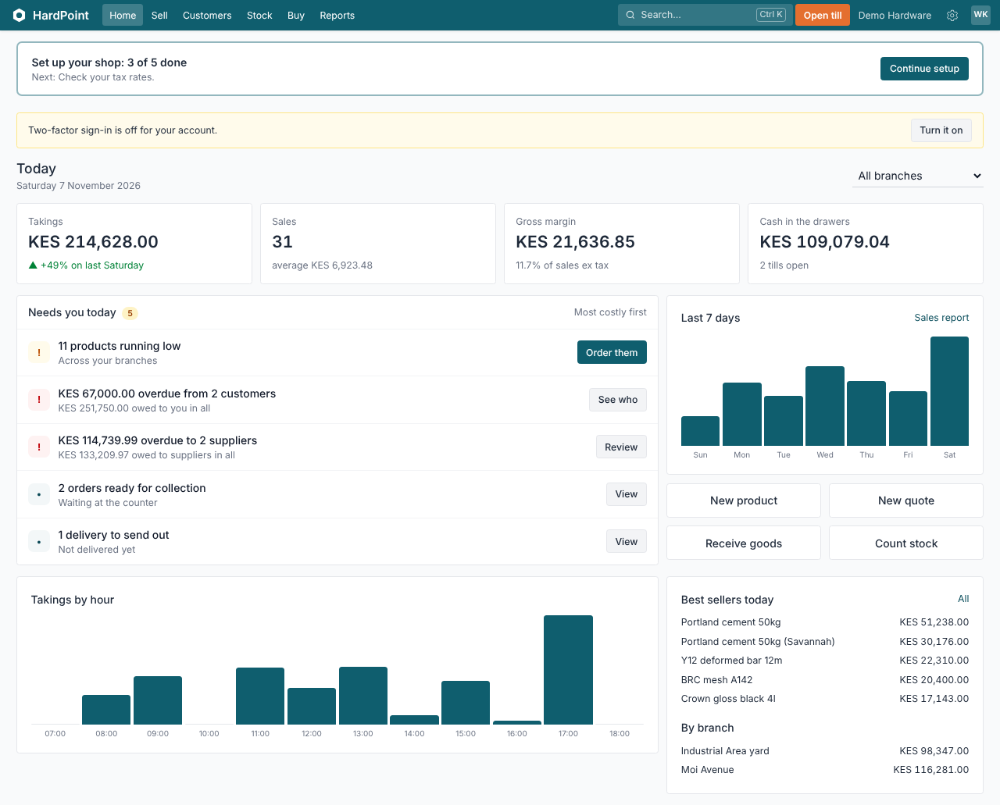
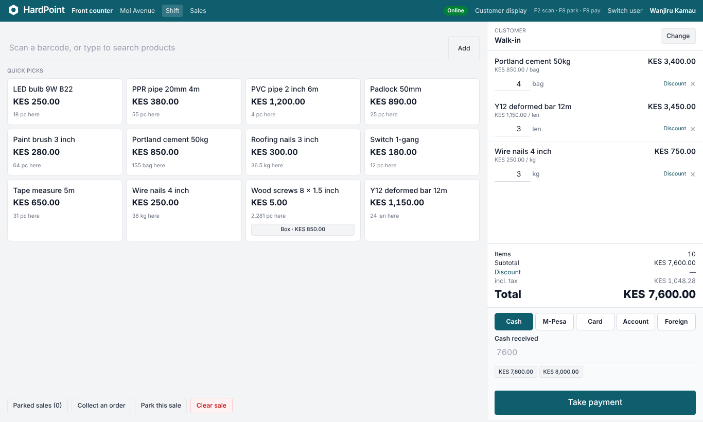
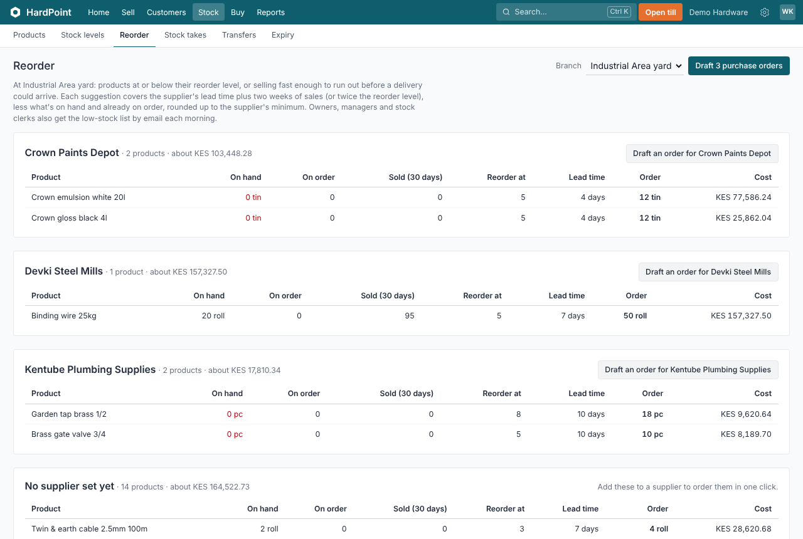

# HardPoint

Point of sale and stock control for hardware stores, as a service. A shop signs up, gets its own web address
(`acme.hardpoint.app`), and runs its tills, stock, suppliers, customers and books from a browser, with M-Pesa and
KRA eTIMS built in. The till keeps selling when the internet drops. No shop can see another shop's data.



**Contents:** [What it does](#what-it-does) · [Try it on your machine](#try-it-on-your-machine) ·
[Documentation](#documentation) · [How it's built](#how-its-built) · [How shop data is kept apart](#how-shop-data-is-kept-apart) ·
[Working on the code](#working-on-the-code) · [Deployment](#deployment)

## What it does

Each area below links to its guide in the help centre (`/help` on the public site), which is where shop staff learn
to use it. All the guides are also in one document, [docs/USER_GUIDE.md](docs/USER_GUIDE.md). For the full list of what each
phase of the build added, see [docs/FEATURES.md](docs/FEATURES.md).

### At the till

- A **full-screen till** built around a barcode scanner: scan, search or tap a quick-pick button; loose goods by the
  metre or kilo; pack sizes; F2 scan · F8 park · F9 pay. Each computer remembers its till.
- **Payments** by cash with change, M-Pesa (a prompt to the customer's phone, or money paid to your Paybill), Airtel Money, card,
  foreign notes, on account, or a mix. Gap-free receipt numbers per branch.
- **Discounts** within the shop's limit; bigger ones, voids, returns and going over a credit limit need a manager's
  **approval PIN**, which approves that one thing and signs nobody in.
- **Shifts** with an opening float, cash drops and payouts, an X report, a blind count at close and a Z report.
- **Promotions** (percent off, buy 10 get 1 free, any 3 for a price) apply by themselves.
- **Offline:** when HardPoint can't be reached, the till keeps selling from its own copy of the catalogue, customers
  and promotions, and sends the sales when it's back.
- **Hardware:** 80 mm receipts from the browser or straight to the printer through QZ Tray (with the cash drawer),
  and any keyboard-style scanner.

Guides: [Selling at the till](https://hardpoint.app/help/selling) ·
[When the internet goes down](https://hardpoint.app/help/offline) ·
[Tills and printers](https://hardpoint.app/help/tills-and-printers) ·
[Promotions](https://hardpoint.app/help/promotions) ·
[WhatsApp](https://hardpoint.app/help/whatsapp)



### Customers and orders

- **Accounts** with credit limits, payment terms, price lists, statements and a **Who owes us** ageing list.
- **Quotes → orders → collection** as one document, with deposits, collected at the till at the quoted price.
- **A4 tax invoices** and **delivery notes** with dispatch and proof of delivery.
- **Jobs for contractors:** tag purchases to a project, track it against a budget, and print a cost summary or a
  marked-up bill for their client.
- **An online store** at `yourshop.hardpoint.app/store` for click-and-collect, paid ahead by M-Pesa or on collection.

Guides: [Customers on account](https://hardpoint.app/help/customer-accounts) ·
[Jobs for contractors](https://hardpoint.app/help/contractor-jobs) ·
[Online store](https://hardpoint.app/help/online-store) ·
[Deliveries and transport](https://hardpoint.app/help/deliveries)

### Stock and purchasing

- **A catalogue** with nested categories, brands, fractional units, several barcodes per product, pack sizes, kits,
  price lists and quantity breaks; **CSV import and export** (20,000 rows in about 12 seconds) and barcode labels.
- **Stock per branch** kept as an append-only ledger: adjustments with reasons, transfers between branches, and stock
  takes (counted on a computer or a phone) approved by a manager.
- **Batches and expiry dates** for goods that go off: first-expiring-first selling, write-offs and recall lists.
- **Purchasing:** suppliers, purchase orders emailed as PDFs, reorder suggestions with one-click draft orders, goods
  received with transport and duty spread over the cost, supplier invoices, payments, **What we owe**, and returns to
  suppliers with debit notes.
- **HardPoint Stock** on the phone: look up, count and check deliveries in with the camera.

Guides: [Stock and stock takes](https://hardpoint.app/help/stock-and-stock-takes) ·
[Buying from suppliers](https://hardpoint.app/help/buying-from-suppliers) ·
[Importing products](https://hardpoint.app/help/importing-products) ·
[Stock on your phone](https://hardpoint.app/help/stock-on-your-phone) ·
[Batches and expiry](https://hardpoint.app/help/batches-and-expiry) ·
[Changing prices](https://hardpoint.app/help/changing-prices)



### Money, tax and reports

- **M-Pesa (Daraja)** on the shop's own Paybill or Till, with a reconciliation report, and **Airtel Money** prompts.
- **WhatsApp** buttons on receipts, quotes, statements, purchase orders and delivery notes.
- **Bulk price changes** by category, brand or supplier, with rounding and a preview, and **transport charges** on deliveries.
- **KRA eTIMS (OSCU)**, one control unit per branch: every sale signed, KRA's QR code on the receipt, and retries when
  KRA is down. **SMS** through Africa's Talking for receipts, order updates and reminders.
- **Foreign currencies** at the till and with importers, with a daily market rate.
- **A live owner's dashboard** and **reports** for any period and branch, on screen, as CSV or as PDF: sales and margin,
  profit and loss, VAT, payments, discounts and voids, stock valuation, dead stock and shifts. A daily summary email,
  and a **QuickBooks Online export**.

Guides: [M-Pesa](https://hardpoint.app/help/mpesa) · [Airtel Money](https://hardpoint.app/help/airtel-money) ·
[KRA eTIMS](https://hardpoint.app/help/etims) · [Reports](https://hardpoint.app/help/reports) ·
[QuickBooks Online](https://hardpoint.app/help/quickbooks) · [Currencies](https://hardpoint.app/help/foreign-currencies)

### Running the shop on HardPoint

- **Staff and roles** (owner, manager, cashier, stock clerk, accountant), PIN quick-switch at a shared till,
  two-factor sign-in, and an activity log of who changed what.
- **Self-service signup** with a 30-day trial and a **Set up your shop** checklist. Plans: Starter (KES 2,500 a month),
  Business (KES 6,500) and Enterprise (KES 15,000), paid by M-Pesa or card; a shop with an overdue invoice becomes read-only until it
  pays.
- **A public API and webhooks** for web shops and accounting software (Business and Enterprise), documented at
  `/developers`.
- **Your data:** export everything as CSV files, or close the shop.
- **Help in the app:** the guides, WhatsApp, and a message form that tells support which page you were on.

Guides: [Setting up your shop](https://hardpoint.app/help/getting-started) ·
[Finding your way around](https://hardpoint.app/help/getting-around) ·
[Staff and roles](https://hardpoint.app/help/staff-and-roles) · [Billing](https://hardpoint.app/help/billing) ·
[Connecting apps](https://hardpoint.app/help/connecting-apps) · [Your data](https://hardpoint.app/help/your-data)

## Try it on your machine

You need the Ruby in `.ruby-version`, PostgreSQL 18, and a regular (non-superuser) database role, because row-level
security doesn't apply to superusers:

```sh
sudo -u postgres psql -c "CREATE ROLE hardpoint LOGIN CREATEDB NOSUPERUSER NOBYPASSRLS PASSWORD 'hardpoint'"
```

Then install the gems, prepare the database, seed the demo shops and start the server:

```sh
bin/setup
```

Browsers send `*.localhost` to your own machine, so each shop has its own address locally too:

| Where | Address | Sign in as | Password |
|---|---|---|---|
| Public site, signup and help | <http://localhost:3000> | | |
| The demo shop | <http://demo.localhost:3000> | `owner@demo.test` | `hardpoint-demo` |
| A shop on trial | <http://coast.localhost:3000> | `owner@coast.test` | `hardpoint-demo` |
| A read-only shop (unpaid invoice) | <http://lakeside.localhost:3000> | `owner@lakeside.test` | `hardpoint-demo` |
| Platform admin | <http://admin.localhost:3000> | `admin@hardpoint.test` | `hardpoint-demo` |

In the demo shop the cashier's till PIN is `1234`, and the owner's approval PIN (for big discounts, voids and returns)
is `2468`.

**What's in the demo shop:** about 30 hardware products with stock at two branches, a transfer in transit and a stock
take in progress, suppliers with orders and invoices, trade customers with account sales (one overdue), a quote, an
order ready to collect with a deposit, deliveries, and a month of trading for the dashboard and reports. M-Pesa, KRA
eTIMS and SMS are connected to simulators that answer like the real services: try M-Pesa at the till (a phone number
ending 0000 declines). Without Paystack keys, "Pay by card" goes to a simulated checkout.

**Things worth knowing:**

- The platform admin needs two-factor. Add the development-only key `HARDPOINTDEVADMINTOTPSECRETKEYAB` to an
  authenticator app, or print a code with
  `bundle exec ruby -rrotp -e 'puts ROTP::TOTP.new("HARDPOINTDEVADMINTOTPSECRETKEYAB").now'`.
- Make someone a platform administrator from the console only (there's deliberately no screen for it):
  `bin/rails runner 'User.find_by!(email_address: "you@example.com").update!(admin: true)'`
- Emails can be previewed, for example the
  [daily summary](http://demo.localhost:3000/rails/mailers/reports_mailer/daily_summary) and the
  [low-stock digest](http://demo.localhost:3000/rails/mailers/stock_mailer/low_stock_digest).
- Texts aren't sent in development; they're kept in `Sms::Outbox` and the log.
- Point at another database with `DATABASE_HOST`, `DATABASE_USERNAME` and `DATABASE_PASSWORD`.

## Documentation

| Document | For | What's in it |
|---|---|---|
| Help centre (`/help`, in `app/views/help`) | Shop owners and staff | How to set up and use every part of HardPoint |
| [docs/USER_GUIDE.md](docs/USER_GUIDE.md) | Shop owners and staff, trainers | Every help guide in one document, to read, print or share. Generated from the help centre by `bin/rails help:export` |
| Developer docs (`/developers`) | Developers connecting other apps | The REST API and webhooks, with signature checks in Ruby, Node.js and Python |
| [docs/FEATURES.md](docs/FEATURES.md) | Everyone | What each phase of the build added, with screenshots |
| [docs/PLAN.md](docs/PLAN.md) | The team | The original plan, decisions and the backlog |
| [docs/SIMPLIFY.md](docs/SIMPLIFY.md) | The team | The plan for making the app simpler to use, with mockups |
| [docs/BRAND.md](docs/BRAND.md) | Anyone changing screens | The look and layout: colours, components and rules |
| [docs/RUNBOOK.md](docs/RUNBOOK.md) | Whoever runs production | Deploys, backups and restores, incidents, scaling out |
| [docs/SECURITY.md](docs/SECURITY.md) | Security reviewers | Controls and the penetration test brief |
| [docs/LAUNCH.md](docs/LAUNCH.md) | The team | The pilot and go-live checklist |
| [perf/README.md](perf/README.md) | Anyone changing the till or the database | Load testing with k6, and the results |
| [docs/screenshots](docs/screenshots) | Everyone | A screenshot of every screen |

## How it's built

The vanilla Rails way: Rails 8.1, PostgreSQL 18, Hotwire (Turbo and Stimulus), Tailwind CSS 4, Solid Queue, Cache and
Cable, Minitest with fixtures, and Kamal for deployment, with a short, deliberate list of gems.

| | Version |
|---|---|
| Ruby | see `.ruby-version` |
| Rails | 8.1 (`Gemfile.lock`) |
| PostgreSQL | 18, in production and CI |
| Tailwind CSS | 4, through `tailwindcss-rails` |

Some numbers from testing: a 10-line scanned sale with a split payment takes about 2.6 seconds end to end in a real
browser; 40 cashiers selling flat out on 4 cores keep 95% of scans under 280 ms; a year of a busy shop's sales reports
in under a second.

## How shop data is kept apart

1. **Subdomain → `Current.account`.** `AccountScoped` resolves the shop from the subdomain on every request.
2. **Queries go through the account.** Always `Current.account.branches.find(id)`, never `Branch.find(id)`.
3. **Postgres row-level security.** Every table with an `account_id` has a policy that only exposes rows of the
   account in the `app.current_account_id` setting, which `Current.account=` keeps in step. With no account set,
   no rows are visible. Jobs remember the account they were enqueued under.

New tenant tables must call `enable_row_level_security :table_name` in their migration and use
`add_foreign_key ..., deferrable: :immediate`. `test/models/account/isolation_test.rb` fails if either is missing.

Row-level security doesn't apply to superusers or `BYPASSRLS` roles, so the app, including in development and
tests, connects as a regular role. Code that legitimately spans shops wraps itself in
`Account.without_isolation { ... }`. A test also requests every route that takes a record id with another shop's
record, and checks they're all refused.

## Working on the code

Run the checks before pushing; `bin/ci` runs them all, as GitHub Actions does:

```sh
bin/rails test                        # includes the tenant isolation tests
node --test test/javascript/*.mjs     # the offline till's arithmetic and receipt printing
bin/rubocop
bin/brakeman
bin/bundler-audit
```

**Changing a screen?** Follow [docs/BRAND.md](docs/BRAND.md), and update the help guide that describes it: the
guides name buttons and menus exactly as they appear (for example **Stock › Stock takes**), so a renamed button
needs its guide changed too.

**Adding a help guide:** add a line to `HelpArticle.all` in `app/models/help_article.rb` (slug, title, one-line
summary, section and related guides; the order is the reading order) and write its text in
`app/views/help/articles/_<slug_with_underscores>.html.erb`, using `<h2>`, `<p>`, `<ul>` and `<ol>`. Search covers
the text, and each guide links on to the next one in its section. Write for someone at the counter: what to press,
in the order they press it, using the words on the screen. After adding or changing a guide, run
`bin/rails help:export` to rebuild [docs/USER_GUIDE.md](docs/USER_GUIDE.md); a test fails until you do.

Load testing (k6) is in [perf/README.md](perf/README.md); backups, restores and incidents in
[docs/RUNBOOK.md](docs/RUNBOOK.md).

## Deployment

Kamal deploys to a single Contabo VPS (see `config/deploy.yml`); [docs/RUNBOOK.md](docs/RUNBOOK.md) section 6 covers
scaling out to separate database, replica, web and job servers with `config/deploy.scaled.yml`.

```sh
bin/kamal setup    # first time
bin/kamal deploy
```

### The server

- PostgreSQL 18 runs as a Kamal accessory, tuned by `config/postgres/postgresql.conf` for a 6-core, 12 GB VPS.
  `config/postgres/create_app_role.sh` creates the non-superuser `hardpoint` role on first boot. The app runs
  `WEB_CONCURRENCY=6` Puma workers of 3 threads.
- kamal-proxy serves `hardpoint.app` and `*.hardpoint.app` with a Cloudflare Origin CA certificate (Cloudflare SSL
  mode: Full (strict)).
- **Backups** run from cron on the host (`config/backup/backup.sh`, set up as in [docs/RUNBOOK.md](docs/RUNBOOK.md)).
- Secrets come from the environment (see `.kamal/secrets`): `POSTGRES_PASSWORD`, `HARDPOINT_DATABASE_PASSWORD`, and
  the Cloudflare origin certificate and key files.
- Two-factor secrets are encrypted with Active Record Encryption. Run `bin/rails db:encryption:init` and add the
  printed `active_record_encryption` keys with `bin/rails credentials:edit`. Development and test use fixed,
  non-secret keys.

### Credentials and settings

Everything below is added with `bin/rails credentials:edit` unless it says otherwise.

- **Email** goes through AWS SES's SMTP interface: `ses: { smtp_username:, smtp_password:, region: }`.
- **SMS:** `africas_talking: { username:, api_key:, sender_id: }` (username `sandbox` for their sandbox).
- **Billing HardPoint's own subscriptions:** `billing: { mpesa: { environment:, shortcode:, passkey:, consumer_key:,
  consumer_secret:, callback_token: }, paystack_secret_key: }`. Safaricom calls back to
  `https://APP_HOST/webhooks/billing/mpesa/<callback_token>`; set Paystack's webhook URL to
  `https://APP_HOST/webhooks/paystack` (signed with the secret key). `BillingJob` runs daily at 05:00 UTC, and
  `AccountMaintenanceJob` (expired exports, shops due for deletion) at 01:00 UTC.
- **QZ Tray** (optional, to skip its "allow" prompt on tills): `qz: { certificate:, private_key: }`.
- **Exchange rates:** nothing to set up; the morning job uses open.er-api.com's free feed. To use another feed with
  the same JSON shape, add `exchange_rates_url: "https://…/%{base}"`.
- **Support** (environment variables): `SUPPORT_EMAIL` receives support requests (default `support@hardpoint.app`)
  and `SUPPORT_WHATSAPP` is the WhatsApp number, in international format without the plus.
- Simulators are refused in production unless `ALLOW_INTEGRATION_SIMULATORS` is set (for a public demo, say).

### What each shop sets up itself

- **M-Pesa:** the shop adds its Daraja app's consumer key, secret and passkey under **Settings › M-Pesa**, then presses
  **Receive payments** to register the callback URLs. Callbacks go to `https://APP_HOST/webhooks/mpesa/<token>/…`, so
  the bare domain must reach the app. Production accepts callbacks only from Safaricom's published addresses (set
  `MPESA_CALLBACK_IPS` to override). Cloudflare's ranges are trusted proxies, so the visitor's real address is checked.
- **KRA eTIMS:** register each branch's OSCU device on the eTIMS portal, then add its PIN, branch ID and serial under
  **Settings › KRA eTIMS** and press **Set up with KRA**. Test against KRA's sandbox (and get the integration
  certified) before switching a device to production.
- **Tills:** open the till once while online on each device (that's when it keeps its offline copy). For silent
  browser printing, run Chrome with `--kiosk-printing`. For QZ Tray, install it on the till's computer and set the
  till to "Straight to the printer" with the printer's name.
