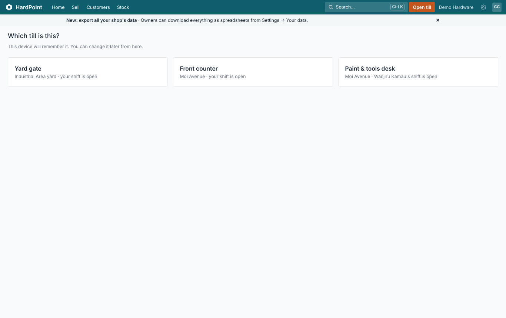
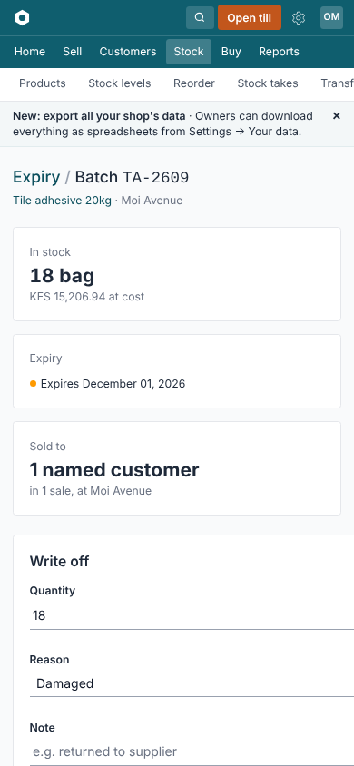
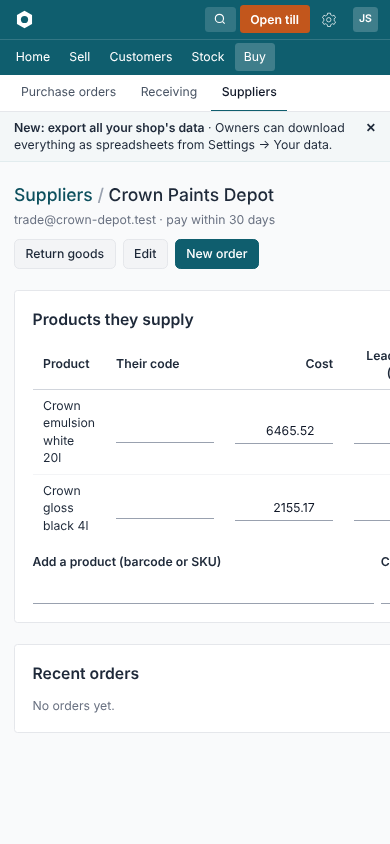
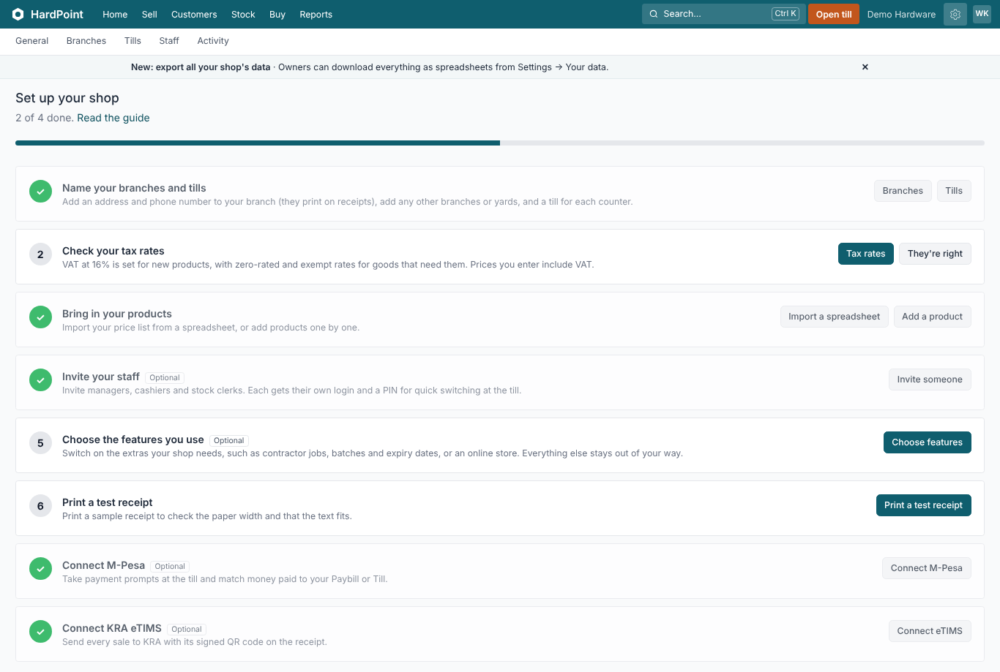
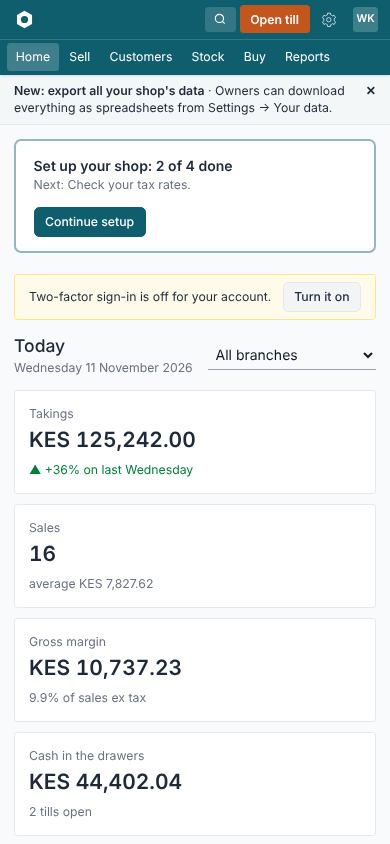

# Audit: the app, its screens and its processes

A review of HardPoint after Phase 41: what breaks, where people get stuck, where money or stock can go wrong, and where
the screens fall short of [BRAND.md](BRAND.md). Each finding has a place in the code and a suggested fix, so it can go
straight into the backlog in [PLAN.md](PLAN.md).

This is the second run, on 11 November 2026. The first run (10 November) found two crashing pages and ten things to fix
first, and those were fixed on this branch. This run checks those fixes in the running app, re-checks every other finding
against the code as it is now, and reviews the fixes themselves. They brought in four problems of their own, which come
first below.

**Contents:** [How this was done](#how-this-was-done) · [Summary](#summary) · [Fix first](#fix-first) ·
[Problems the fixes brought in](#problems-the-fixes-brought-in) · [Fixed since the first run](#fixed-since-the-first-run) ·
[At the till](#at-the-till) · [Stock and purchasing](#stock-and-purchasing) ·
[Customers, orders and money](#customers-orders-and-money) · [Signing up, billing, staff and settings](#signing-up-billing-staff-and-settings) ·
[Screens, accessibility and consistency](#screens-accessibility-and-consistency) ·
[Help text that disagrees with the app](#help-text-that-disagrees-with-the-app) · [What's good](#whats-good)

## How this was done

1. **The running app.** The demo data was loaded fresh from `bin/setup`'s seeds on Ruby 4.0.9 and PostgreSQL 18, with
   the demo manager bound to one branch (Moi Avenue) so branch limits could be seen. A script signed in as each role and
   opened every screen it could reach by following links:

   | Signed in as | Screens |
   |---|---|
   | Owner | 205 |
   | Manager bound to Moi Avenue | 174 |
   | Cashier | 85 |
   | Stock clerk | 126 |
   | Nobody (public site, help, online store) | 50 |

   On each screen it recorded errors and slow pages, pages wider than a 390 px phone, inputs without labels, and
   [axe-core](https://github.com/dequelabs/axe-core) WCAG 2.2 AA violations. A second script went through each flow fixed
   since the first run in a real browser (11 checks, all passed).
2. **The code.** Every finding left open by the first run was checked again at its place in the code, and marked still
   open, fixed, or wrong. The eight commits that fixed the first run's findings (`161f75a`…`8eda4e3`) were reviewed for
   problems they brought in.
3. **The tests.** `bin/rails test` passes (953 runs, 0 failures, 0 errors), as do `bin/rubocop`, `bin/brakeman` and the
   JavaScript tests. None of the four problems in [Problems the fixes brought in](#problems-the-fixes-brought-in) is
   caught by a test.

| Severity | Meaning |
|---|---|
| **High** | Loses or misstates money or stock, lets someone do what their role shouldn't, or stops a shop working. |
| Medium | A dead end, a wrong number, or a screen that misleads. |
| Low | Polish. |

"Unverified" marks findings worked out from the code but not seen happening.

## Summary

**Better than the first run.** No screen crashed or gave a 404 for any role, against two 500s and a 404 last time.
Contrast failures fell from 190 of the owner's screens to 19, now that the top bar's Search is readable. The fixes hold in
the browser: the online store's second page, the Activity log, Enter after a name at the till, the till picker's
warning, **Close shift** away from the till, branch limits for a bound manager, and the import's stock default.

**Worse in four places**, all from the fixes:
- a Paybill payment can crash its webhook;
- offline M-Pesa sales without a code are refused after the first;
- a late M-Pesa prompt payment can pay the wrong customer's sale;
- every past void credited to an account now counts, and QuickBooks doesn't agree.

**Still open: 104 findings**, 9 of them High:
- **Money taken on trust:** a cash payment can be removed from a sale with one tap and no record, and a write-off can go
  past the debt and be paid out.
- **Stock that can be made up:** the sending branch can receive its own transfer, counting in Add mode makes phantom stock,
  and overlapping stock takes post the same shortage twice.
- **Dead ends:** a goods received note can't be corrected, a pending billing payment hides the pay form for good, and a
  cancelled order comes back to life.

## Fix first

Ten things, in order. The first four are problems the fixes brought in; the rest are the open Highs that cost the most.

| # | What | Where | Fix |
|---|---|---|---|
| 1 | A Paybill payment whose code a cashier typed in another case crashes the C2B webhook (500), and Safaricom's retry skips matching, so the money sits unmatched for good | `mpesa/transaction.rb:59,81`; `concerns/mobile_money_code.rb` | Compare codes the same way in `already_recorded` (upper-cased, trimmed), and store references upper-cased; use `create` and check `persisted?` |
| 2 | Offline M-Pesa payments sent without a code all get the reference `"OFFLINE"`, so every one after the first is refused and the sale parked | `sale/offline.rb:150` | Skip the code check for that placeholder, or give each a unique one (e.g. `OFFLINE-<sale uuid>`) |
| 3 | Money for an expired prompt is applied to whatever the sale holds when it arrives, which may be the next customer's goods | `mpesa/stk_request.rb` (`pending? \|\| expired?`) | For an expired prompt, record the money and mark the prompt paid, but leave it unmatched for the cashier to pick |
| 4 | Every past void credited to an account counts as credit from the moment of deploy, with no notice; QuickBooks still reverses those voids to cash or M-Pesa, so the books and the app disagree | `customer/receivables.rb` (`void_credit_payments`); `quickbooks_export.rb:165` | Count only voids after the deploy (a cut-off date), tell owners about older ones, and credit accounts receivable in the QuickBooks void entry |
| 5 | A payment can be removed from a sale with one tap: no confirmation, no PIN, no Activity entry. Cash taken can be removed and the sale finished on account | `pos/_payment.html.erb:9`, `pos/payments_controller.rb:19`, `sale/payable.rb:99` | Confirm; record `payment_removed`; need approval for cash and card |
| 6 | A write-off has no limit, so writing off more than is owed makes credit, and **Refund credit** pays it out with no approval | `customer_payment.rb:25-34`, `customers/write_offs_controller.rb:13` | Cap at the balance; approval for cash refunds of credit |
| 7 | The sending branch can press **Mark received** on its own transfer and write off the "short" stock at the other branch | `stock_transfers/receipts_controller.rb:5`, `stock_transfers/show.html.erb:10-12,44` | Receiving only at the to-branch or by an approver; cancelling only at the from-branch |
| 8 | Counting in **Add** mode refreshes "expected" on each add but keeps the earlier counts, so sales between shelves make phantom stock; two open takes on the same products post the same shortage twice | `stock_count_line.rb:24-29`, `stock_count.rb:31-47` | Keep the variance per entry; refuse overlapping takes |
| 9 | A cancelled order comes back to life when a till sale holding it completes | `customer_order/fulfilment.rb:39-48,180-196` | Block cancelling while a sale holds it; `mark_collected` only from open states |
| 10 | While a billing M-Pesa payment is pending, Billing hides the pay form, and nothing expires it, so a lost callback leaves a read-only shop unable to pay | `billings/show.html.erb:29-33` | Expire after about 2 minutes with a status query; always offer **Try again** |

## Problems the fixes brought in

From reviewing commits `161f75a`…`8eda4e3`. Items 1–4 are also in [Fix first](#fix-first).

| Sev. | Problem | Where | Fix |
|---|---|---|---|
| **High** | Paybill webhook crash on a code typed in another case | `mpesa/transaction.rb:59,81` | Fix first, 1 |
| **High** | Offline M-Pesa payments without a code refused after the first | `sale/offline.rb:150` | Fix first, 2 |
| **High** | A late prompt payment lands on whatever the sale holds now. Related, and older: **Clear sale** is allowed with only an expired prompt, and deleting the sale deletes the prompt, so a late payment for it is never recorded | `mpesa/stk_request.rb`, `sale/voidable.rb` (`discard`), `sale.rb` (`dependent: :destroy`) | Fix first, 3; keep prompts when a sale is cleared |
| **High** | Past voids credited to an account now count; QuickBooks disagrees | `customer/receivables.rb`, `quickbooks_export.rb:165` | Fix first, 4 |
| Medium | The order credit check has gaps: moving a confirmed order to another on-account customer isn't checked; the API's `POST /orders` still creates confirmed orders with no check; the new-order form has no PIN field, so a cashier's **Save as confirmed order** over the limit always ends as a quote; an order saved straight as confirmed with a past date is refused as an "expired" quote | `customer_orders_controller.rb` (`update_within_credit`), `api/v1/orders_controller.rb:17`, `customer_orders/_form.html.erb:69` | Check on a customer change too; check in the API; a PIN field on the new form for on-account customers; skip the expiry check when confirming at once |
| Medium | Closed shifts with a cash void of a deposit or on-account sale no longer add up on their page: the void line uses the new rule, the stored expected cash the old one | `shifts/show.html.erb:69`, `shift.rb` | Store the void refund amount on the sale at void time and show that |
| Medium | The duplicate-code check scans every payment, deposit and account payment on each M-Pesa payment, inside the sale's lock at the till; there's no index on `reference` | `concerns/mobile_money_code.rb` | An index on `upper(trim(reference))` for each table, or store references upper-cased and index them |
| Low | Re-picking the same customer no longer reprices the sale after their price list changes | `sale/cart.rb` (`change_customer`) | Return early only when nothing about the customer changed, or always reprice |
| Low | The Settings **Tills** card counts every till, while a branch-bound manager now sees only their own | `settings_helper.rb:58` | Count `within_visible_branches` |
| Low | `MobileMoneyCode`'s comment says typed codes the Paybill hasn't seen show on the M-Pesa report; only sale payments do | `report/mobile_money.rb` | List deposits and account payments too |
| Low | Paying a sale whose discount grew in money (not in share) since approval is refused with a percentage message | `sale/payable.rb` (`check_ready_to_complete`) | Word it as the till does |
| Low | "More than one product matches" at the till is styled as an error, though it's guidance | `pos/_message.html.erb` | Show it as a message |
| Unverified | Voiding a sale and ringing it up again with the same M-Pesa code is now refused | `concerns/mobile_money_code.rb` | Decide; if allowed, skip payments on voided sales |
| Unverified | An unknown Code 39/128 barcode containing letters can add the one product whose name or SKU contains it | `pos/lines_controller.rb` | Name search only when the code has a space or isn't barcode-shaped |
| Unverified | `check_status` tests `pending?` before taking the lock, so a callback committing in between leaves an extra `STK…` transaction | `mpesa/stk_request.rb` | Check inside the lock |

## Fixed since the first run

Each with tests, and the guides that describe it updated.

| Finding | Fix | Seen working |
|---|---|---|
| Online store page 2 crashed | Reads "Everything" | Browser: 200 |
| Activity crashed on an entry kept as text | `Shift#close` stores the integer; `money()` reads text | Browser: 200 |
| **Close shift** gave a 404 away from the till | Says which till to close it from | Browser |
| Enter after a name said "Nothing found" | One match is added; several ask for a tap | Browser ([screenshot](audit/01-till-several-match.png)) |
| Search label contrast | Full white | axe: gone from every page |
| Typed M-Pesa codes taken on trust | A code pays once, must cover the amount, and claims the money; the prompt's duplicate transaction is renamed | Tests (see the problems above) |
| Voids refunded the whole total | Only money paid; "Credit to account" now credits | Tests (see the problems above) |
| One approval lifted the discount ceiling | An approval covers the money it was given for | Tests |
| **Save as confirmed order** skipped credit | Goes through `confirm`; raising a confirmed order needs a PIN | Tests (gaps above) |
| Branch-bound managers edited every branch | Branches and Tills use the member's branches | Browser |
| Two devices shared a cart unknowingly | The picker says whose shift is open and asks first | Browser ([screenshot](audit/05-till-picker.png)) |
| Customer changed after payment | Refused until the payments are removed | Tests |
| Imports reset stock and wiped blank cells | Stock ignored unless a branch is chosen; blank cells keep values | Browser, tests |
| Duplicate draft orders | Drafts count as on order and are listed | Tests |
| Guides: "isn't suggested twice", "Customers on account", importing | Now match the app | |

## At the till

| Sev. | Finding | Where | Fix |
|---|---|---|---|
| **High** | Removing a payment: Fix first, 5 | | |
| Medium | A discount that brings the total down to what's already paid leaves the sale stuck (payments and Park refused; "nothing to pay" only at 0) | `pos/discounts_controller.rb:107-112`, `pos/_cart.html.erb:88` | Call `keep_what_is_paid!`; a **Complete sale** path when paid ≥ total |
| Medium | A negative quantity sent to add-to-sale shrinks an existing line without the paid or discount guards | `pos/lines_controller.rb:9`, `sale/cart.rb:13` | Refuse quantity ≤ 0 on the server |
| Medium | The offline till keeps selling into a closed shift; those sales land in it or are parked where nobody can recall them | `offline_sync_controller.js:69-83`, `sale/offline.rb:68,167,183` | Drop the stale `shift_id` when the catalogue redirects; no offline selling without a live shift |
| Medium | Offline sync fails silently (expired session, 422, 429): "3 sales sending" for ever | `offline_sync_controller.js:88-95` | Show the error and **Sign in again** |
| Medium | A sale can be parked while a payment prompt is waiting | `pos/parkings_controller.rb:6` | The same check **Clear sale** has |
| Medium | A locked approval PIN reads as a wrong PIN, and 50 wrong guesses from any till lock approvals shop-wide | `approval.rb:19-34`, `concerns/authorization.rb:82-87` | A "locked for N minutes" message; count per approver |
| Medium | A manager can't close an abandoned shift that has open or parked sales; the shift pages offer no way to clear them | `shift.rb:113-116` | Let approvers park or discard them from the shift page |
| Medium | The offline unit price is trusted; only a warning | `sale/offline.rb:98-101,173` | Cap at the catalogue price, or alert the owner |
| Medium | Two open sales can be created at once; no unique index (unverified in practice) | `shift.rb:37` | A unique partial index on open sales per shift |
| Low | Voided sales' M-Pesa overpayment and foreign-note change aren't taken off expected cash | `shift.rb:43,71,81` | The same statuses in both sums |
| Low | Opening a shift twice at once gives a 500 | `shifts_controller.rb:28` | Rescue `RecordNotUnique` |
| Low | "abc" in the discount box removes the discount | `pos/discounts_controller.rb:119-121` | Refuse non-numbers |
| Low | M-Pesa polling never stops and ignores errors (**Stop waiting** exists) | `mpesa_poll_controller.js:9-26` | Stop after about 3 minutes; show errors |
| Low | "122 bag here", "24 len here" | `pos/products/index.html.erb:33` | Plural units |
| Low | Category chips cut off with no sign they scroll | `pos/products/index.html.erb:5` | A fade, or two rows |
| Low | The announcement banner takes a row on the till | `layouts/pos.html.erb:47` | Not on the till |
| Low | Totals not in a live region; a missing serial shown only by a red border | `pos/_cart.html.erb:84`, `pos/_line.html.erb:13` | `aria-live`; text for the serial |

## Stock and purchasing

*New this run: the batch page's Write off form runs off the right edge on a phone.*

| Sev. | Finding | Where | Fix |
|---|---|---|---|
| **High** | Sending branch receives its own transfer: Fix first, 7 | | |
| **High** | Phantom stock in Add mode, and overlapping takes: Fix first, 8 | | |
| **High** | A goods received note can't be corrected or voided, and the phone help sends you to Buy › Receiving to add transport later, which isn't possible | `config/routes.rb:387`, `mobile/goods_receipts_controller.rb:8`, `_stock_on_your_phone.html.erb:36` | A void (reversal) and **Add landed cost** |
| Medium | Stock adjustments post at once for any stock clerk, with no approval or loss alert (lowered from High: within the role, a policy gap) | `stock_adjustment.rb:18` | Approval and an owner alert above a threshold |
| Medium | Branch-bound users see other branches' purchase orders and goods received (creating them is now limited) | `goods_receipts_controller.rb:7,13`, `purchase_orders_controller.rb:11,84,91,98`, `product_imports_controller.rb:5,28` | `within_visible_branches` |
| Medium | Stock-take approval ignores **Require a second approver** | `stock_counts/approvals_controller.rb:6` | `approver_for_action` |
| Medium | A submitted take can't be sent back to counting | `stock_count.rb:27-29` | **Return to counting** |
| Medium | A product not in the take can't be added to it | `stock_counts/scans_controller.rb:9-12` | **Add to this take** |
| Medium | The desktop scanner sets the count; the phone adds to it | `stock_counts/scans_controller.rb:20` | Default to add, with **Set total** |
| Medium | Rebalancing suggests a move again while it's in transit, for products turned away at the till | `branch_rebalancing.rb:53-56` | Subtract in transit and on order |
| Medium | Transfers and supplier returns can take stock promised to orders | `stock_transfer_line.rb:39`, `supplier_return_line.rb:54` | `available_at` |
| Medium | Bulk price changes can reach 0, with no undo | `price_change.rb:57-61` | Refuse ≤ 0 or below cost; **Undo** |
| Medium | Pack costs rounded to whole cents per unit (a box of 12 at 100.00 becomes 99.96) | `concerns/bought_by_the_pack.rb:69` | Keep the pack cost for totals |
| Medium | Phone receiving keeps one order's list in the session | `concerns/mobile_receiving.rb:16-32` | Save the draft on the order |
| Medium | Supplier returns reduce what's owed at once, which may count twice if the supplier only invoices what was accepted (partly unverified) | `supplier/payables.rb:49-55` | Apply against that delivery's invoice |
| Medium | The supplier page runs off a phone screen (733–747 px) | `suppliers/show.html.erb` | An overflow wrapper on the products table |
| Medium | **New this run:** the batch page's Write off form runs off a phone screen (481 px) | `stock_batches/show.html.erb:23` | Single column below `sm` |
| Low | Stock checks on transfers and adjustments aren't locked; `move_stock` allows negatives | `stock_transfer_line.rb:39`, `stock_adjustment.rb:35-38` | `allow_negative: false` under a lock |
| Low | Opening stock costed at the product's current cost (often 0) | `stock_adjustment.rb:18` | Ask for a cost |
| Low | Batch write-offs accept 2.5 bags | `stock_batch.rb:46-48` | `quantity_allowed?` |
| Low | Phone: "Receive" / "Deliveries expected" / "Deliveries"; the stock take's live "Expected" column | `mobile/purchase_orders/*`, `stock_counts/show.html.erb:47` | One name; "System now" |
| Low | **New product** takes opening stock for one branch only | `products/_form.html.erb:39-42` | A row per branch |

## Customers, orders and money

| Sev. | Finding | Where | Fix |
|---|---|---|---|
| **High** | Write-off past the debt, paid out: Fix first, 6 (raised from Medium) | | |
| **High** | Cancelled order revives: Fix first, 9 | | |
| **High** | Fundi commission and job material lists ignore whole-cart discounts, so commission is overpaid on every such sale (raised from Medium) | `fundi_entry.rb:26-30`, `job.rb:100-104` | Apply the paid share the tax report uses |
| Medium | Deposits aren't capped at the order total, and **Refund** hides once the order stops taking deposits | `customer_order/fulfilment.rb:109-112`, `customer_orders/show.html.erb:77-80` | Cap; show Refund while a deposit is held |
| Medium | A deposit on an expired quote is saved but the quote stays unconfirmed | `fulfilment.rb:116` | Refuse it, or extend and confirm |
| Medium | Online orders hold stock for ever and can both take the last one; Home flags only ready orders | `storefront/checkout.rb:37-44`, `home_helper.rb:56` | Lock in the transaction; auto-cancel unpaid; a Home row |
| Medium | Voided account sales vanish from statements (the void credit now shows; the sale and its reversal don't) | `customer/receivables.rb:87`, `customer/statement.rb:44-47` | Show the sale and a dated reversal |
| Medium | Figures that ignore the chosen branch: fundi commissions report, Home's owed-to and owed-by-us, eTIMS refused | `report/fundi_commissions.rb:10`, `dashboard.rb:71-88`, `home_helper.rb:12` | Filter, or label "whole shop" |
| Medium | Receivables totals subtract customers in credit | `customer/receivables.rb:22`, `receivables/show.html.erb:29` | Positive balances only |
| Medium | Back-dated account payments can miss an exported QuickBooks month | `quickbooks_export.rb:200`, `customer_payment.rb:27` | Limit back-dating, or export by entry date |
| Medium | eTIMS submissions stuck pending never reach Home; the retry job rescues only two errors | `home_helper.rb:12`, `etims/retry_job.rb:9`, `etims/submission.rb:55-57` | A "not sent in N hours" row; rescue per submission |
| Medium | A transport charge for a customer over their limit fails with "needs a PIN" and no PIN field | `delivery_note.rb:133` | `confirm(check_credit: false)` or a PIN field |
| Low | **Who owes us** has the heading "Sales" | `receivables/show.html.erb:4` | "Who owes us" |
| Low | **Cancel** offered on an order with a deposit, then always fails | `customer_orders/show.html.erb:118-119` | Hide; point to Refund |
| Low | Voiding a sale leaves its delivery notes open | `sale/voidable.rb` | Cancel undelivered notes |
| Low | A phone number shared by two customers makes a new customer per online order | `storefront/checkout.rb:68-75`, `customer.rb:41-47` | Pick the latest, or ask |

## Signing up, billing, staff and settings

*Still open: "Print a test receipt" is required, so a shop without a printer never finishes setup.*

| Sev. | Finding | Where | Fix |
|---|---|---|---|
| **High** | Pending billing payment hides the pay form: Fix first, 10 | | |
| **High** | Support, signed in as an owner, can switch off two-factor for managers, raise limits, read and roll webhook secrets, and change the plan; SECURITY.md bars the first two | `accounts_controller.rb:20`, `webhook_endpoints/secrets_controller.rb`, `webhook_endpoints/show.html.erb:30`, billing plan controller | `refuse_while_impersonated` on those |
| Medium | The billing guide says read-only "a week after it's due"; it's the day after (lowered from High: the guide misleads, the code is consistent) | `_billing.html.erb:19`, `account/billing_cycle.rb:31` | Correct the guide |
| Medium | **Print a test receipt** is required, so a shop with no printer never finishes setup | `onboarding.rb:21` | Optional, or **We don't print receipts** |
| Medium | New shops get no till | `signup.rb:37` | "Till 1" at signup |
| Medium | Losing the two-factor phone is a dead end: no regenerating, printing or copying codes, and no support link on the code page | `my/recovery_codes/show.html.erb`, `sessions/two_factors/new.html.erb`, `routes.rb:108` | **Regenerate**, **Print/Copy**, a WhatsApp link |
| Medium | The code box opens a number pad, so a recovery code can't be typed on a phone | `sessions/two_factors/new.html.erb:11` | Drop `inputmode` |
| Medium | With neither M-Pesa nor cards, an overdue invoice has no way to pay | `billings/show.html.erb:33-42` | Bank details and a support contact |
| Medium | **Require a second approver** can freeze a one-owner shop | `membership.rb:133-134` | Need two approvers with PINs first |
| Medium | Invitations expire in 3 days with no "Invited" note or **Resend** | `user.rb:13`, `memberships/index.html.erb` | Both |
| Medium | Managers see **Edit** on owners' rows, which the server refuses | `memberships/index.html.erb:18` | Hide it |
| Medium | A read-only shop can't shrink its plan (removals are blocked); **Switch to…** has no confirmation | `subscription_enforcement.rb:17`, `billings/show.html.erb:75-76` | Allow removals; confirm with the amount |
| Medium | The shop's web address is hard to find again | `users_mailer/email_confirmation.text.erb`, `signups_controller.rb:19` | A welcome email with it; **Email me my shops** |
| Medium | Stock clerks can edit tax rates (unverified whether intended) | `tax_rates_controller.rb:4`, `membership.rb:92-93` | Owners and managers |
| Low | The signup address field rejects capitals | `signups/new.html.erb:22` | Accept and lower-case |
| Low | "Plan after the trial" is misleading | `signups/new.html.erb:43` | "Your plan (free for 30 days)" |
| Low | Appearance, Preferences, Backups and Guided tours don't highlight Settings | `navigation_helper.rb:71-72` | Add the paths |
| Low | Five wrong PINs on a colleague's name lock their PIN | `membership.rb:191-201` | Lock the device |
| Low | Developers ignores its feature switch | `concerns/developer_settings.rb:5-7` | Check it |
| Low | Owner announcements show to every role | `shared/_announcements.html.erb:1` | An audience |

The first run's "cashiers get a blank 403 in Branches and Tills" was wrong: the buttons were already hidden from them,
and only a typed address gives the 403.

## Screens, accessibility and consistency

*Still open: on a phone, the four number cards fill the first screen and push Needs you today below it.*

| Sev. | Finding | Where | Fix |
|---|---|---|---|
| Medium | Validation messages use column names ("Price cents…", "Sku can't be blank") (lowered from High) | `config/locales/en.yml` | `activerecord.attributes` names |
| Medium | Money fields never show their own error; the summary does (lowered from High) | `concerns/monetary.rb:7-17` | Copy `*_cents` errors to the field |
| Medium | Error pages are Rails' defaults (lowered from High) | `public/400,404,422,500.html` | Branded pages with **Home** and **Open till** |
| Medium | Admin **Sign in as…** confirmation never shows (lowered from High: staff-only, and recorded) | `admin/accounts/show.html.erb:106-107` | Drop `turbo: false` |
| Medium | Themes check only the 500 shade; the till bar's 70% white fails on red and orange | `theme.rb:44`, `layouts/pos.html.erb:40` | Check the 400 shade |
| Medium | "Brick red" makes primary buttons red; "Burnt orange" hides **Open till** | `theme.rb:12-13`, `_navigation.html.erb:22` | Adjust presets; theme the button |
| Medium | **Start selling** orange fails contrast | `dashboards/show.html.erb:22-24`, `tours/index.html.erb:20` | A darker orange |
| Medium | Input underlines are `gray-400`; the "Filter" placeholder is `gray-400` (axe flags it on 14 report and list screens) | `application.css:73-74`, `_control_panel.html.erb:54` | `gray-500` |
| Medium | Links in sentences told apart by colour only (axe: 110 of the owner's screens) | `application.css:89-91` | Underline them |
| Medium | Three date formats | `en.yml` | Define formats; use `l` |
| Medium | **Revoke** API key and **Remove endpoint** aren't styled as danger | `developers/show.html.erb:36`, `webhook_endpoints/edit.html.erb:4` | `btn-danger` |
| Medium | Hints aren't tied to their fields (414 hints, 1 `aria-describedby`) | form views | A helper |
| Medium | Online store products with no picture are links with no name (62 on the owner's crawl) | `store/_product_card.html.erb:5-9` | An `aria-label` |
| Medium | The till's phone tabs don't say which is selected | `pos/_pane_tabs.html.erb:4-7` | `aria-selected` |
| Medium | Dropdowns leave focus on the hidden menu after Escape | `dropdown_controller.js`, `search_panel_controller.js` | Return focus |
| Medium | Dashboard bars readable only by hovering | `dashboards/_bars.html.erb:3-5` | Values in the label |
| Medium | Phone Home pushes **Needs you today** below the fold; it's also 402 px wide | `dashboards/_owner.html.erb:20,48` | 2×2 numbers, or the list first |
| Low | Help pages' small labels and grey text fail contrast (axe: all 50 public pages) | `.walkthrough-eyebrow` in `application.css:174`, help cards | Darker text |
| Low | Tables: no `scope`, empty `<th>` | `sales/index.html.erb:14` | `sr-only` text |
| Low | Page titles break "Parent / Page" | `events/index.html.erb:3`, `branches/index.html.erb:4` | A `page_header` helper |
| Low | "New" vs "Add branch" vs "New API key"; two pager styles | `branches/index.html.erb:6`, `developers/show.html.erb:23` | The control panel |
| Low | Tap targets under 44 px; promotion category checkboxes and the transfer "lost" radio flagged by axe | `_control_panel.html.erb:14`, `_navigation.html.erb:48`, promotions form | `pointer-coarse:min-h-11` |
| Low | Skip link only in the main layout; the account button's name hides its initials | layouts, `_navigation.html.erb:28` | Both |
| Low | Tidy-ups: `animate-pulse` without `motion-safe`, progress bars without a role, `hello_controller.js` | various | |

## Help text that disagrees with the app

| Guide | Says | The app |
|---|---|---|
| Billing (`_billing.html.erb:19`) | Read-only "a week after it's due" | The day after |
| Selling (`_selling.html.erb:25`) | "F9 takes payment" | F9 focuses **Cash received** only |
| Selling (`_selling.html.erb:19`) | Line discounts take a percentage | An amount only |
| Stock on your phone (`:36`) | Transport costs are added in Buy › Receiving | There's no way to |
| Staff and roles (`:30`) | 10 wrong approval PINs lock the shop | 10 per till, 50 per shop |
| Set up your shop (`onboardings/show.html.erb:6`) | Everyone invited gets a till PIN | Managers can't have one |
| Pricing (`pages/pricing.html.erb:9`) | Every plan includes every feature | The API is Business and up |

Fixed since the first run: "isn't suggested twice", "Customers on account", and the importing guide.

## What's good

- **Receipt numbering** is gap-free and locked; **payments** lock the sale; **return refunds** are capped at money paid;
  **offline sales** are de-duplicated; **discount approval** is checked again at payment.
- **Tenant isolation:** row-level security, plus a test that requests every route with another shop's record. The
  review of the fixes found no new query that escapes the shop.
- **Home's Needs you today**, the grouped **Settings** page with search, and the **till's** big tiles and F-keys.
- **Forms:** labels on almost every input, error states with the right status, `submit-once`, a skip link,
  `prefers-reduced-motion` guards.
- **No crashes** on any of 640 screens across five roles, and every page under 1.5 seconds bar one (Reorder for a
  manager, 1.9 s once, 0.9 s on repeat).
