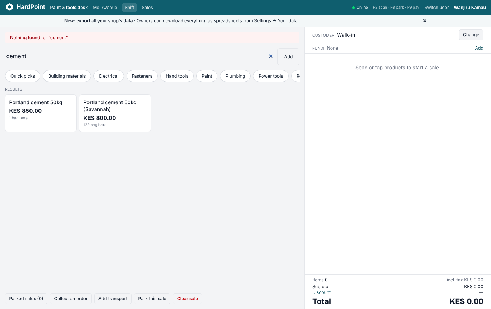
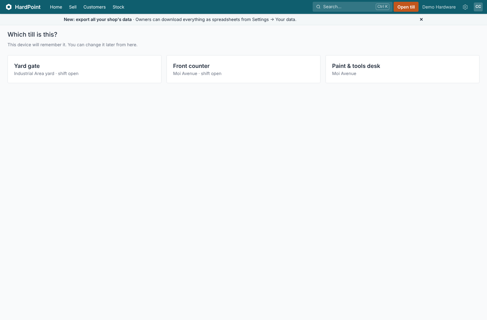

# Audit: the app, its screens and its processes (November 2026)

A review of HardPoint as it stands after Phase 41: what breaks, where people get stuck, where money or stock can
go wrong, and where the screens fall short of [BRAND.md](BRAND.md). Each finding has a place in the code and a suggested
fix, so it can go straight into the backlog in [PLAN.md](PLAN.md). The ten in [Fix first](#fix-first) and the broken pages
have since been fixed: see [What's been fixed](#whats-been-fixed). Everything else is still open.

**Contents:** [How this was done](#how-this-was-done) · [Summary](#summary) · [Fix first](#fix-first) · [What's been fixed](#whats-been-fixed) ·
[Broken pages](#broken-pages-found-by-the-crawl) · [At the till](#at-the-till) · [Stock and purchasing](#stock-and-purchasing) ·
[Customers, orders and money](#customers-orders-and-money) · [Signing up, billing, staff and settings](#signing-up-billing-staff-and-settings) ·
[Screens, accessibility and consistency](#screens-accessibility-and-consistency) · [Help text that disagrees with the app](#help-text-that-disagrees-with-the-app) ·
[What's good](#whats-good)

## How this was done

1. **The running app.** The demo data from `bin/setup` was loaded on Ruby 4.0.9 and PostgreSQL 18. A script signed in as
   the owner, a cashier and a stock clerk, and opened every screen it could reach by following links (204, 86 and 127
   screens), plus 50 public pages. On each screen it recorded:
   - errors and slow pages;
   - pages wider than a 390 px phone;
   - inputs without labels;
   - [axe-core](https://github.com/dequelabs/axe-core) WCAG 2.2 AA violations.

   It also rang up a sale at the till and read the screenshots.
2. **The code.** Five read-through reviews covered:
   - the till, shifts and offline selling;
   - stock and purchasing;
   - customers, orders and money;
   - the shop's lifecycle (signup, billing, staff, settings, admin);
   - the screens as a whole against BRAND.md.

   Every finding marked **High** was checked against the code a second time.
3. **The tests.** `bin/rails test` was run on the same setup: everything passes (see [Summary](#summary)).

The severity scale:

| Severity | Meaning |
|---|---|
| **High** | Loses or misstates money or stock, lets someone do what their role shouldn't, or stops a shop working. |
| **Medium** | A dead end, a wrong number, or a screen that misleads. |
| **Low** | Polish. |

"Unverified" marks findings worked out from the code but not seen happening.

## Summary

HardPoint is in good shape for an app this broad. The till flow is fast and clear. Home's **Needs you today** list
turns numbers into actions. Settings is easy to scan. The tenant isolation, receipt numbering and stock ledger are
careful. Most screens pass the basics: labels on inputs, a skip link, error states with the right status.

The problems sit in four places:

1. **Money that's taken on trust.**
   - A typed M-Pesa code is accepted without checking that it exists, is unused, or covers the amount.
   - A void refunds the whole sale in cash, including the deposit and the on-account part.
   - One manager approval lifts the discount ceiling for the whole sale.
   - A customer order can skip the credit check.
2. **Roles and branches that leak.**
   - A manager bound to one branch can edit, delete and add branches and tills anywhere.
   - Several purchasing screens ignore branch visibility.
   - The sending branch can mark its own transfer as received.
3. **Dead ends.**
   - A cashier away from their till gets a 404 on **Close shift**.
   - A shop with no receipt printer can never finish setup.
   - A stuck M-Pesa billing payment hides the pay form for good.
   - A submitted stock take can't be sent back.
4. **Two pages that crash.**
   - Page 2 of every online store.
   - The demo shop's Activity log.

**Tests:** `bin/rails test` (4 workers, Ruby 4.0.9, PostgreSQL 18.6) passes: 932 runs, 6,563 assertions, 0 failures,
0 errors, in 75 seconds. It doesn't catch either crash above. Each fix in this audit wants a test of its own,
starting with the online store's second page and an Activity log that includes every kind of event.

## Fix first

The ten changes that matter most, roughly in order:

| # | What | Where | Fix |
|---|---|---|---|
| 1 | The online store's page 2 crashes (500) for every shop with more than 24 products | `app/views/store/products/index.html.erb:10` | `@category&.name`, or use the "Online store" heading |
| 2 | A typed M-Pesa code is accepted if it's merely present: no check that it exists, is unused, or covers the payment. The same applies to customer payments and deposits, which never claim the transaction | `app/models/payment.rb:16,41`, `customer_payment.rb`, `deposit.rb` | Refuse codes already used; require the matched transaction to cover the amount; flag unmatched codes on the M-Pesa report |
| 3 | Voiding with a cash refund takes the **whole** total out of expected cash, including deposit and on-account parts. M-Pesa is marked refunded however the money went back | `app/models/shift.rb:52`, `sale/voidable.rb:29-47` | Refund only `refundable_payments`; store the refund amount; set `refunded_at` only for M-Pesa refunds |
| 4 | One discount approval becomes the ceiling for every line and the cart, and survives park and recall | `concerns/pos_sale.rb:31`, `sale/cart.rb:137` | Store the approved amount per line and per cart discount; ask again when either grows |
| 5 | **Save as confirmed order** sets `ordered` directly and skips the credit check and PIN. Editing a confirmed order skips it too, and so does a deposit of KES 1 | `customer_orders_controller.rb:50`, `customer_order/fulfilment.rb:9` | Route through `confirm(approver:)`; recheck when the total rises; make a deposit cover the shortfall |
| 6 | A branch-bound manager can rename, delete or add **any** branch and till | `branches_controller.rb:6,43`, `registers_controller.rb` | Scope to `visible_branches`; owners (or unbound managers) only for create and destroy |
| 7 | Two devices on one till share one cart: scans land in another customer's sale. The till picker says "shift open" but not who | `shift.rb:36-37`, `pos/tills_controller.rb` | One open sale per device or user; show who's on a till and warn before joining it |
| 8 | Changing the customer after an on-account payment moves or orphans the debt | `pos/customers_controller.rb`, `sale/cart.rb` | Refuse a customer change once payments exist (at least on-account ones) |
| 9 | Importing a spreadsheet resets live stock to the file's numbers by default. Blank cells on existing products clear VAT, zero the cost and reactivate hidden products | `product_imports_controller.rb:9`, `product_import/row.rb:38` | Default to "ignore stock"; treat blank cells as "keep"; show stock changes in the check step |
| 10 | Draft orders aren't counted as on order, so pressing **Draft purchase orders** twice makes duplicates | `reorder_suggestion.rb:99-101` | Count draft lines, or link to the existing draft |

## What's been fixed

Each fix has tests, and the guides that describe it were updated (and `docs/USER_GUIDE.md` regenerated). After them,
`bin/rails test` passes: 953 runs, 0 failures, 0 errors. `bin/rubocop`, `bin/brakeman` and the JavaScript tests are clean too.

| Finding | Fix |
|---|---|
| Online store page 2 crashes | It reads "Everything" |
| Activity crashes on a shift entry kept as text | `Shift#close` records the stored integer; `money()` reads text |
| **Close shift** gives a 404 away from the till | The report says where to close it; the closing page sends them to Shifts with that message |
| Enter after a name says "Nothing found" | One match is added; several say "tap the one you want". An all-digit code never adds a partial match |
| Search label contrast | Full white |
| Fix first 2: typed M-Pesa codes | `MobileMoneyCode` on sale payments, deposits and account payments: a code pays once, must cover the amount if Safaricom knows it, and claims the money. Also: the duplicate prompt transaction is renamed rather than recorded twice, and a late payment marks an expired prompt paid |
| Fix first 3: voids refund the whole total | `Sale#void_refund_cents` is the money paid; expected cash and the screens use it; M-Pesa is marked refunded only for an M-Pesa reversal. **Found while fixing:** "Credit to the customer's account" on a void credited nothing. It now counts in the balance and ageing, and shows on statements as "Voided sale credited" |
| Fix first 4: one approval lifts the ceiling | An approval records the money over the limit it covered (`sales.approved_discount_cents`); more asks again |
| Fix first 5: **Save as confirmed order** skips credit | It confirms through `CustomerOrder#confirm`, or stays a quote saying why; raising a confirmed order past the credit needs a PIN |
| Fix first 6: branch-bound managers edit every branch | Branches and Tills use the member's branches; adding and removing branches needs someone who sees them all |
| Fix first 7: two devices share a cart unknowingly | The till picker says whose shift is open and asks before joining someone else's. (Separate carts per device would change shared tills and PIN switching; left as a decision for the team) |
| Fix first 8: changing the customer after payment | Refused until the payments are removed |
| Fix first 9: imports reset stock and wipe blank cells | Stock is ignored unless a branch is chosen (the form warns); blank cells keep the product's value; the branch is one the member sees |
| Fix first 10: duplicate draft orders | Drafts count as on order, and Reorder lists the drafts still to send |
| Guides | The import guide's required columns, units and "plan limits" were wrong; corrected along with the guides for each fix above |

## Broken pages found by the crawl

| Page | What happens | Cause | Severity |
|---|---|---|---|
| `/store?page=2` | 500 for shoppers pressing Next | `@category.name` on nil, `store/products/index.html.erb:10` | **High** |
| `/events` (Activity), demo shop | 500 | `db/seeds.rb:264` passes a decimal to `Shift#close`, so the event stores `"2173250.0"`; `money()` (`catalogue_helper.rb:5`) can't take a string, and one bad event breaks the whole log | Medium: fix the seed, and make `money` coerce with `.to_d` |
| `/shifts/:id/closing/new` as a cashier or stock clerk on a device not set to that till | Bare 404 | **Close shift** (`shifts/show.html.erb:12`) and **End my shift** (`dashboards/show.html.erb:54`) are shown, but `closings_controller.rb:21-23` only finds the shift on the current till | Medium: hide the link off the till, or explain "Close it from the till it's on" |
| `/suppliers/:id` on a phone | 733 px wide; the cost table and **Add a product** form run off screen | No overflow wrapper on the "Products they supply" form table | Medium |
| Home on a phone | 462 px wide | The "Last 7 days" bar chart has fixed-width bars | Low |

## At the till

*Typing "cement" and pressing Enter says "Nothing found" above two cement results.*

| Sev. | Finding | Where | Fix |
|---|---|---|---|
| **High** | Items 2, 3, 4, 7 and 8 in [Fix first](#fix-first) | | |
| Medium | **Enter after typing a name says "Nothing found for 'cement'"** while the matches are on screen. Enter is always an exact barcode or SKU lookup. The offline till gets this right | `pos/lines_controller.rb:7`; compare `offline_till_controller.js:64` | When there's exactly one match, add it; otherwise say "2 match: tap one" and move focus to the results |
| Medium | A discount or customer change that brings the total down to what's already paid leaves the sale stuck: payments are refused, Park is refused, and "nothing to pay" only appears at a total of 0 | `pos/discounts_controller.rb`, `pos/customers_controller.rb` don't call `keep_what_is_paid!` | Call it in both; add a **Complete sale** path when paid ≥ total |
| Medium | A negative quantity sent to add-to-sale shrinks a line without the paid or discount guards (only `min=1` in the HTML stops it) | `pos/lines_controller.rb:9`, `sale/cart.rb` | Reject quantity ≤ 0 on the server |
| Medium | The offline till keeps selling into a shift that's been closed. Those sales land in a closed shift, or are parked where nobody can recall them | `offline_sync_controller.js:69-83`, `sale/offline.rb` | Drop `shift_id` from the snapshot when the catalogue redirects; block offline selling with no live shift; let managers finish orphaned parked sales |
| Medium | Offline sync fails silently (expired session, 422, 429): "3 sales sending" forever | `offline_sync_controller.js:89-95` | Show the error and a **Sign in again** link |
| Medium | A sale can be parked while an M-Pesa or Airtel prompt is still waiting; if the customer pays, the money is left unmatched | `pos/parkings_controller.rb:6` | The same pending-prompt check that **Clear sale** has |
| Medium | Removing a payment is one tap on ✕: no confirmation, no PIN, no Activity entry | `pos/_payment.html.erb:9`, `sale/payable.rb` | Confirm, record it, and need approval for cash or card |
| Medium | A locked-out approval PIN reads as a wrong PIN, and 50 wrong guesses from any till lock approvals for the whole shop | `approval.rb:20,33` | A distinct "locked for 12 minutes" message; count per user, not per shop |
| Medium | A manager can't close an abandoned shift from another device while it has open or parked sales; the error gives no way forward | `shift.rb`, `shifts/closings_controller.rb` | Let approvers park or discard those sales from the shift page |
| Medium | The offline payload's unit price is trusted; a stale or tampered till can sell at KES 1 with only a warning | `sale/offline.rb:101,173` | Cap at the last catalogue price, or alert the owner above a threshold |
| Medium | Two open sales can be created at once (`find_by \|\| create!` race); later scans go to either (unverified in practice) | `shift.rb:37` | A unique partial index on open sales per shift |
| Low | Voided sales' M-Pesa overpayment and foreign-note change aren't taken off expected cash | `shift.rb` | Use the same statuses for both sums |
| Low | Opening a shift twice at once raises an unrescued `RecordNotUnique` (500) | `shifts_controller.rb:28` | Rescue it and go to the till |
| Low | Junk in the discount box ("abc") silently removes the discount | `pos/discounts_controller.rb:19` | Reject input that isn't a number |
| Low | M-Pesa polling never gives up and ignores errors | `mpesa_poll_controller.js` | Stop after about 3 minutes; offer **Stop waiting** |
| Low | Stock counts read "122 bag here", "24 len here", "2,279 pc here" | product tiles | Pluralise the unit, or "122 in stock" |
| Low | The category chips are cut off ("Ro…") with no sign they scroll | `pos/show.html.erb` | A fade at the edge, or wrap to two rows |
| Low | The shop announcement banner takes a row on the till screen | till layout | Don't show announcements on the till |
| Low | Totals aren't in a live region; a missing serial number shows only as a red border | `pos/_cart.html.erb:84`, `pos/_line.html.erb:13` | `aria-live="polite"` on the totals; text for a missing serial |

*The till picker shows "shift open" but not whose shift. Choosing it puts a second device into that cashier's sale (Fix first, 7).*

## Stock and purchasing

| Sev. | Finding | Where | Fix |
|---|---|---|---|
| **High** | Items 9 and 10 in [Fix first](#fix-first) | | |
| **High** | The **sending** branch can press **Mark received** on its own transfer, enter a short count and write off the "lost" stock at the other branch; it can also cancel after the goods arrived | `stock_transfers/show.html.erb`, `StockTransfers::ReceiptsController` | Receiving only at the to-branch (or by an approver); cancelling only at the from-branch |
| **High** | Counting in **Add** mode refreshes "expected" to live stock on each add, but keeps earlier counts: sales between shelves create phantom stock | `stock_count_line.rb:26` | Store the variance per entry and add those up |
| **High** | Stock adjustments post straight away for any stock clerk, with no approval or loss alert; −50 "stolen" needs nothing | `stock_adjustment.rb:18` | Approval for decreases above a threshold; the `count_loss` alert |
| **High** | Two open stock takes on the same products post the same shortage twice | `stock_count.rb` (no guard) | Block overlapping takes, or recheck against the ledger on approval |
| **High** | A goods received note can't be corrected or voided, and phone receiving never asks for transport or duty, though the phone help says they "can be added later" | `routes.rb` (no edit or void), `mobile/goods_receipts_controller.rb:8` | A void (reversal), and **Add landed cost** on a received note |
| Medium | Branch-bound users can see and act on other branches' purchase orders, receipts and imports | `goods_receipts_controller.rb:13`, `purchase_orders_controller.rb:84,91`, `product_imports_controller.rb:17` | `within_visible_branches` / `visible_branches` |
| Medium | Stock-take approval ignores **Require a second approver**: one manager can start, count, submit and approve | `stock_counts/approvals_controller.rb` | `approver_for_action` |
| Medium | A submitted stock take can only be approved or cancelled; one wrong shelf means recounting everything | `stock_count.rb#submit` | **Return to counting** |
| Medium | A product added mid-count, or an inactive product with stock, "isn't in this stock take" and can't be added | `stock_counts/scans_controller.rb:11` | **Add to this take** |
| Medium | The desktop scanner *sets* the count while the phone *adds* to it; scanning the same item on two shelves keeps only the last number | `stock_counts/scans_controller.rb:20` | Default to add, with a **Set total** button, as on the phone |
| Medium | Rebalancing suggests the same move again while the first transfer is in transit | `branch_rebalancing.rb:55` | Subtract stock in transit and on order |
| Medium | Transfers and supplier returns can take stock that's promised to customer orders | `stock_transfer_line.rb:39`, `supplier_return_line.rb` | `available_at` instead of `stock_at` |
| Medium | Bulk price changes can set prices to 0 (clamped, not refused), with no below-cost warning and no undo | `price_change.rb:60` | Refuse results ≤ 0 (or below cost); offer **Undo** |
| Medium | Pack costs rounded to whole cents per unit: a box of 12 at 100.00 becomes 99.96 on the order | `concerns/bought_by_the_pack.rb:69` | Keep the pack cost for line totals |
| Medium | Phone receiving keeps the checked-in list in the session, one order at a time; opening a second order silently drops the first | `concerns/mobile_receiving.rb:18` | Save the draft on the order |
| Medium | Supplier returns reduce what we owe at once, even when the supplier only invoices what was accepted, so the balance can drop twice (partly unverified) | `supplier/payables.rb:49-50` | Apply returns against the delivery's invoice, or wait for the credit note |
| Low | Stock checks on transfers, adjustments and returns aren't locked, so concurrent moves can go below zero | `stock_transfer_line.rb`, `stock_adjustment.rb` | `allow_negative: false` under a lock |
| Low | Opening stock is costed at the product's current cost (often 0), so valuation reads KES 0 | `stock_adjustment.rb` | Ask for a cost with opening stock |
| Low | Batch write-offs accept 2.5 bags | `stock_batch.rb#write_off` | `quantity_allowed?` |
| Low | Phone: the tab says "Receive", the page "Deliveries expected", the breadcrumb "Deliveries". The stock take's "Expected" column changes after counting | mobile views, stock count view | One name; label the live column "System now" |
| Low | **New product** only takes opening stock for one branch; in a two-branch shop the owner can't stock the other branch from the form | `products/_form.html.erb` | A row per visible branch, or say which branch and how to stock the others |

## Customers, orders and money

| Sev. | Finding | Where | Fix |
|---|---|---|---|
| **High** | Items 2 and 5 in [Fix first](#fix-first) | | |
| **High** | An M-Pesa prompt resolved by a status query is recorded as `STK<checkout id>`; the real callback later creates a second transaction under the real receipt number, which can then be spent on another sale | `mpesa/stk_request.rb:189-211` | In `resolve`, rename the existing transaction instead of creating one |
| **High** | A cancelled order comes back to life when a till sale that already held it completes | `customer_order/fulfilment.rb:39-48,180-196`, `sale/payable.rb:202` | Block cancelling while a sale holds the order; `mark_collected` only from open states |
| Medium | Deposit money can get stuck: deposits aren't capped at the order total, and **Refund** only shows while the order takes deposits (not once it's cancelled or collected) | `fulfilment.rb:79,109`, `customer_orders/show.html.erb:77-80` | Show Refund whenever a deposit is held; cap deposits |
| Medium | A deposit on an expired quote is saved but the quote isn't confirmed, so it can't be collected (Paybill auto-match can do this unseen) | `fulfilment.rb:116` | Refuse it, or extend and confirm |
| Medium | A write-off can exceed the debt, creating credit that **Refund credit** pays out with no approval | `customer_payment.rb:25-34`, `customers/payments_controller.rb:6` | Cap at the balance; approval for cash credit refunds |
| Medium | Online orders hold stock for ever, two shoppers can buy the last one, and Home only flags orders once they're *ready* | `storefront/checkout.rb:37-44`, `home_helper.rb:56` | Lock stock in the transaction; auto-cancel unpaid orders after N days; a **New online orders** row on Home |
| Medium | Voided account sales vanish from statements, so last month's closing balance stops matching this month's opening | `customer/receivables.rb:79`, `customer/statement.rb:45` | Show the sale and a dated "Voided" credit |
| Medium | Fundi commission and job bills ignore whole-cart discounts, so commission is overpaid | `fundi_entry.rb:75-80`, `job.rb:96` | Apply the same paid share the tax report uses |
| Medium | Some figures ignore the chosen branch while their headings name it: the fundi commissions report, Home's owed-to and owed-by-us figures, eTIMS refused | `report/fundi_commissions.rb:95`, `dashboard.rb:71-88` | Filter by branch, or label them "whole shop" |
| Medium | Receivables totals subtract customers in credit, and those customers appear on **Who owes us** | `receivables.rb:22` | Positive balances only; show credit separately |
| Medium | Account payments can be back-dated freely, so they can miss a QuickBooks period already exported | `quickbooks_export.rb:201` | Limit back-dating, or export by entry date and flag late ones |
| Medium | eTIMS submissions stuck *pending* (KRA down for days) never appear on Home; only refusals do | `home_helper.rb:12`, `etims/retry_job.rb` | A "not sent for over N hours" row; rescue per submission in the retry job |
| Medium | A transport charge for a customer over their limit fails the delivery note with "needs a PIN", but the form has no PIN field | `delivery_note.rb:133` | `confirm(check_credit: false)` (the till checks), or a PIN field |
| Low | A late M-Pesa callback is recorded, but the prompt stays "expired", so the cashier may ask the customer to pay again | `stk_request.rb:176-181` | Mark it paid, as Airtel does |
| Low | **Who owes us** has the heading "Sales" | `receivables/show.html.erb:4` | "Who owes us" |
| Low | **Cancel** is offered on an order with a deposit, then always fails | `customer_orders/show.html.erb:117` | Hide it; point to **Refund** or **Keep the deposit and cancel** |
| Low | Voiding a sale leaves its delivery notes open | `sale/voidable.rb` | Cancel undelivered notes with the void |
| Low | A phone number shared by two customers matches neither, so every online order makes another customer | `storefront/checkout.rb:72` | Pick the most recent, or ask |

## Signing up, billing, staff and settings

*"Print a test receipt" is required, so a shop without a printer stays at "2 of 4 done" for good. Three primary buttons compete for the next step.*

| Sev. | Finding | Where | Fix |
|---|---|---|---|
| **High** | Item 6 in [Fix first](#fix-first) | | |
| **High** | While a billing M-Pesa payment is pending, the Billing page shows only "Waiting for … to enter their M-Pesa PIN" and hides the pay form. Nothing expires it, so a lost callback leaves a read-only shop with no way to pay (unless it has cards) | `billings/show.html.erb:29-39`, `billing/mpesa_shortcode.rb` | Expire after about 2 minutes with a status query; always show **Try again** |
| **High** | Support, signed in as an owner, can turn off **two-factor for managers**, raise discount and payout limits, read and roll webhook secrets, and change the plan. SECURITY.md says support can't | `accounts_controller.rb:20`, `webhook_endpoints/show.html.erb:30`, billing plan controllers | `refuse_while_impersonated` on those actions |
| **High** | The billing guide says the shop goes read-only "a week after it's due"; the code locks the day after the due date (which is a week after the invoice) | `help/articles/_billing.html.erb`, `billing_cycle.rb:31` | Correct the guide (or the code) |
| Medium | **Print a test receipt** is a required setup step, so a shop with no printer can never finish setup; the card stays on Home for good | `onboarding.rb:22,35-40` | Make it optional, or add **We don't print receipts** |
| Medium | New shops get a branch but no till; the first **Open till** lands on "This shop has no tills yet" | `signup.rb:37` | Make "Till 1" at signup |
| Medium | Losing the two-factor phone is a dead end: recovery codes can't be regenerated, printed or copied, and the code page has no support link (support needs you signed in) | `my/recovery_codes/show.html.erb`, `sessions/two_factors/new.html.erb` | **Regenerate codes**, **Print / Copy**, and a WhatsApp support link on the code page |
| Medium | The two-factor code box opens a number pad on phones, so a recovery code like `ab3cd-9xk2p` can't be typed | `sessions/two_factors/new.html.erb:11` | Drop `inputmode`, or a **Use a recovery code** toggle |
| Medium | With neither M-Pesa nor cards available, an overdue invoice shows no way to pay at all | `billings/show.html.erb:33-42` | Always show bank-transfer details and a support contact |
| Medium | **Require a second approver** can freeze a one-owner shop: nobody is left to approve | `accounts_controller.rb:20`, `membership.rb:133` | Need two approvers with PINs before it can be turned on |
| Medium | Staff invitations expire in 3 days, and the staff list neither shows "invited" nor offers **Resend** | `user.rb:13`, `memberships/index.html.erb` | An "Invited" note and **Resend invitation** |
| Medium | Managers see **Edit** on owners' rows and the role list includes Owner, but the server refuses both | `memberships/index.html.erb:18`, `_role_field.html.erb:26` | Hide what they can't change |
| Medium | A read-only shop can't shrink to a cheaper plan, because removing staff or tills is blocked while read-only; **Switch to…** has no confirmation though an upgrade bills at once | `subscription_enforcement.rb:16`, `billings/show.html.erb:75` | Allow removals while read-only; confirm with the amount |
| Medium | The shop's web address is hard to find again: the confirmation email doesn't spell it out, and opening a second shop sends no email | `users_mailer/email_confirmation`, `signups_controller.rb:19` | A welcome email with the address; **Email me my shops** on the lookup page |
| Medium | Stock clerks can change tax rates, the default rate and eTIMS codes (unverified whether that's intended) | `catalogue_settings_controller.rb:5` | Owners and managers only for tax |
| Low | Signup's web address field rejects capitals with the browser's generic message, though the server lower-cases it anyway | `signups/new.html.erb:22` | Accept and lower-case, or a hint |
| Low | "Plan after the trial" is misleading: the trial already runs on that plan's limits | `signups/new.html.erb`, `signup.rb:32` | "Your plan (free for 30 days)" |
| Low | Cashiers and accountants see Branches and Tills in Settings, but every action there gives a blank 403 | `navigation_helper.rb:68`, `authorization.rb` | Hide them, or a friendly "Ask the owner" page |
| Low | Appearance, Shop preferences, Backups and Guided tours don't highlight Settings in the bar | `navigation_helper.rb:71-72` | Add them to the Settings paths |
| Low | Five wrong PIN guesses on a colleague's name lock their PIN until they sign in with a password | `sessions/switches_controller.rb`, `membership.rb:192` | Lock the device, not the person |
| Low | The Developers page and API keys don't check the **developers** feature switch | `developers_controller.rb`, `api_keys_controller.rb` | Check it, as the Settings card does |
| Low | Shop announcements meant for owners ("Owners can download everything…") show to cashiers and stock clerks | announcements banner | An audience on announcements |

## Screens, accessibility and consistency

*On a phone, the four number cards fill the first screen; **Needs you today**, the part that says what to do, starts below the fold.*

| Sev. | Finding | Where | Fix |
|---|---|---|---|
| **High** | Validation messages use column names: "Price cents must be greater than or equal to 0", "Sku can't be blank". `en.yml` has 17 lines | `config/locales/en.yml`, `shared/_errors` | `activerecord.attributes` for every `*_cents`, `sku` and `etims_*` attribute |
| **High** | Money fields never show their error: the form binds `price`, the error is on `price_cents`, so there's no red line and no `aria-invalid` | every `money_attribute` field | Copy `*_cents` errors onto the virtual attribute |
| **High** | The **Search** label in the top bar fails contrast on every signed-in page (3.96:1 on the default teal; down to 2.8:1 on custom themes). axe flags it on 190 of 204 owner screens | `shared/_navigation.html.erb:16-18` | `text-white` for the label and the key hint |
| **High** | Error pages (404, 422, 500) are Rails' defaults: no HardPoint look, no way back, and "If you're the application owner check the logs" | `public/*.html` | Branded pages with **Home** and **Open till** |
| **High** | Admin's **Sign in as…** confirmation never shows: `turbo: false` with `turbo_confirm`, and there's no rails-ujs | `admin/accounts/show.html.erb:107` | Drop `turbo: false` and redirect with `:see_other` |
| Medium | Themes only check white on the 500 shade. The focus ring (400) fails 3:1 on orange and custom colours; white at 70% on the till bar fails on red and orange | `theme.rb`, `pos.html.erb:40` | Check the 400 shade too, or ring with 600 |
| Medium | The "Brick red" theme makes every primary button red, which BRAND.md keeps for danger. "Burnt orange" hides the orange **Open till** button (1.14:1 against the bar) | theme presets, `_navigation.html.erb:22` | Drop or adjust those presets; take **Open till** from a token |
| Medium | **Open a shift and start selling** (white on `#e46f2f`) is 3.18:1; the line under it is 2.86:1 | `dashboards/show.html.erb:21-23`, `tours/index.html.erb:20` | `#c2561c` or darker, and document it in BRAND.md |
| Medium | Inputs' only edge is a `gray-400` underline (about 2.6:1, under the 3:1 needed); 103 `text-gray-400` uses include real text | `application.css:74` | `gray-500` underline; `gray-500` for meaningful text |
| Medium | Links inside sentences are told apart by colour alone (axe: 109 owner screens) | `.link` | Underline links in running text |
| Medium | Dates come out three ways: "November 05, 2026" (`l :long`, 56 uses), "05 Nov 14:30" (`:short`, 69), "5 Nov 2026" (`strftime`, 37) | no `en.date.formats` | Define Kenyan/British formats; use `l` everywhere |
| Medium | Only 8 of 32 delete buttons use `btn-danger`: **Revoke** API key, **Remove endpoint** and **Delete** backup look like ordinary buttons or links | `developers/show.html.erb:36`, `account_data/show.html.erb:72`, products sections | `btn-danger`, or a new `link-danger` for row actions |
| Medium | 414 hints, 1 `aria-describedby`: screen readers don't hear the hints | form views | A helper that ties each hint to its field |
| Medium | Online store product pictures are links with no name (24 per page) | `store/products/_product` | `aria-label` with the product name, or `alt` on the image |
| Medium | The till's phone tabs don't say which is selected | `pos/_pane_tabs.html.erb` | `role=tab` with `aria-selected` |
| Medium | Dropdowns close on Escape but leave focus on the hidden menu; Tab out doesn't close them | `dropdown_controller.js`, `search_panel_controller.js` | Return focus to the button; close on `focusout` |
| Medium | The dashboard bars are only readable by hovering | `dashboards/_bars.html.erb` | Values in the label, or a hidden table |
| Medium | Phone Home: four stacked number cards push **Needs you today** below the fold | `dashboards/_owner` | On phones, a 2×2 grid of numbers, or the to-do list first |
| Low | Tables: no `scope`, 18 empty `<th>`; the Activity, currencies and appearance pages have inputs with no label | `sales/index.html.erb:14`, … | `sr-only` header text; labels |
| Low | Page titles break the "Parent / Page" rule on about 80 screens (Activity, Branches); h1 spacing varies | many | A `page_header` helper |
| Low | "New" vs "Add branch" vs "New API key", buttons left or right, two pager styles | `branches/index.html.erb`, `shared/_pagination` | Use the control panel everywhere |
| Low | Tap targets under 44 px: the ⚙ list menu, phone area links, row **Remove** links, promotion category checkboxes | `_control_panel.html.erb:14`, `_navigation.html.erb:48` | `pointer-coarse:min-h-11` |
| Low | Skip link only in the main layout; the account button's name ("Your account") hides its visible initials | `admin`, `mobile`, `store`, `pos` layouts | Skip link everywhere; "Your account (WK)" |
| Low | `animate-pulse` without `motion-safe:`; progress bars without `role=progressbar`; "-" and "−" both used for minus; `hello_controller.js` left over | various | Tidy |

## Help text that disagrees with the app

The README says the guides name buttons "exactly as they appear". These don't match:

| Guide | Says | The app |
|---|---|---|
| Billing | Read-only "a week after it's due" | The day after it's due |
| Selling | "F9 takes payment" | F9 focuses **Cash received**, and nothing when another tender is showing |
| Selling | Line discounts take a percentage | The line discount box takes an amount only |
| Stock and stock takes | What's on order "isn't suggested twice" | Drafts are suggested again |
| Stock on your phone | Transport costs can be added later in Buy › Receiving | There's no way to |
| Customers on account | Confirming over the limit needs approval | **Save as confirmed order** doesn't ask |
| Staff and roles | 10 wrong approval PINs lock the shop | 10 per till, 50 per shop |
| Set up your shop | Everyone invited gets a till PIN | Managers can't have one |
| Pricing | "Every plan includes every feature" | The API and webhooks are Business and up |

## What's good

Worth keeping as they are:

- **Receipt numbering** is gap-free and locked.
- **Payments** lock the sale.
- **Return refunds** are capped at the money paid.
- **Offline sales** are de-duplicated by UUID.
- **Discount approval** is checked again at payment.
- **Tenant isolation:** row-level security, plus a test that requests every route with another shop's record.
- **Home's Needs you today list**, which turns each number into a button.
- **The grouped Settings page** with search.
- **The till's layout:** big tiles, quick picks, F-keys shown in the bar.
- **Forms:** labels on almost every input, error states rendered with the right status, `submit-once` on non-Turbo forms, a skip link and `prefers-reduced-motion` guards.
- **Money format:** "KES 1,234.00" everywhere through `money`.
- **Status rule:** BRAND.md's no-coloured-capsules rule is kept.
