# What's been built, phase by phase

HardPoint was built in phases, each one a working slice of the product. This is the record of what each phase added,
with a screenshot of it. For what HardPoint does today, grouped by job, start with the [README](../README.md); for how
to use it, the help centre (`/help` on the public site). The plan the phases came from is [PLAN.md](PLAN.md).

- [Phase 1: shops, staff and sign-in](#phase-1-shops-staff-and-sign-in)
- [Phase 2: catalogue and stock](#phase-2-catalogue-and-stock)
- [Phase 3: the till](#phase-3-the-till)
- [Phase 4: purchasing](#phase-4-purchasing)
- [Phase 5: customers, credit, quotes and invoices](#phase-5-customers-credit-quotes-and-invoices)
- [Phase 6: reports and the owner's dashboard](#phase-6-reports-and-the-owners-dashboard)
- [Phase 7: M-Pesa, KRA eTIMS and SMS](#phase-7-m-pesa-kra-etims-and-sms)
- [Phase 8: selling offline, and the till's hardware](#phase-8-selling-offline-and-the-tills-hardware)
- [Phase 9: HardPoint as a service](#phase-9-hardpoint-as-a-service)
- [Phase 10: hardening and launch readiness](#phase-10-hardening-and-launch-readiness)
- [Phase 11: public API and webhooks](#phase-11-public-api-and-webhooks)
- [Phase 12: online store with click-and-collect](#phase-12-online-store-with-click-and-collect)
- [Phase 13: tool hire](#phase-13-tool-hire)
- [Phase 14: contractor jobs](#phase-14-contractor-jobs)
- [Phase 15: stock on the phone](#phase-15-stock-on-the-phone)
- [Phase 16: batches and expiry dates](#phase-16-batches-and-expiry-dates)
- [Phase 17: room to grow](#phase-17-room-to-grow)
- [Phase 18: foreign currencies](#phase-18-foreign-currencies)
- [Phase 19: promotions](#phase-19-promotions)
- [Phase 20: loyalty points](#phase-20-loyalty-points)
- [Phase 21: the offline till catches up](#phase-21-the-offline-till-catches-up)
- [Phase 22: returns to suppliers](#phase-22-returns-to-suppliers)
- [Phase 23: points that expire, and texts about them](#phase-23-points-that-expire-and-texts-about-them)
- [Phase 24: mix-and-match bundles](#phase-24-mix-and-match-bundles)
- [Phase 25: spending points on the offline till](#phase-25-spending-points-on-the-offline-till)
- [Phase 26: counting by batch](#phase-26-counting-by-batch)
- [Phase 27: jobs for contractors, continued](#phase-27-jobs-for-contractors-continued)
- [Phase 28: the daily exchange rate](#phase-28-the-daily-exchange-rate)
- [Phase 29: shop-editable hire terms](#phase-29-shop-editable-hire-terms)
- [Phase 30: tool hire, loyalty points and the customer display removed](#phase-30-tool-hire-loyalty-points-and-the-customer-display-removed)
- [Phase 31: WhatsApp, transport, bulk prices, QuickBooks and Airtel Money](#phase-31-whatsapp-transport-bulk-prices-quickbooks-and-airtel-money)
- [Since then: the new look, lists and help](#since-then-the-new-look-lists-and-help)
- [Phases 34 to 47: ahead of the competition](#phases-34-to-47-ahead-of-the-competition)

## Phase 1: shops, staff and sign-in

- **Shops on subdomains:** signup on the bare domain; each shop at `<name>.hardpoint.app`
- **Branches and tills** (registers) per shop
- **Staff and roles:** owner, manager, cashier, stock clerk, accountant; email invitations
- **Two-factor sign-in** (authenticator app + one-time recovery codes); shops can require it for owners and managers
- **Till PIN quick-switch:** cashiers and stock clerks switch in at a signed-in till with a 4–6 digit PIN (locks after 5 wrong tries)
- **Activity log:** an append-only audit trail of who changed what
- **Platform admin** on `admin.hardpoint.app`: separate sign-in with mandatory two-factor, a list of all shops, and
  support impersonation that is time-boxed to an hour, shown in a banner and recorded in the shop's Activity

## Phase 2: catalogue and stock

- **Catalogue:** categories (nested), brands, units (whole or fractional, e.g. kg and metres), tax rates, and
  products with a cost, a price and a photo
- **Barcodes:** several per product, for pack sizes too; products without one get an in-store EAN-13
- **Pack sizes** (a box of 200 screws with its own price), **kits** (made of other products), **price lists**
  (contractor, wholesale) and **quantity breaks**. Customers always get the lowest price that applies.
- **Fast search** by any words in the name or SKU, or by scanning a barcode (Postgres trigram indexes)
- **Stock ledger:** every change is an append-only movement; cached levels per branch are updated in the same
  transaction under a row lock, and the Stock page checks that levels still equal the sum of their movements
- **Adjustments** with reasons (opening, damaged, stolen, expired, found…), **branch transfers**
  (send → in transit → receive or cancel) and **stock takes** (full or by category, with scanner entry,
  variance at cost and manager approval)
- **Reorder list** per branch and a **daily low-stock email** to owners, managers and stock clerks
- **CSV import** with a full check and preview before anything changes (20,000 rows in about 12 seconds), and
  **CSV export** in the same format, so a shop can round-trip through Excel
- **Barcode labels** for A4 label sheets or 50 × 25 mm label printers, printed from the browser

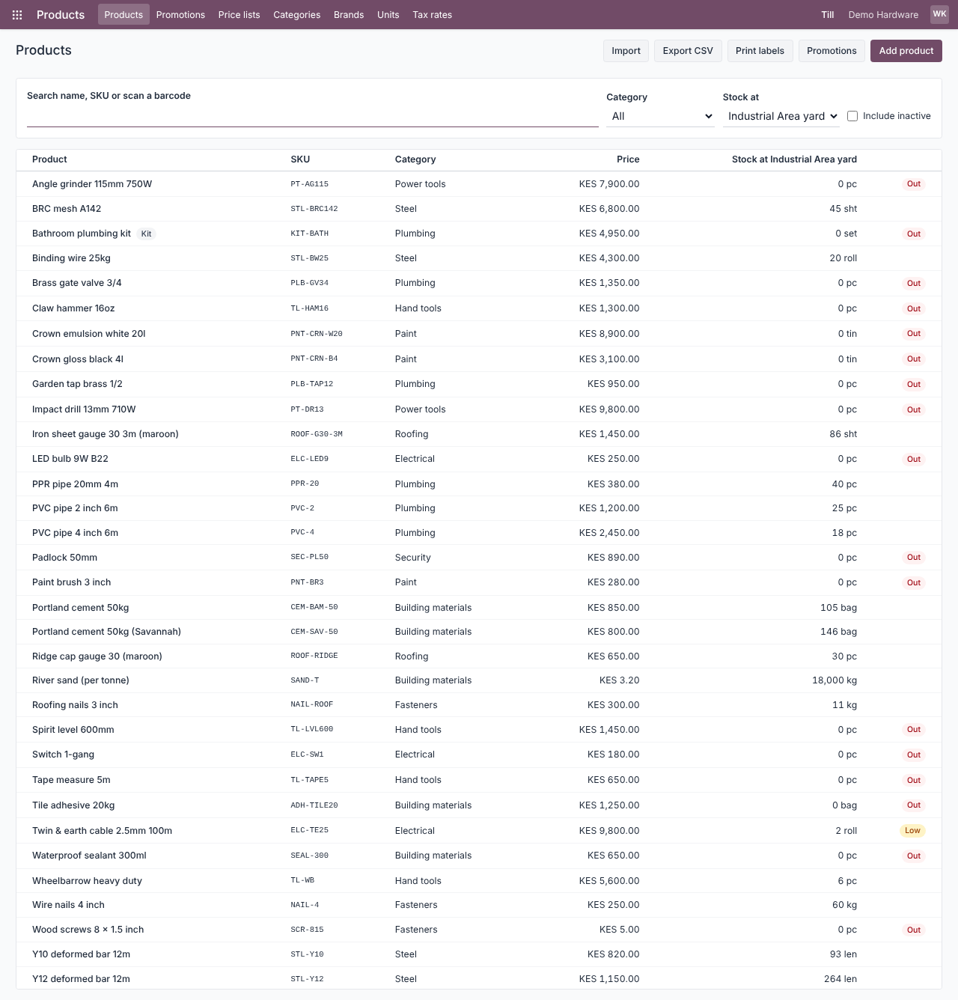

## Phase 3: the till

- **Full-screen till**, scanner first: a barcode scanner types and presses Enter to add; typing searches; quick-pick
  buttons for fast movers and pack sizes. F2 scan · F8 park · F9 pay. Each device remembers its till.
- **Cart:** decimal quantities for fractional units, switching between pieces and packs, serial numbers for
  serialised items, stock warnings, and the customer's price list applied when you pick them
- **Discounts** per line or on the whole sale (amount or %). Above the shop's limit (5% by default) an owner or
  manager approves with an **approval PIN**, which authorises that one action and signs nobody in
- **Split payment** by cash (with change), M-Pesa (transaction code), card, or on account (within the customer's
  credit limit). Completing a sale assigns a **gap-free receipt number per branch** and takes the stock out
  (kits take their parts) in one transaction
- **Park and recall** sales, clear unwanted carts
- **Shifts:** opening float, cash drops, payouts and pay-ins, **X report** during the shift, **blind count** at close
  and a **Z report** with over/short
- **Voids** during the shift and **returns** against a receipt (restock or write off; refund by cash, M-Pesa,
  card or account credit), both needing approval and both recorded in Activity
- **80 mm thermal receipts** printed from the browser, reprints, and emailed receipts. Set the receipt printer's
  "open cash drawer" option to pop the drawer when a receipt prints
- **Sales history** by day, branch or receipt number, and simple **customer** records (prices, credit limit, balance)

A 10-line scanned sale with a split payment takes about 2.6 seconds end to end in a real browser (the plan's target
was under 30).

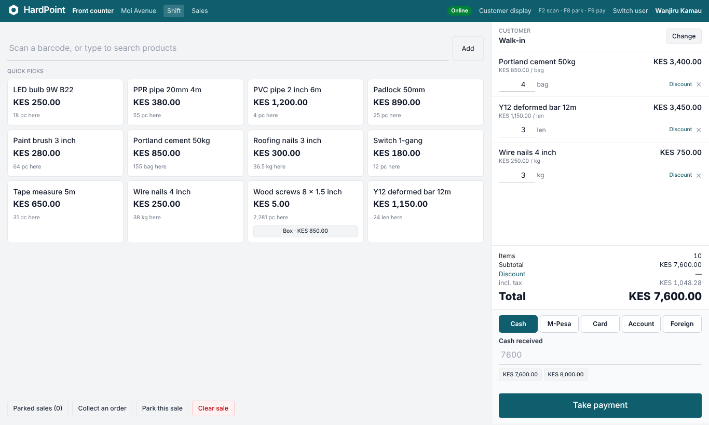

## Phase 4: purchasing

- **Suppliers** with contacts, payment terms, and the products they supply (their code, price, lead time, minimum
  order, preferred supplier)
- **Purchase orders**: draft → sent (emailed to the supplier with a PDF attached, or marked sent for phoned-in orders)
  → partially/fully received, numbered per branch (e.g. MOI-PO00012)
- **Receiving goods (GRNs)** against an order or without one: stock goes into the branch, transport and duty are
  spread over the lines by value, and each product's cost becomes the **weighted average** of old and new stock
- **Reorder suggestions** per branch from reorder levels, last 30 days' sales, supplier lead time, stock on order and
  minimum order sizes, grouped by supplier with a **one-click draft order**
- **Supplier invoices and payments** (payments settle the oldest invoices first), each supplier's balance, and a
  **What we owe** ageing report (not yet due, 1–30, 31–60, 61–90, over 90 days)
- Accountants get the money side (invoices, payments, ageing) without ordering; stock clerks order and receive

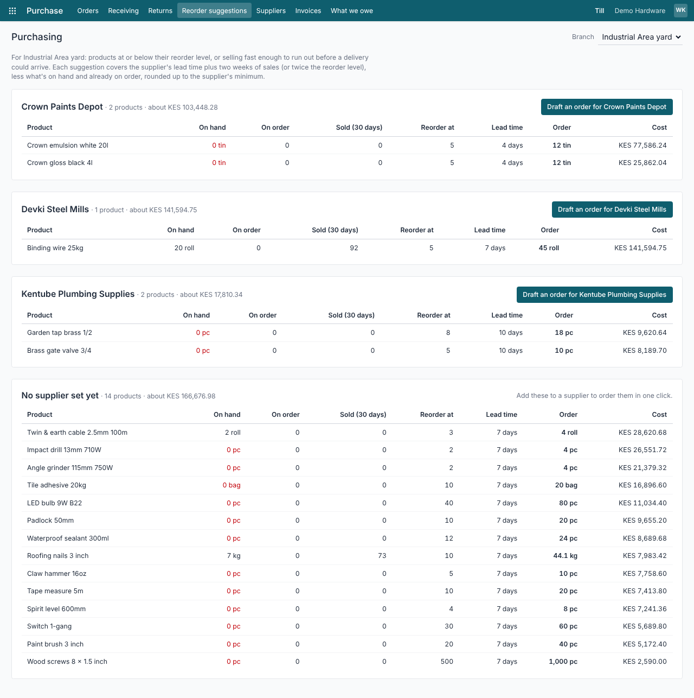

## Phase 5: customers, credit, quotes and invoices

- **Quotes → orders → collection**, one document all the way: a quote (PDF or email, valid for 14 days by default)
  is confirmed into an order, takes **deposits** (cash, M-Pesa, card or bank; refundable), is marked ready when the
  goods are in, and is **collected at the till** at the quoted prices, with the deposit as a tender
- **Invoices on account:** a sale put on account is the invoice, due after the customer's payment terms, with an
  **A4 tax invoice** PDF for trade customers
- **Payments on account** settle the oldest sales first; **statements** (PDF or email) bring the balance forward and
  run it through the period with ageing; **Who owes us** lists every customer's balance by how late it is
- **Credit limit at the till:** going over it needs an owner's or manager's approval PIN, recorded on the sale
- **Delivery notes** from a completed sale: printable note with a signature line, dispatch with driver and vehicle,
  and proof of delivery (who received it and a photo of the signed note)
- Cash deposits and cash account payments go through the till's drawer and show on the **X/Z report**
- Accountants see customers, statements and who owes us, but not the till

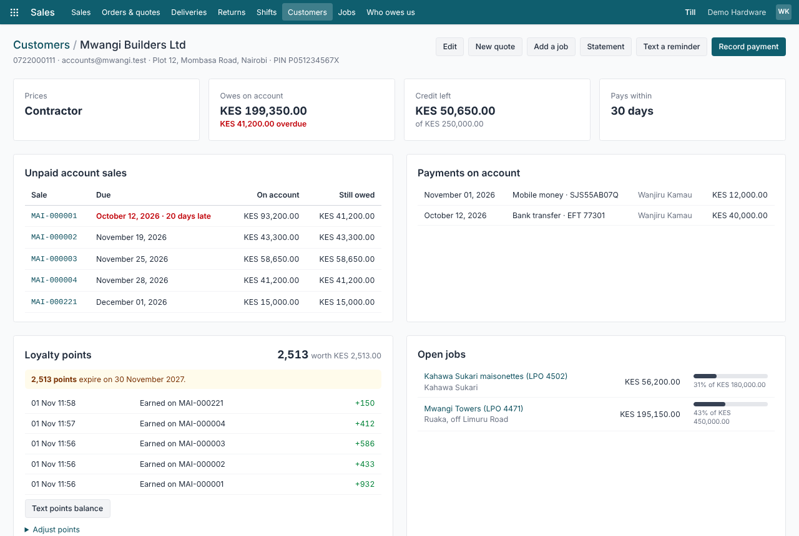

## Phase 6: reports and the owner's dashboard

- **Live owner dashboard:** today's takings (against the same day last week), sales and average sale, gross margin,
  cash in the drawers, takings by hour and over the last 7 days, best sellers, each branch, money owed both ways,
  low stock, orders ready and deliveries due. It refreshes by itself as sales happen (Turbo morphing over Solid Cable)
- **Reports** for any period (today, this week, last month… or chosen dates) and branch, on screen, as **CSV** (opens in
  Excel) or **PDF** on the shop's letterhead:
  - **Sales and margin** by day, month, branch, cashier, category or product
  - **Profit and loss** (sales less returns, cost of sales, stock losses, till payouts)
  - **Tax (VAT)**: output tax by rate, input tax from supplier invoices, VAT payable
  - **Payments by method**, refunds, deposits and payments on account
  - **Discounts, voids and returns** per cashier, every void, the biggest discounts and who approved them
  - **Stock valuation** at cost and selling price, **dead stock**, and **shifts** with their over/short
  - Plus the existing stock movement history, who owes us and what we owe
- **Margins stay true:** each sale line records what it cost when it was sold
- **Daily summary email** each morning with yesterday's figures, for owners, managers and accountants (each can turn
  it off under My profile)
- Reports and the dashboard are for owners, managers and accountants only

A full year for a busy shop (60,000 sales, 180,000 lines) reports in under a second, and the dashboard renders in about
0.2 seconds, so reports run on request rather than in background jobs.

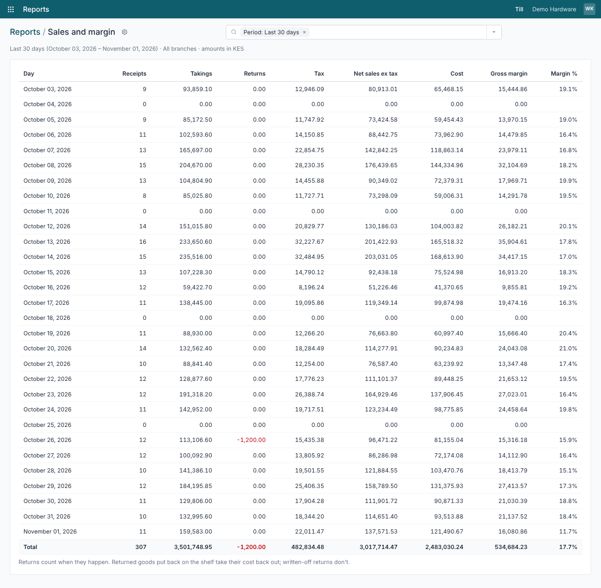

## Phase 7: M-Pesa, KRA eTIMS and SMS

- **M-Pesa (Daraja)** for each shop's own Paybill or Till, with its API credentials stored encrypted:
  - **Prompt to pay from the till** (STK push): the cashier enters the customer's number, the customer enters their
    PIN, and the sale completes by itself. Late callbacks are chased with a status check
  - **Payments made straight to the Paybill/Till** (C2B) arrive automatically. An order number as the account makes a
    deposit on that order; a customer's phone number pays their account; anything else waits at the till under
    "Received on M-Pesa" to be used on a sale. A code typed at the till claims the matching payment
  - **M-Pesa reconciliation report:** money received but not used, and codes typed at a till that Safaricom never confirmed
  - **Callbacks** find the shop from a secret token in the URL (never the payload), accept only Safaricom's addresses in
    production, are safe to receive twice, and always answer Safaricom the way it expects
- **KRA eTIMS (OSCU)**, one control unit per branch: set up with KRA, items registered once per branch, every sale
  sent and signed, voids and returns sent as credit notes against the original, and **signed receipts with KRA's QR
  code**. When KRA can't be reached, the till keeps selling and sending is retried with growing gaps; refusals show why
  and can be sent again. The owner's dashboard warns about refused submissions
- **SMS through Africa's Talking:** text a receipt (from the till or the sale), "your order is ready", and balance
  reminders with the Paybill to pay to. Shops turn it on in their settings; each shop can send at most 500 a day
- **Card terminals** stay as typed references for now
- Every integration has a **simulator** (demo shops and development) that answers like the real service, so the whole
  flow can be tried without real money or KRA

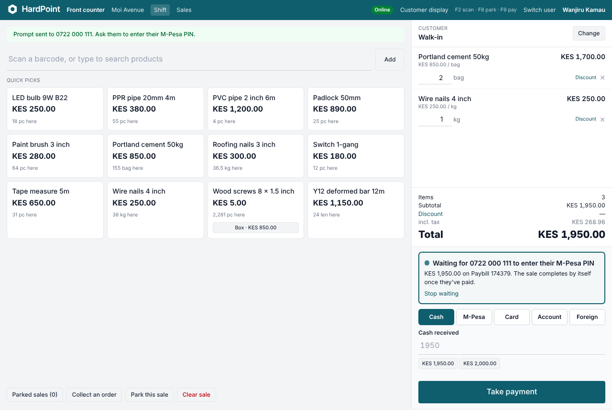

## Phase 8: selling offline, and the till's hardware

- **The till keeps selling when HardPoint can't be reached.** Each till keeps an offline copy of itself (a service
  worker) and a snapshot of the catalogue (retail prices, quantity breaks, packs, barcodes, stock at its branch; no
  costs) in the browser. When the connection drops, the till says so and switches to the **offline till**: scan,
  search, cash with change, or a typed M-Pesa or card code, and an offline receipt
- **Offline sales are sent by themselves** when the till is back, each with its own ID so sending twice records it
  once. They get their real receipt numbers then and keep the time they happened. Anything worth a second look comes
  back as a warning and goes in Activity: a price that has since gone up, stock now below zero, a shift that had
  already closed, or a total the till worked out differently. Typed M-Pesa codes are checked by the M-Pesa reconciliation
- **Connection indicator** on every till page: Online / Offline, and how many sales are waiting
- **Installable till** (web app manifest), opening straight on the till
- **Receipt printers:** each till prints through the browser (silent with a kiosk-mode browser) or **straight to the
  printer through QZ Tray** in ESC/POS, which also cuts the paper, prints KRA's QR code, and **opens the cash drawer**
  for cash sales. An **Open drawer** button logs every no-sale opening in Activity
- **Customer display:** a second screen beside the till shows the cart, the total, the Paybill to pay to, and the
  change; it works offline too (removed in Phase 30)

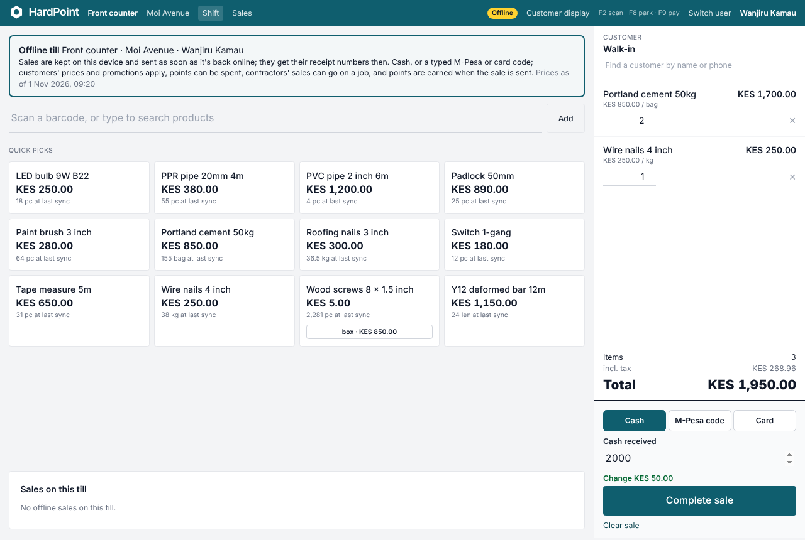

## Phase 9: HardPoint as a service

- **Public site** on the bare domain: home page, pricing, a privacy page in plain language (Kenya Data Protection
  Act), a **help centre** of guides with search (eleven at the time; now 25, searched by their full text), and "Sign in", which asks for the shop's web address
- **Self-service signup** with a choice of plan, then a **Set up your shop** checklist on the owner's dashboard:
  branches and tills, tax rates, products, staff, a **test receipt** to check the printer, and optionally M-Pesa and
  eTIMS. Steps tick themselves off from what the shop has actually done
- **Plans and limits:** Solo (KES 1,500/month: 1 branch, 1 till, 2 staff), Starter (KES 2,500: 1, 2, 5),
  Business (KES 3,500: 2, 4, 10) and Unlimited (KES 5,000, no limits). Products are never limited. Every new shop gets **30 days free** on its chosen plan.
  Going past a limit (adding a branch, a till, a person, a product or an import) is refused with a pointer to Billing
- **Billing:** at the trial's end HardPoint emails an invoice (PDF, numbered `HP-2026-000123`) due a week later,
  payable from **Settings › Billing** by an **M-Pesa prompt** to HardPoint's own Paybill or **by card through Paystack**.
  Reminders go out 3 days before the trial ends and 2 days before an invoice is due. Owners change plan there too:
  bigger at once, smaller only if the shop fits
- **Read-only mode:** a week after an unpaid invoice falls due the shop becomes read-only. Everyone can still sign in
  and look things up, owners can pay, export and ask for help, and offline sales rung up before the lock are still
  accepted, but nothing can be sold or changed. Paying unlocks it at once
- **In-app help:** "Help" in the menu opens the guides, a WhatsApp chat, and a message form that emails support
  with the shop, the person and the page they were on
- **Your data** (owners): **export everything** as a ZIP of CSV files (one per table, secrets left out) plus product
  images and delivery photos, emailed when ready and kept 7 days; and **close the shop**, with the password: it goes
  read-only for owners only, and 30 days later every row is deleted, unless an owner cancels. HardPoint keeps only a
  record of the invoices it issued, for tax
- **Platform admin:** shops by plan and status with usage and revenue, and per shop: change plan, extend the trial,
  record a bank payment, suspend and restore (each recorded in the shop's activity with the administrator's email);
  announcements shown as a dismissible banner in every shop; and the support inbox

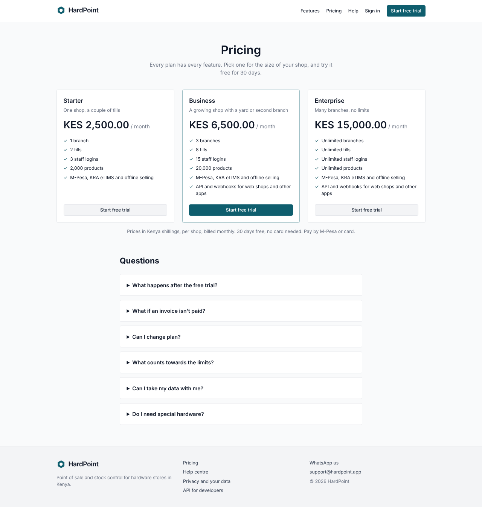

## Phase 10: hardening and launch readiness

- **Tenant isolation checked route by route:** a test signs in as one shop's owner and requests every
  one of the 136 routes that take a record id with another shop's record; all are refused
- **Content security policy enforced** (scripts only from the app, no inline handlers, no framing, forms
  only to the app, shop subdomains and Paystack), HSTS for every subdomain, a permissions policy, and
  PINs, codes, phone numbers and KRA PINs filtered from logs
- **Rate limits that suit shops:** a shop's tills share one public address, so sign-in is limited per login
  (and loosely per address), PIN switching and offline sync per till
- **Load tested** with k6: 40 cashiers ringing up sales flat out on 4 cores, 95% of scans under 280 ms
  and payments under 640 ms, no errors ([perf/README.md](../perf/README.md)); fixed the cart's per-line queries
- **Database:** every foreign key indexed (checked by a test), PostgreSQL tuned for the VPS with a
  connection budget, Puma workers per core, and an admin **Database** page (size, connections, cache hit
  rates, slowest queries, unused indexes, vacuum)
- **Backups and disaster recovery:** hourly encrypted dumps off-site, daily files, and a restore script,
  drilled: the restored copy matched the original table for table, with row-level security intact
  ([RUNBOOK.md](RUNBOOK.md)); RPO 1 hour, RTO 2 hours
- **Launch:** security controls and the penetration test brief ([SECURITY.md](SECURITY.md)), the pilot
  and go-live checklist ([LAUNCH.md](LAUNCH.md)), Dependabot for gems, Actions and the base image,
  and CI security scans weekly

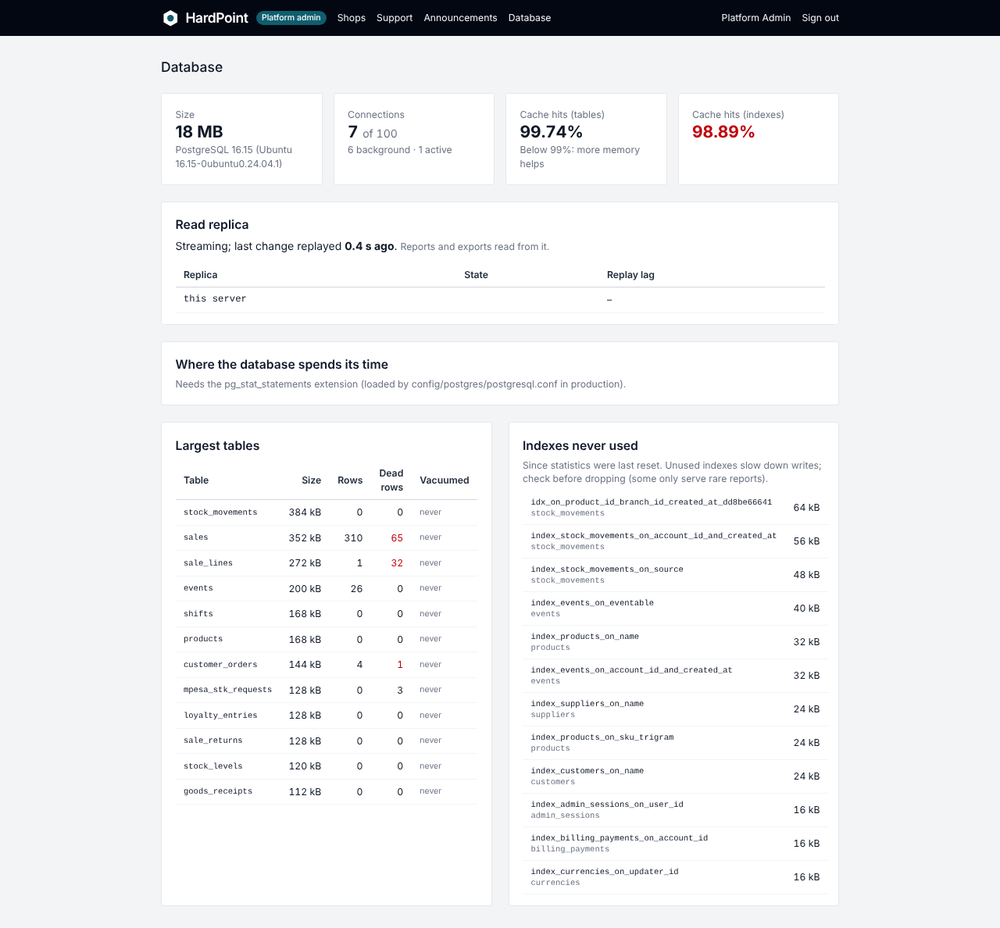

## Phase 11: public API and webhooks

- **API keys** made by the owner in **Settings › Developers**: read only or read and write, shown once and stored
  only as a digest, revocable, last use recorded; changes made with a key show in Activity as that key. Business and
  Unlimited plans
- **REST API** at `https://api.hardpoint.app/v1`: the shop and branches, products (with barcodes, prices and stock per
  branch; create and update), stock levels, customers (create and update), sales and orders, including placing a
  **click-and-collect order** that lands in the shop's open orders. Cursor paging, `updated_since` for syncing,
  idempotency keys, 600 requests a minute per key, clear JSON errors, UTC times, amounts in cents; no writes while the
  shop is read-only
- **Webhooks** for sales completed and voided, products, stock changes, orders and customers: the same JSON as the
  API, signed with HMAC-SHA256, retried for a day with back-off, switched off (and the owner emailed) after 25
  failures in a row, only to public HTTPS addresses. Each endpoint's page shows recent deliveries and payloads,
  with resend, a test event and a new signing secret
- **Developer documentation** on the public site at `/developers`, with signature checks for Ruby, Node.js and Python
  (each one verified against real deliveries)

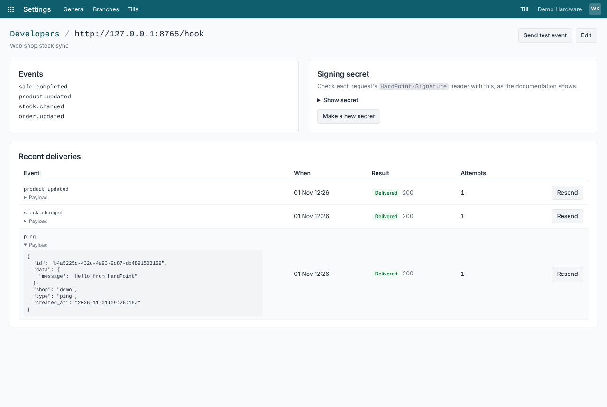

## Phase 12: online store with click-and-collect

- **Every shop can sell online** at `yourshop.hardpoint.app/store`, switched on in **Settings › Online store** with a
  headline, introduction, collection note, contact number and the branches customers can collect from. Every
  active product with a price is in the store unless it's ticked off on the product
- **For customers** (built for phones): categories, search, product pages with the price and stock at each
  collection branch (numbers, or just in stock / low / out, as the shop prefers), a cart, and checkout with a name,
  mobile number and branch; no account to make
- **The order** arrives as a confirmed order marked **Online** in Orders; owners and managers get an email, the
  customer a confirmation page, a text (where SMS is on) and an email if they gave one, all linking to a page that
  follows the order from received to ready to collected. Marking it ready texts them as before
- **Paying ahead:** the order page shows the shop's Paybill with the order number as the account number; the M-Pesa
  matching from Phase 7 turns the payment into a deposit on the order. Otherwise they pay at the till on collection
- Returning customers are recognised by their phone number; spam is held back by rate limits, a hidden field bots
  fill in, and limits on cart size; nothing can be ordered while the shop is read-only

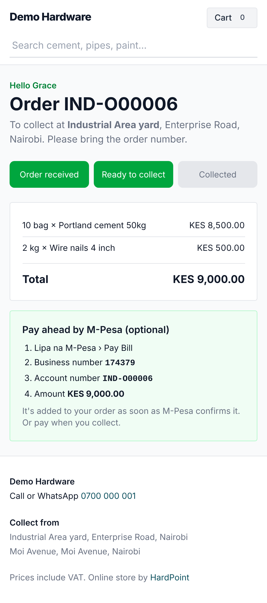

## Phase 13: tool hire

*Removed in [Phase 30](#phase-30-tool-hire-loyalty-points-and-the-customer-display-removed).*

- **Tools for hire** (Settings › Tools for hire): each concrete mixer, compactor or scaffold set with an asset tag,
  branch, daily and optional weekly rate, deposit and status (available, on hire, in maintenance, retired), with what
  it has earned
- **Hiring out** (Hire › New hire): pick or add the customer, record their ID number and site, choose the tools and
  when they're due back, take the deposit (cash, M-Pesa or card) and print the A4 agreement with terms and signatures
- **While out:** extend the due date, see what's overdue, and send a reminder text (at most once a day)
- **Returns** tool by tool, with a note on condition and any damage charge; damaged tools go to maintenance. A day is
  24 hours from going out with an hour's grace, and never more than the weekly rate per week
- **Settling up** happens at the till, like collecting an order: the charges become lines such as "Tool hire · Plate
  compactor CMP-01, 3 days", the deposit counts towards them and any balance left over is refunded from the order

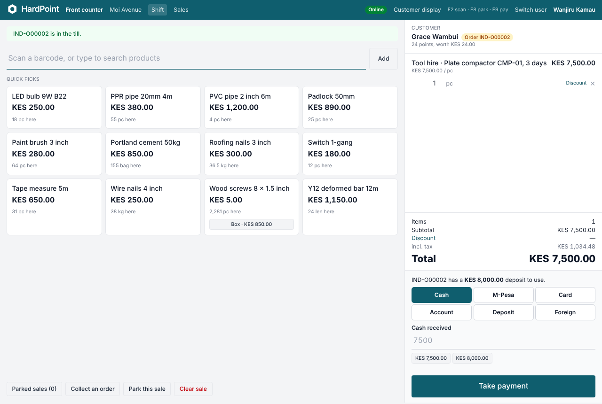

## Phase 14: contractor jobs

- **Jobs** (Sales › Jobs, or **Add a job** on a customer): a contractor's project, with their reference or LPO number,
  the site and an optional materials budget
- **At the till**, once the customer is chosen, a **Job** list shows their open jobs, with the budget left; the sale
  counts towards the job and the job is printed on the receipt and the A4 tax invoice. Quotes and orders can be for a
  job too, and carry it to the till when collected
- **The job page** shows what it has cost against its budget (sales less returns), every material that went into it
  product by product, its sales and returns, and open quotes. The **cost summary** PDF lists the same for the
  contractor to keep or pass on to their own client
- Finished jobs are closed so they stop showing at the till; the API lists jobs with their spend and filters sales
  by job

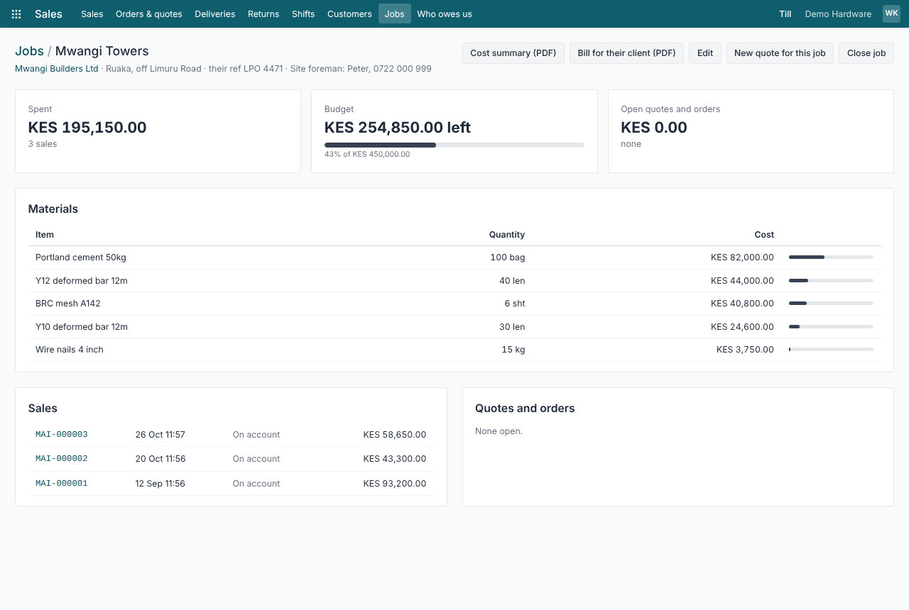

## Phase 15: stock on the phone

- **HardPoint Stock** at `yourshop.hardpoint.app/m`: a phone-sized part of the app, opened from the QR code on the
  Stock page and added to the home screen like an app. It scans barcodes with the phone's camera (Chrome on Android);
  on other phones you type the code or pair a Bluetooth scanner
- **Look up:** scan anything on the shelf for its price, pack prices, cost (for those who may see it), stock at every
  branch with what's on order, and its latest movements
- **Count:** scan through a stock take shelf by shelf. Counts are blind (the expected quantity isn't shown), a box's
  barcode counts as the box, and **Add to count** lets two people count the same product in different places at once
- **Receive:** check a delivery in against its purchase order by scanning, with what's still to come beside what
  arrived, then record it with the supplier's delivery note number; it becomes a goods received note as on the desktop

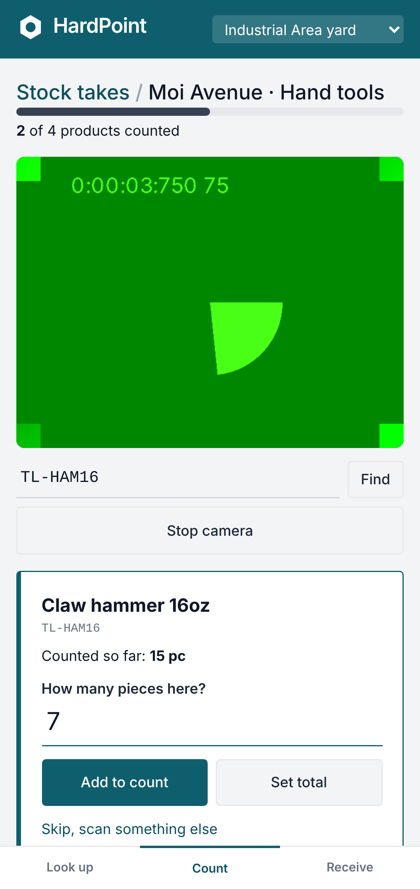

## Phase 16: batches and expiry dates

- **Per product:** tick **Batches and expiry dates** for things that go off or get recalled (tile adhesive, sealants,
  paint, chemicals, fertiliser)
- **Receiving** (on the desktop or the phone) asks for the batch number and expiry date printed on the goods
- **Selling** needs nothing extra at the till: stock goes out first-expiring-first, skipping expired batches, and each
  sale remembers which batches it took. Voids, returns and transfers put stock back into, or carry it to, the same
  batches
- **Stock › Expiry** lists what's expired or expiring in 30 days at a branch, with its value; a batch's page writes it
  off (expired or damaged) and, for a recall, lists **who bought it** with their phone numbers
- Stock that was on the shelf before batches were tracked is kept "not in a batch" and sold first

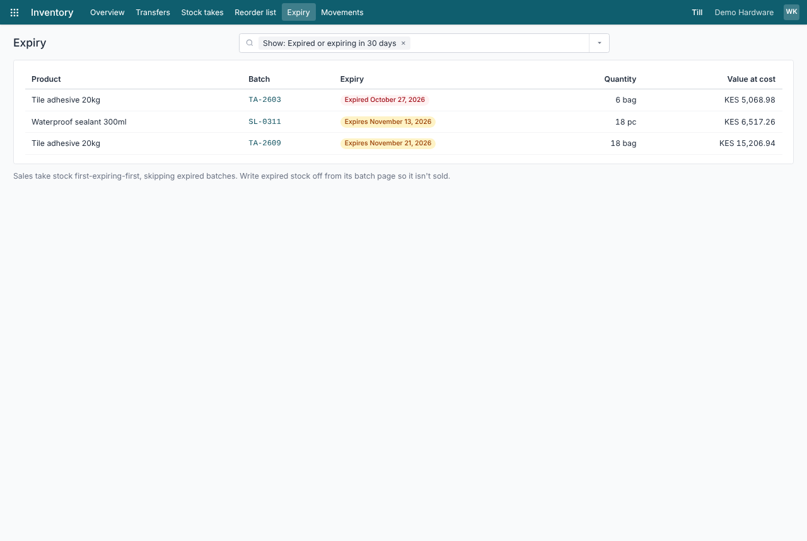

## Phase 17: room to grow

- **A read replica** for reports and data exports, so month-end reports never slow the tills. Row-level security
  holds on the replica: `Account.reading` sets the shop on the replica's own connection, and a replica connection
  without one sees nothing (checked against a real streaming standby, and by tests on a separate connection)
- **Scaling out with Kamal:** `config/deploy.scaled.yml` puts the database, a streaming replica, two web servers and
  a jobs server on their own machines (`bin/kamal deploy -d scaled`); the replica clones itself from the primary on
  first start
- **Uploads on object storage** (Contabo Object Storage, R2 or S3) once there are two web servers, with
  `bin/rails storage:copy[local,object_storage]` to move existing files
- The admin **Database** page shows whether reports read from a replica and how far behind it is
- [RUNBOOK.md](RUNBOOK.md) section 6 is the step-by-step, including when to grow, the connection budget and
  how to go back

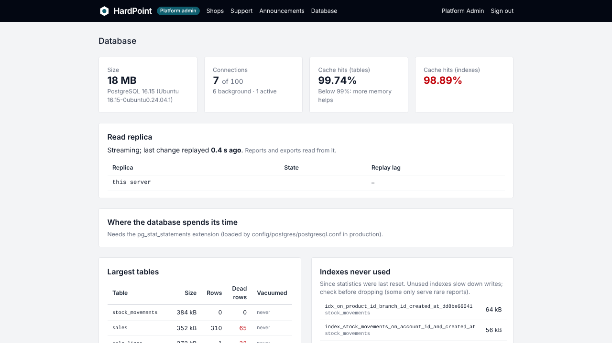

## Phase 18: foreign currencies

- **Settings › Currencies:** dollars, Ugandan and Tanzanian shillings and any other currency, with what one unit is
  worth in shillings; owners and managers update the rate, and every change is in the activity log
- **At the till**, a **Foreign** tender takes notes in any currency the shop accepts: the till shows what they're
  worth and the change, which is given in shillings. The receipt shows the notes and the rate
- **The drawer** is counted per currency at close (still blind); the X and Z reports show foreign notes expected,
  counted and over or short, and the shilling change given for them
- **Suppliers who invoice in dollars** (importers): their orders, invoices, payments and balance are in their currency;
  goods are received at the day's rate, so stock is costed in shillings with transport added; input VAT and the
  "what we owe" totals convert
- Each payment, order, receipt and invoice keeps the rate it used, so changing a rate never rewrites history

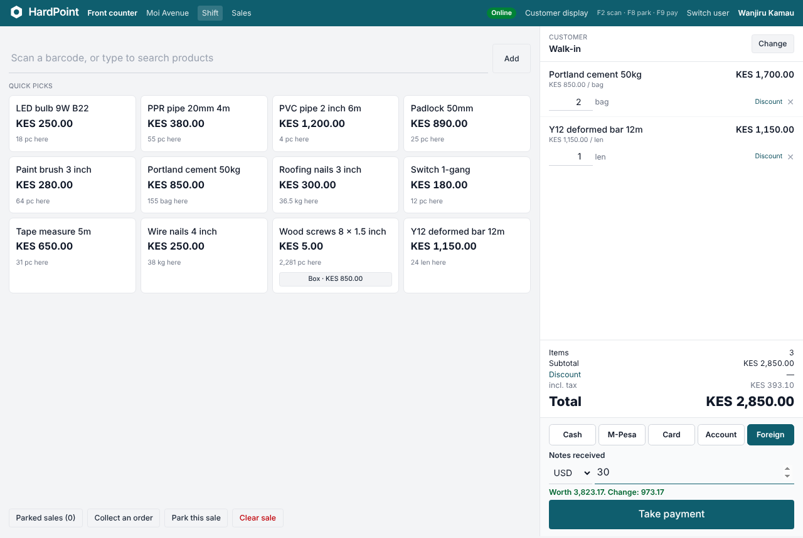

## Phase 19: promotions

- **Products › Promotions:** a percentage off, or "buy 10, get 1 free", on chosen products (by SKU or barcode) or whole
  categories, between two dates, at every branch or some; owners and managers set them up, everyone can see them
- **At the till** nothing needs doing: each line gets the promotion that saves the customer most, shown on the line.
  Promotions are kept apart from hand discounts, so they never need a manager's PIN, and a contractor on a price list
  gets whichever is better, their price or the offer, not both
- **Receipts** show each saving and "You saved" at the bottom (printed and ESC/POS); invoices, KRA eTIMS, returns and
  reports all see the lower totals
- **Quotes, orders and the online store** get percentages off, with the old price struck through in the store
- Each promotion's page shows its sales, units, what it gave away and its takings; used promotions end rather than
  disappear

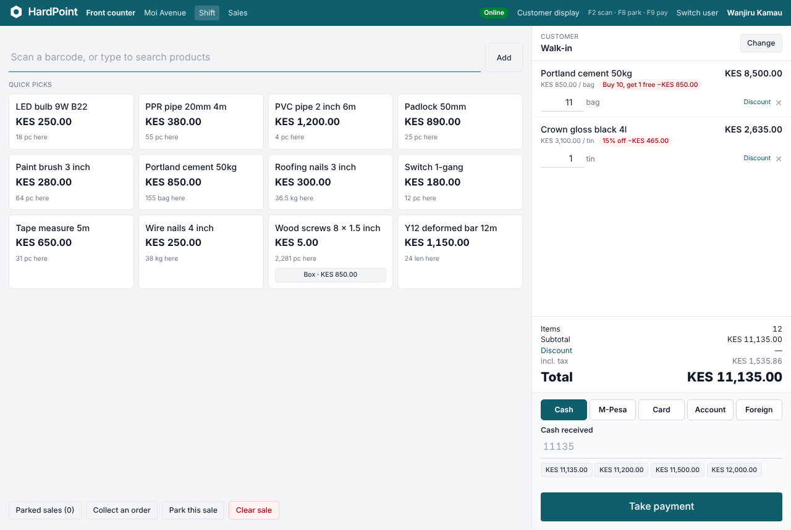

## Phase 20: loyalty points

*Removed in [Phase 30](#phase-30-tool-hire-loyalty-points-and-the-customer-display-removed).*

- **Settings › Loyalty points:** points per KES 100 spent, what a point is worth, and the minimum to spend; the page
  shows what the scheme gives back (1% by default), how many customers have points and what unspent points are worth
- **Named customers earn** on every completed sale in their name, on what they paid for (not the part paid with points);
  voids take the points back and give back any spent, and returns take back their share
- **At the till** the customer's balance shows under their name, and a **Points** tender spends them like money, in whole
  points and never more than the balance; the receipt prints points earned and the new balance
- **The customer's page** lists every change with its sale or return; owners and managers can adjust with a reason
  (logged in the activity log)

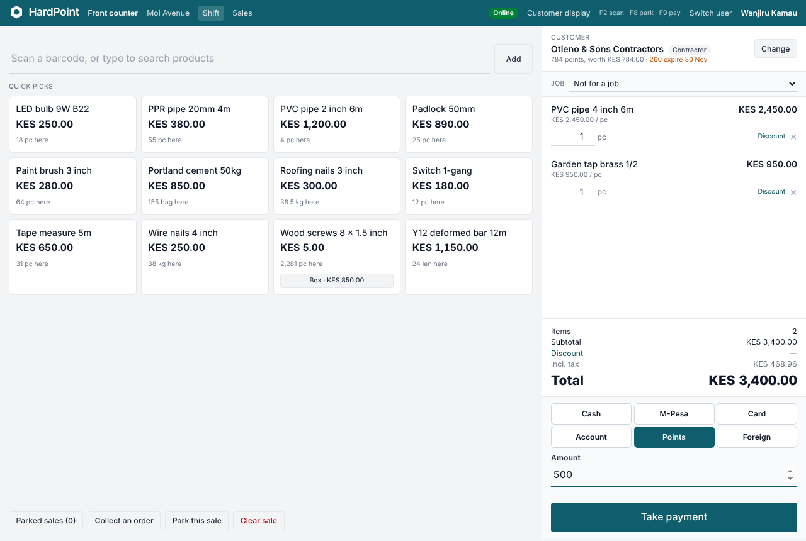

## Phase 21: the offline till catches up

- **Customers offline:** the offline till finds customers by name or phone from its snapshot; their price list applies,
  the receipt carries their name, and their loyalty points are earned when the sale reaches HardPoint
- **Promotions offline:** the snapshot carries promotions running now or starting in the next two weeks, and the till
  checks the dates itself on the day it sells; the best offer per line, "You saved" on the receipt, exactly as online
- **The same sums:** the offline arithmetic mirrors the server's rules for price lists and promotions, with shared test
  cases in Ruby and JavaScript; checked end to end in a browser with the server stopped (KES 10,835.00 offline, KES
  10,835.00 recorded, points earned, no warnings)
- On sync, a promotion that wasn't running on the day of the sale is flagged in the sale's warnings; the snapshot's
  version now changes with customers, price lists and promotions (to the microsecond)

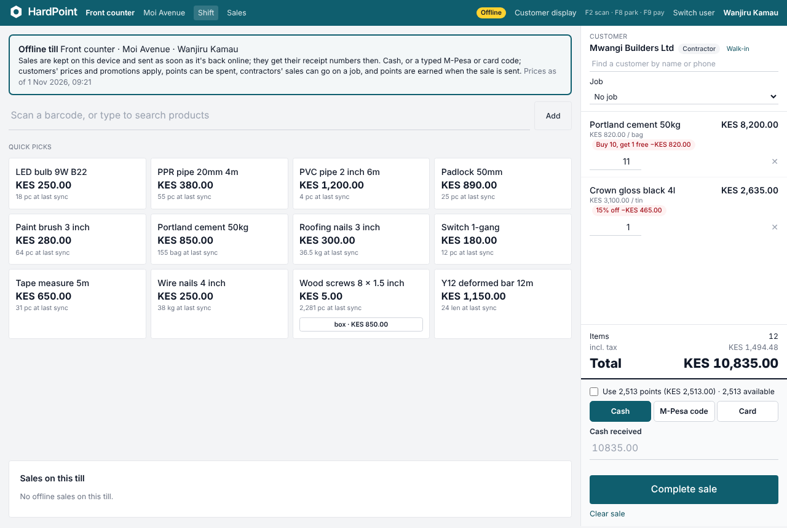

## Phase 22: returns to suppliers

- **Purchasing › Returns:** damaged, wrong, faulty or unordered goods go back to the supplier, from the delivery they
  came on (its products listed, at what was paid) or by scanning; batch-tracked goods can come out of a chosen batch
- **Recording a return** takes the goods out of stock ("returned to supplier" in the ledger) and raises a **debit note**
  for what they cost plus VAT, which comes straight off what the shop owes the supplier (settling the oldest invoice
  first) and off the period's input VAT on the VAT report
- **The debit note** is an A4 PDF on the shop's letterhead, emailed to the supplier when it's recorded (or later);
  suppliers in dollars get it in dollars
- When the supplier's **credit note** arrives, its number and date are noted; the list shows what's still waiting
- Also fixed: purchase-order emails to suppliers in another currency showed amounts in shillings

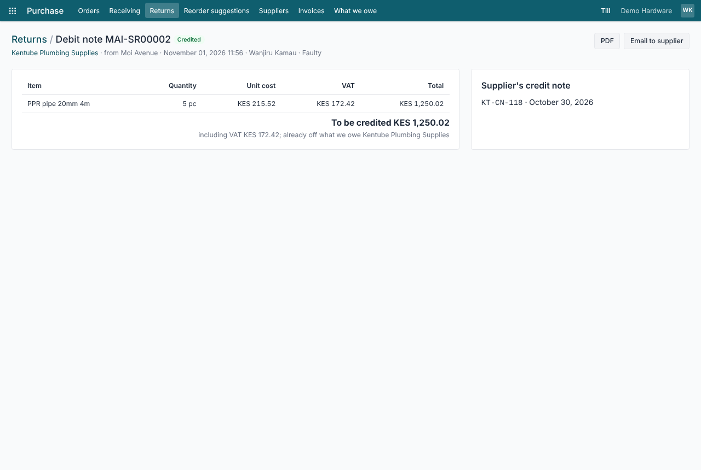

## Phase 23: points that expire, and texts about them

*Removed in [Phase 30](#phase-30-tool-hire-loyalty-points-and-the-customer-display-removed).*

- **Settings › Loyalty points** can make points expire 6 to 36 months after the month they're earned in; oldest points
  are spent first, and points customers already hold count from the day the rule is turned on or shortened
- A nightly job expires what has run out (an "expired" entry in the customer's points history, safe to run twice) and,
  in the last 14 days of a month, texts each customer whose points run out at its end, once
- With **Text customers about their points** ticked, a named sale texts the points earned, the balance and when the next
  points run out; anyone can text a customer their balance from the customer page
- The customer page and the till show when points next run out; the settings page shows what runs out this month and
  what expired in the last year

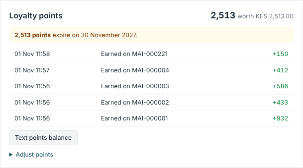

## Phase 24: mix-and-match bundles

- **A third kind of promotion:** any N of the chosen products and categories together for one price ("any 3 Stanley tools
  for KES 3,000"), with dates and branches like the others
- **Across the sale:** the till works bundles out over all the lines whenever the cart changes, filling them with the
  dearest items first and sharing the saving across the lines in proportion to their cost; extra items pay full price
- **No stacking:** a line is in one promotion at most, and a bundle only takes lines whose own promotions save less;
  packs, hand-discounted lines and order lines stay out
- **The offline till** works bundles out the same way (shared test cases in Ruby and JavaScript), and the server keeps
  what it charged

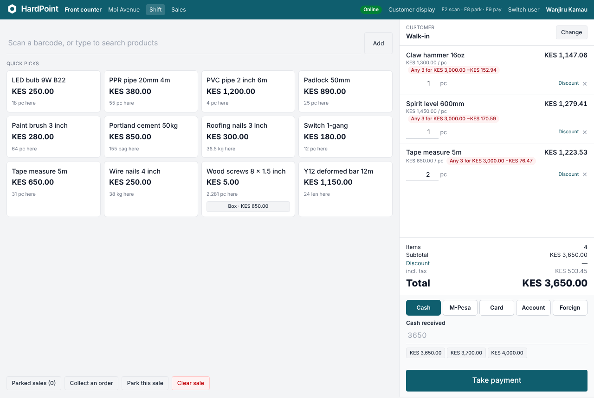

## Phase 25: spending points on the offline till

*Removed in [Phase 30](#phase-30-tool-hire-loyalty-points-and-the-customer-display-removed).*

- The till's snapshot carries each customer's **points balance** and the scheme's terms; the offline till takes off
  what sales on that device have spent since, and offers "Use 2,513 points (KES 2,513.00)" with the rest paid as usual
- The same arithmetic as the server (whole points, rounded up, capped by what's due and the balance; shared test cases)
- When the sale is sent, points are spent as at the till; if the customer spent them on another till meanwhile, the
  shortfall stays owed (cash pays only what the till charged it with, so the change given stays right) and the sale is
  parked with a warning for a manager

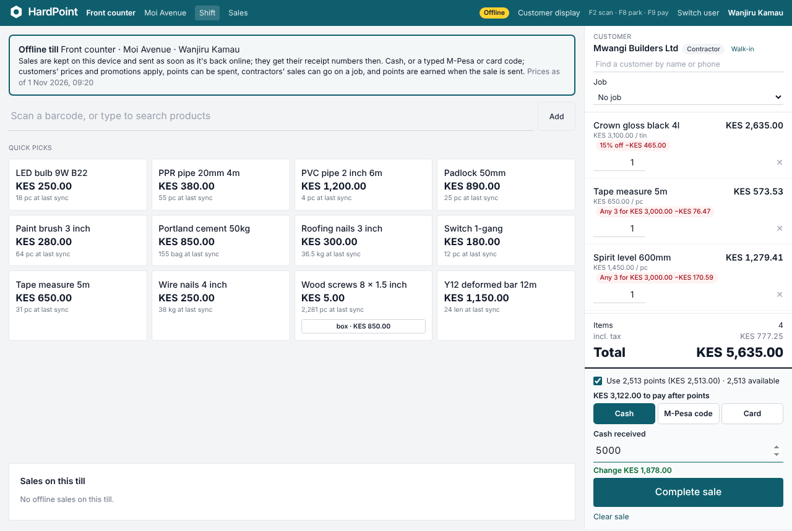

## Phase 26: counting by batch

- **Stock takes** list batch-tracked products batch by batch: every batch in stock when the count started (with its
  expiry date), plus stock not in a batch; the product's line totals its batches
- Batches found on the shelf that never came in on a delivery are added with their number and expiry, on the page,
  by scanning with the batch number, or on the phone ("Which batch?")
- **Approving** corrects each batch to what was counted (one ledger line per batch); new batches join first-expiring-
  first selling, and a batch sold from during the count never goes below nothing
- Uncounted batches are left as they are, as uncounted products are

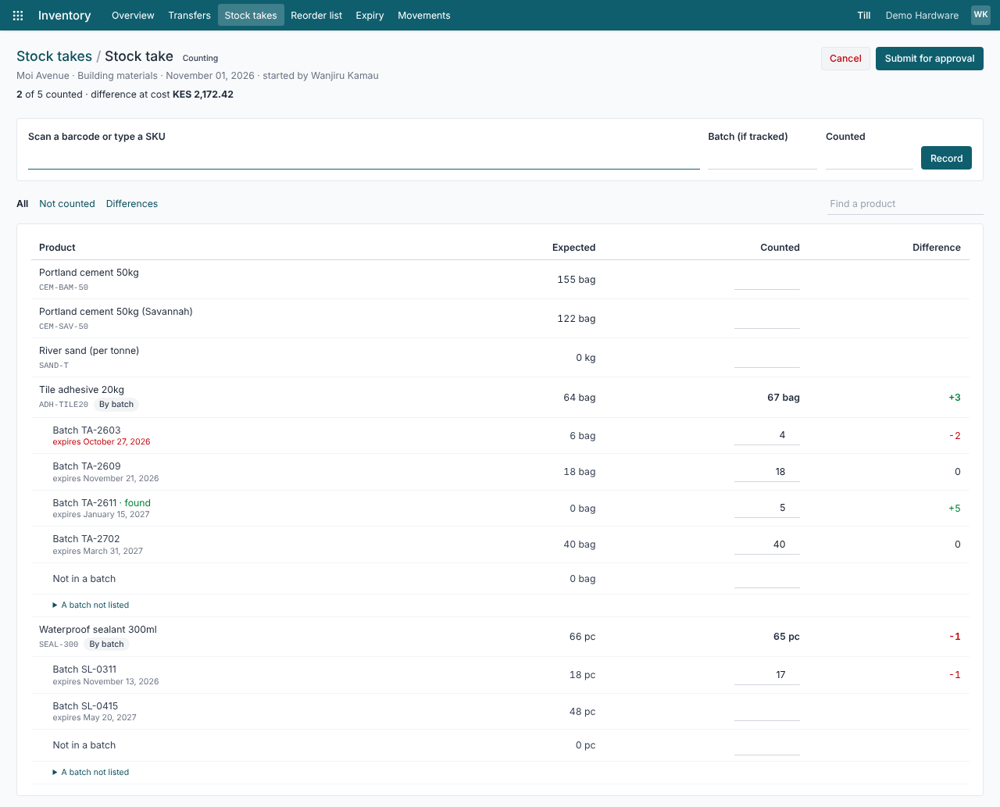

## Phase 27: jobs for contractors, continued

- **A bill for the contractor's client:** each job can name the client and a markup on materials; the job page then
  gives a materials bill as an A4 PDF on the contractor's own letterhead, every material (net of returns) at the shop's
  price plus the markup, without printing the percentage
- **Jobs on the offline till:** the till's snapshot carries each customer's open jobs, the offline till shows the same
  Job list as online, and the job is on the receipt; a job closed before the sale is sent is left off with a warning

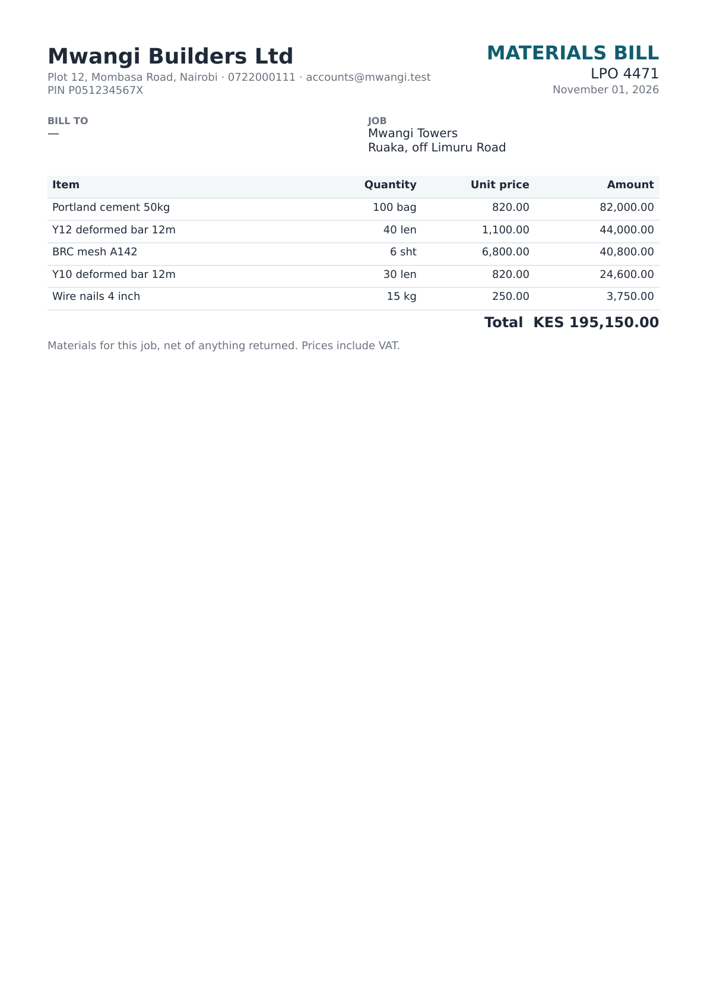

## Phase 28: the daily exchange rate

- **Each morning** a job fetches market rates from a public feed (open.er-api.com by default, one request per home
  currency for all shops) and shows the market rate under each of the shop's currencies
- **Following the market:** a currency can follow the daily rate less a margin (1.5% off the dollar, say), or take the
  market rate once with a click; moves of more than 10% in a day are held until a manager applies them
- A feed that's down or returns nonsense changes nothing

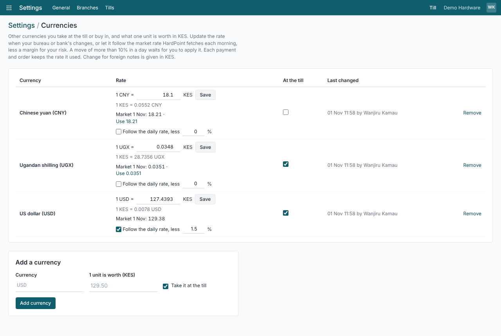

## Phase 29: shop-editable hire terms

*Removed in [Phase 30](#phase-30-tool-hire-loyalty-points-and-the-customer-display-removed), with tool hire.*

- **Hire terms** (owners and managers; ⚙ on Tools for hire, or Settings): the shop writes the numbered terms printed on its
  hire agreements, one per line, with a preview of how they'll print. Until it does, the standard terms apply, and it can
  go back to them at any time
- **Each agreement keeps the terms it was made under**, so editing them never changes what a customer signed; agreements
  from before this print the standard terms they were signed with

## Phase 30: tool hire, loyalty points and the customer display removed

- **Tool hire is gone:** tools for hire, hire agreements, returns, settling hire at the till, overdue texts, hire terms
  and the "Hiring out tools" guide. Its tables are dropped
- **What stays:** the "hire" orders it created, with their deposits, payments, receipts and KRA eTIMS invoices (marked
  "for a tool hire (no longer in HardPoint)"), the "Tool hire" product their lines sold, texts in the SMS log, and
  activity entries, which still read sensibly
- **Loyalty points are gone:** the scheme in Settings, earning and spending at the till and on the offline till, points
  on receipts and customer pages, points texts and the nightly expiry, and the "Loyalty points" guide. Payments made
  with points stay on their sales, receipts, the payments report and eTIMS; a till that still offers points after the
  change has that payment refused and the sale recorded with the amount owed
- **The customer display is gone:** the second-screen page and the till's link to it
- **Labour lines** on a contractor's client bill are dropped from the backlog

## Phase 31: WhatsApp, transport, bulk prices, QuickBooks and Airtel Money

- **WhatsApp:** a button on receipts (and the till's completed sale), quotes and orders, statements, purchase orders
  and delivery notes opens WhatsApp addressed to the customer or supplier, with a short message and a link to that
  document. The link works for 30 days and shows only that document
- **Transport charges:** **Add transport** on the till puts the delivery charge and destination on the sale; a
  **Transport charge** on a delivery note made later becomes an order for the customer, collected at the till or put
  on their account
- **Change prices:** from the Products ⚙ menu, raise or lower prices for every product, a category, a brand or a
  supplier by a percentage or an amount, rounded to the nearest 100, 500, 1,000 or 5,000, with or without pack prices
  and price lists, after a preview of every old and new price
- **QuickBooks Online export** under Reports: a zip of journal entries, customer and supplier lists and a list of
  anything skipped, with the shop's own QuickBooks account names
- **Airtel Money:** connect a merchant account in Settings, send a payment prompt from the till or type the transaction
  ID, and use payments that arrive after the till stopped waiting. It is a payment method wherever M-Pesa is, and on
  the offline till
- **Help for the whole app:** eleven new guides (Airtel Money, QuickBooks Online export, Sending documents on WhatsApp,
  Changing many prices at once, Deliveries and transport charges, Products and the catalogue, Customers, Shifts and
  cash, Returns and refunds, Shop settings, and Your profile and signing in), so every menu and Settings page has one.
  All 34 guides are also in one document, [USER_GUIDE.md](USER_GUIDE.md), rebuilt by `bin/rails help:export`

## Since then: the new look, lists and help

- **Packaging for sale:** products no longer count towards any plan (a hardware shop carries thousands of lines).
  A shop that needs one more till or branch than its plan allows buys it as an **add-on** on the Billing page
  (a till KES 300, a branch KES 750 a month) instead of moving up a plan, and can
  choose **yearly billing** at ten months' price for twelve. The pricing page sells a **setup and training visit**
  (from KES 15,000, free with a year paid upfront) and a quoted **till kit**; platform staff bill those from the admin
  as one-off invoices, paid like any other

- **Apps instead of one long menu:** the back office is a home menu of apps (Point of Sale, Sales, Products, Inventory,
  Purchase, Reports, Employees, Settings, Help), each with its own menu in the top bar; people only see the apps their
  role uses. The colours moved to petrol teal across screens, reports, PDFs, emails and print pages ([BRAND.md](BRAND.md))
- **List pages** share one control panel: a search bar that shows active filters as removable tags, a Filters dropdown and
  a pager; Products, Purchase orders and Orders & quotes also **Group By** (category or brand; supplier or status; status or
  customer), with a count and total per group
- **Hardening:** concurrency, connection pools and memory use
- **Help centre:** guides for getting around, stock and stock takes, buying from suppliers and reports; every menu path
  checked against the current screens; search over each guide's full text; and "next" and related guides at the end
  of each one

## Simpler to use

The plan and its reasons are in [SIMPLIFY.md](SIMPLIFY.md).

- **Six areas instead of eleven apps:** Home, Sell, Customers, Stock, Buy and Reports in the top bar, each area's menu
  underneath, Settings under the gear. Pages that were in two menus have one home; old addresses redirect
- **Needs you today:** Home lists what to act on (low stock, overdue customers and suppliers, eTIMS refusals, stock takes to
  approve, shifts left open, orders to collect, deliveries), each with its button. Cashiers get one big **Start selling**
- **Settings › Features:** deliveries, promotions, currencies, the online store, jobs, batches, serial
  numbers and the API are switched on per shop; one that's off leaves the menus, Settings, Home and forms
- **One Reorder page** that drafts an order for every supplier in one click
- **A shorter product form** with opening stock, and **Add and start another**
- **Search (Ctrl K)** for products, customers, suppliers, document numbers and pages

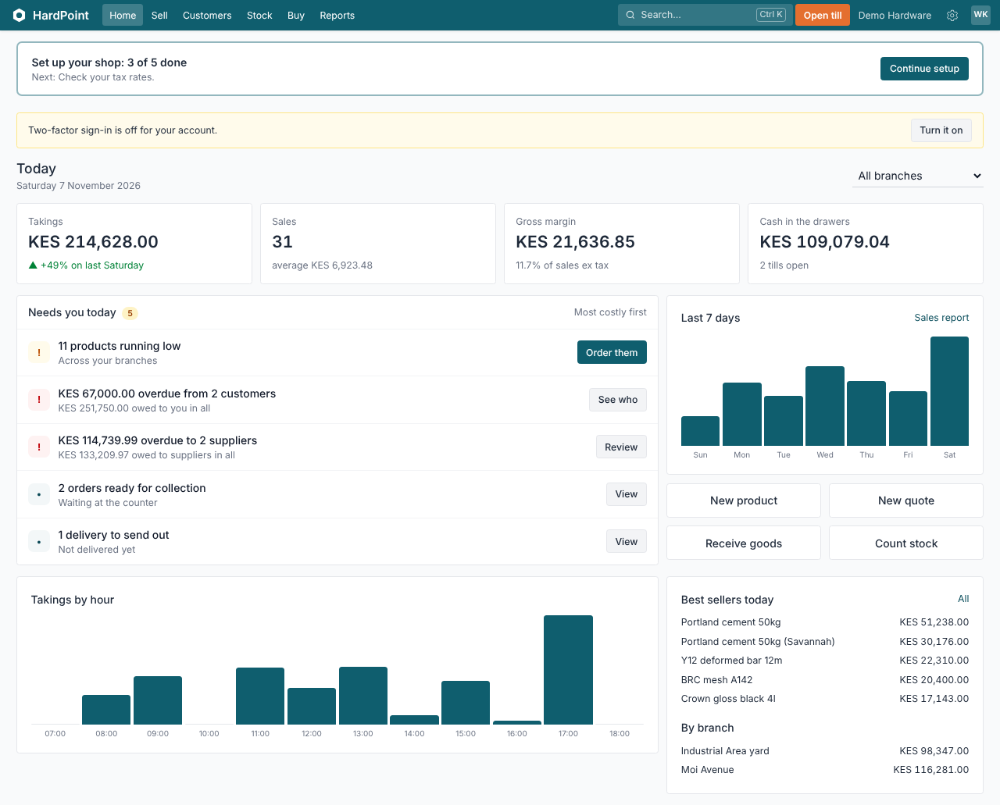

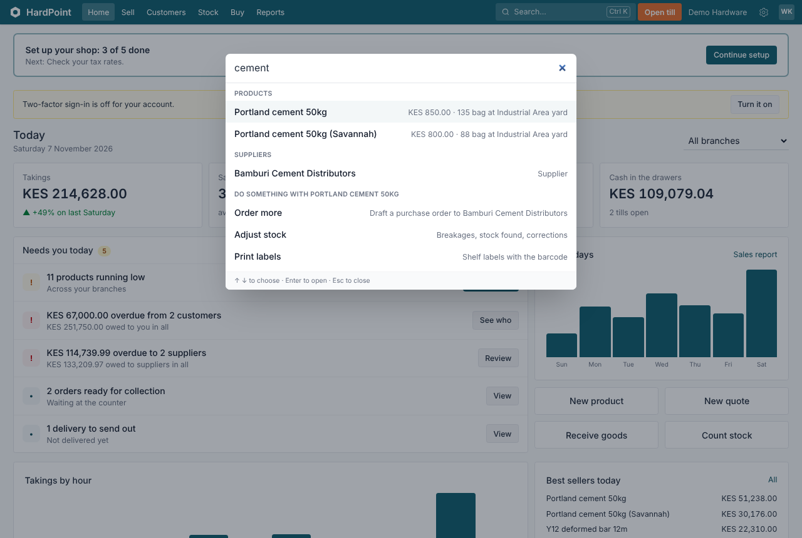

## Touch screens

- **Categories at the till:** Quick picks and every top-level category with something to sell are tabs above the
  products; a category includes its subcategories' products
- **+ and − on each line**, and a bigger remove button
- **A number pad** for cash received and other amounts on touch screens, opened by tapping the amount or the pad button
  and remembered per till; the device's own keyboard no longer covers the till
- **Finger-sized controls:** buttons and fields are at least 44 px tall wherever the screen is touch, and iPhones and
  iPads no longer zoom into fields
- **Every screen size:** the till fills the screen under any banner, so **Take payment** is never cut off; products sit
  beside the sale from tablets up, with the tiles sized by the space they have; phones get **Products** and **Sale** tabs.
  The offline till stacks on phones too

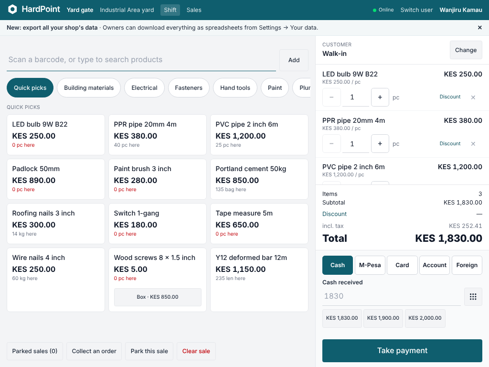

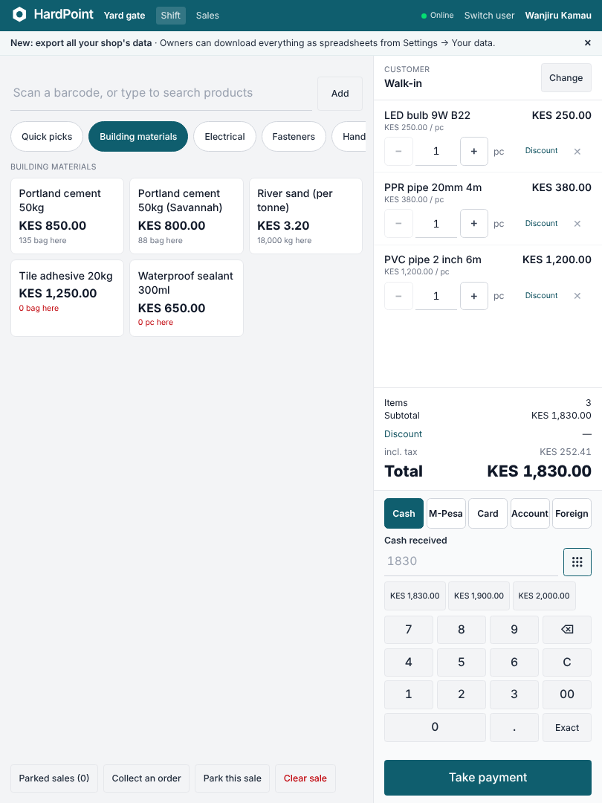

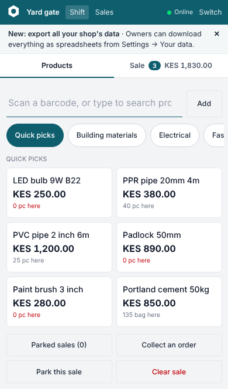 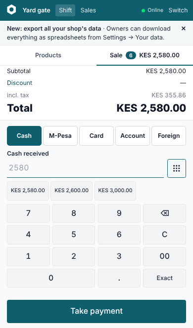

Screenshots of every screen are in [screenshots](screenshots).

## Since then: signing in and adding customers at the till

- **Change password** on My profile: checks the current password, needs at least 10 characters, and signs the person out
  everywhere else
- **Lost phone and recovery codes:** an owner resets two-factor for staff who work only for their shop (Settings › Staff,
  confirmed with the owner's password); HardPoint support resets anyone else from the admin. Either way the person is
  signed out, emailed, and the reset is in Activity. Not while support is signed in as the shop
- **New customer from the till** opens with the name or phone that was searched, and **Add and use on this sale** goes
  straight back to the till with the customer on the sale

## Since then: shops' own backups

- **Backups** under Settings › Your data: automatic every day, week or month at 02:00 in the shop's time zone, and
  **Back up now** whenever an owner likes. Each is a ZIP of every record and file with a manifest of SHA-256 checksums
  and row counts, read from one consistent snapshot, checked before and after it's stored
- Owners choose how many automatic backups to keep (manual ones stay 30 days; the newest good one is never deleted),
  and whether they're emailed after every backup or only when one fails. A failure is retried three times, then every
  owner is emailed and support gets the details
- Downloads and deletions are in Activity; backups go to their own storage bucket when `BACKUP_STORAGE_SERVICE` is set

## Since then: guided tours and walkthroughs

- **Walkthroughs in the help centre:** the guides to finding your way around, selling at the till and products open with
  a screenshot of the real screen. Numbered hotspots pulse on it; **Show me how**, a hotspot, ‹ › or the arrow keys
  light up one step at a time, dim the rest, and a pop-up with an arrow says what that button does. On phones the pop-up
  sits under the picture. The steps are written out underneath too, for reading, searching and the printed user guide.
  The help centre's front page has a **Show me how** row leading to each one
- **Guided tours in the shop:** **Guided tours**, under your name (or search for it), runs the same steps over the live
  screen: the screen dims, the real button is lit up, and the pop-up points at it. Next, Back, → ←, Esc to stop. Steps
  for buttons someone's role or screen size hides are skipped, and accountants aren't offered the till. The till's
  tour waits while the device chooses its till or opens a shift, then starts
- **One source:** each tour is a few lines in `config/help_tours.yml`, pointing at `data-tour="…"` markers on the
  screens. `bin/rails help:screenshots` retakes every tour's screenshot from the demo shop and measures where each step
  is; tests fail if a marker goes missing from its screen or a step isn't on its screenshot
- **Help** under your name, and in search, now opens the help centre: it used to look for it on the shop's own address

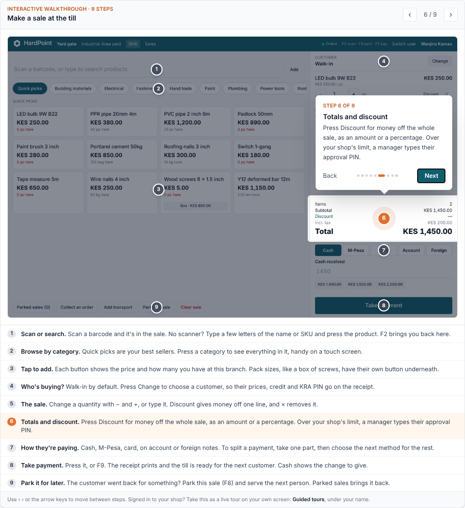

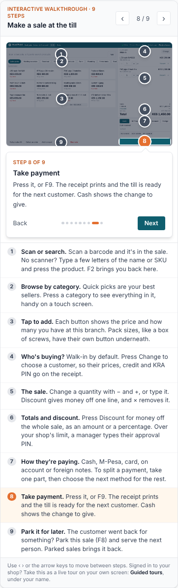

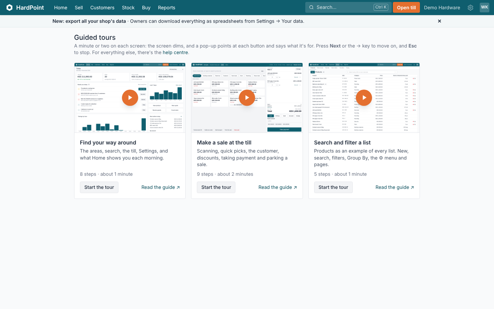

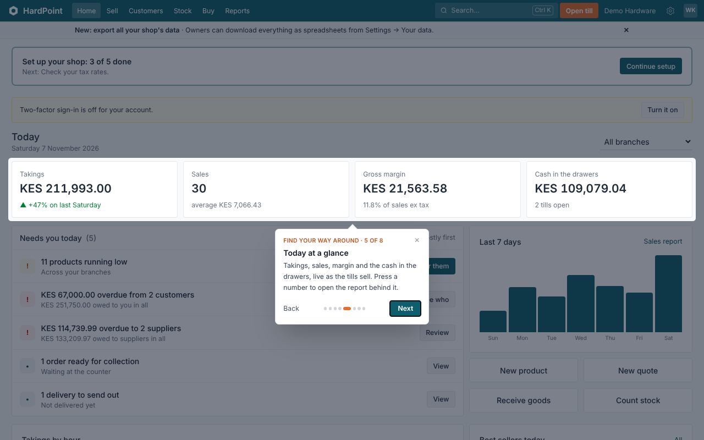

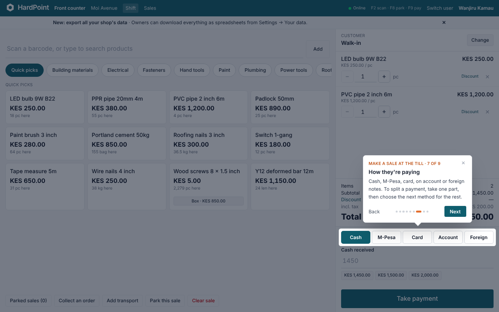

## Since then: tours of stock takes and receiving goods

- **Count stock:** a tour of a stock take being counted: how far it's got, scanning with Record (which replaces a count),
  the Not counted and Differences tabs, typing counts into the table, then Submit for approval and Approve and correct
  stock. It's in the stock takes guide as a walkthrough
- **Receive a delivery:** the supplier and delivery note, what's still to come against what arrived, unit costs,
  transport and duty spread by value, the note, and Receive into stock. It's in the buying guide as a walkthrough
- Both are offered to owners, managers and stock clerks. They start from Stock takes and Receiving, with a note
  saying what to open; the tour starts once you're there. The till's tour now says what to do too (choose the till,
  open a shift)
- A tour can run on any record's page (`page: /stock_counts/:id`), and long tables are shown from their top rather
  than centred

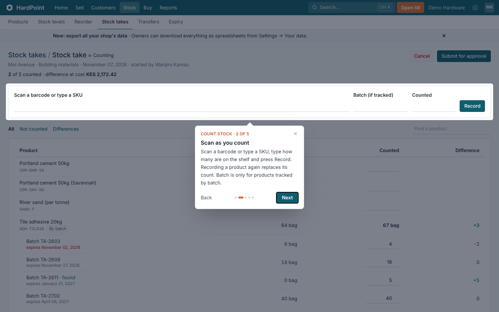

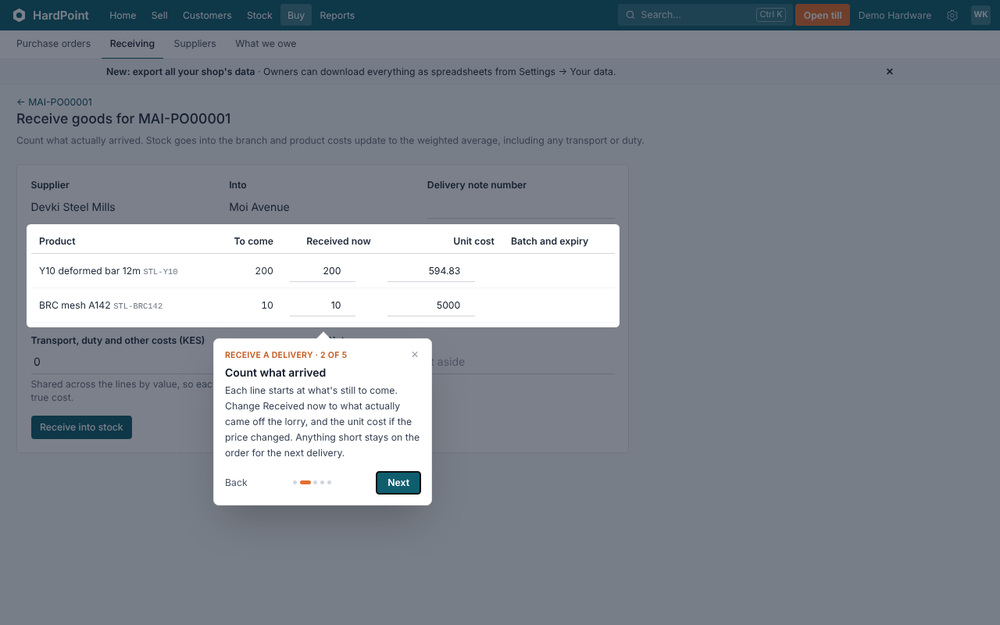

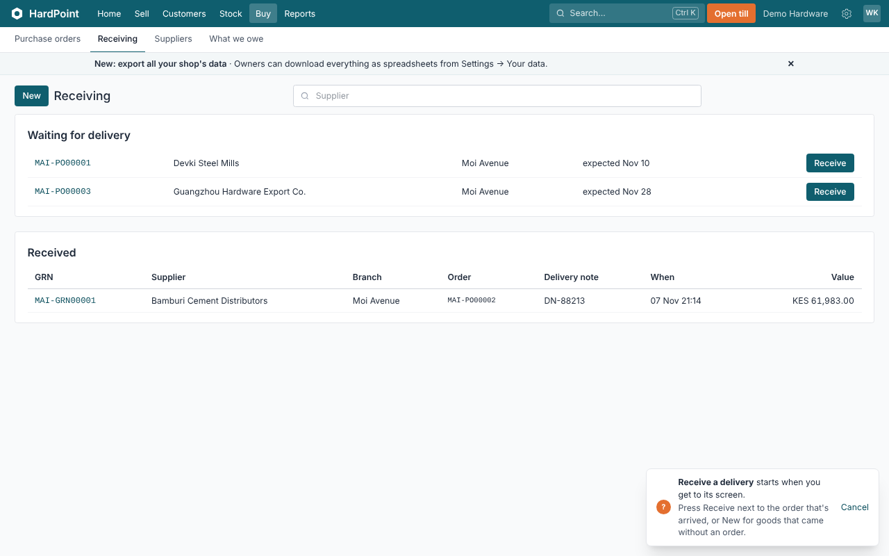

## Since then: tours of every main screen

Six more guided tours, each also a walkthrough in its guide, for 11 in all:

- **Close a shift** (shifts and cash): the blind count, foreign notes, the note, and what the Z report shows. Starts
  from the till, with a note to finish the sale and press Shift, then Close shift
- **Move stock between branches** (stock and stock takes): from and to, the products, the note, sending, and receiving
  or cancelling at the other end
- **Write a quote** (customers on account): the customer, their prices, validity and dates, and quote or confirmed order
- **Order from a supplier** (buying from suppliers): the supplier, supplier prices, delivery, and sending the draft
- **A customer's account** (customers): contact details, what they owe and can still buy on account, the buttons along
  the top, unpaid sales and recent purchases
- **Read a report** (reports): filters, the period and branch shown, the figures, and CSV, PDF and Print. Runs on
  any report

Guided tours are now grouped like the help centre (Getting started, At the till, and so on), and each tour is offered
only to the roles that can open its screen. The note shown while a tour waits for its screen sits at the top, clear
of Take payment. Pages for one record match by number, so a tour of a customer's page doesn't start on New customer.

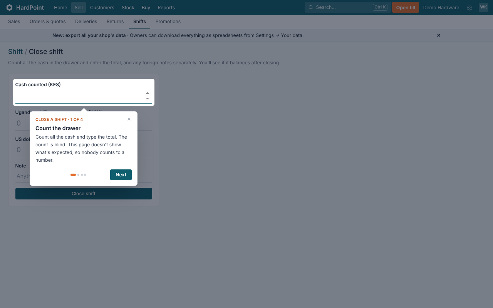

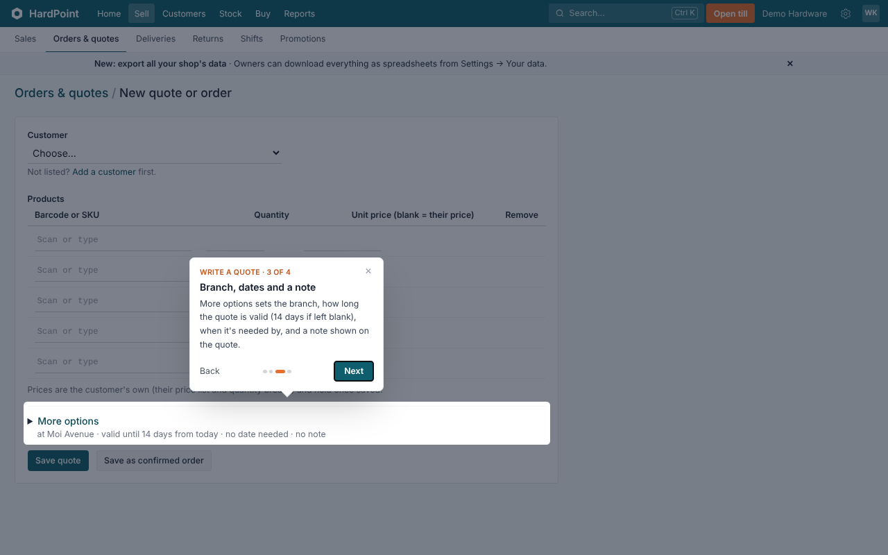

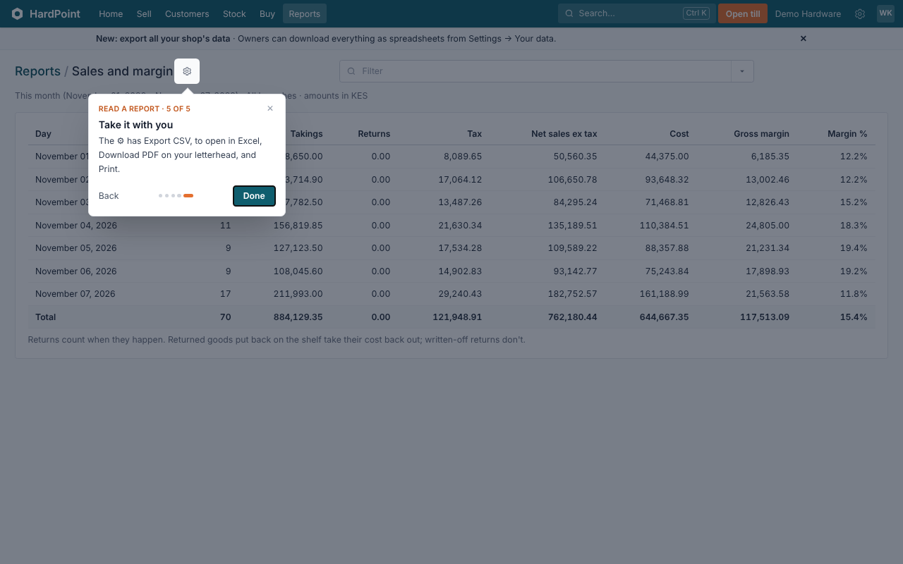

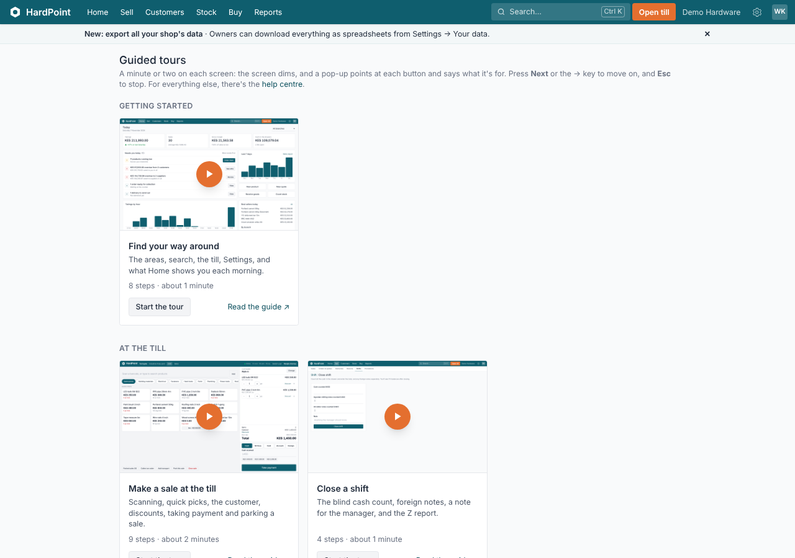

## Since then: a tour for every main guide

Four more guided tours, each also a walkthrough in its guide, for 15 in all:

- **Return goods** (returns and refunds): what's coming back, back on the shelf or written off, how the refund is paid,
  the manager's approval PIN (for cashiers and stock clerks), and Process return. Starts from Sell › Sales
- **Connect M-Pesa** (M-Pesa): adding a Paybill or Till with the Daraja keys, Receive payments and Test connection,
  and the reconciliation report. For owners
- **Find your way around Settings** (shop settings): each section, and what's in it for your role
- **Add a member of staff** (staff and roles): their login, the five roles, and the PINs they set themselves. For
  owners and managers

The screenshot script can take a screen taller than usual (Settings is), and a step only some people see, like the
approval PIN, may be left off the screenshot.

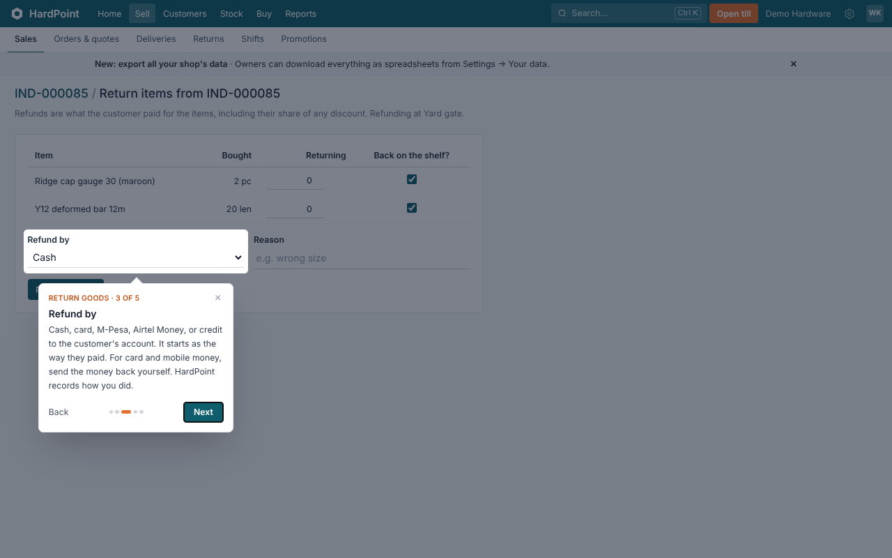

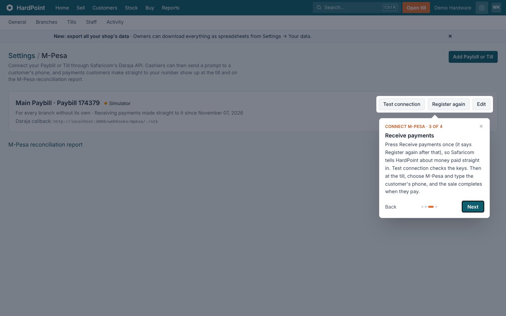

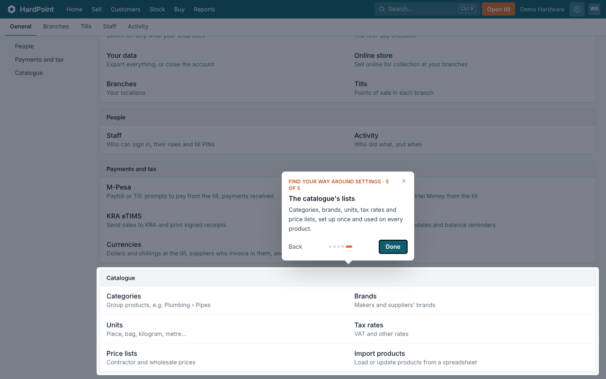

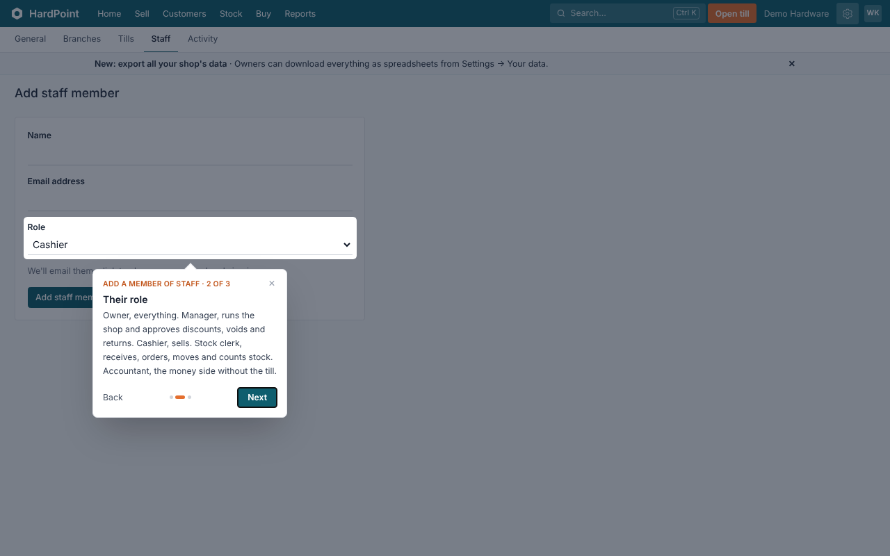

## Since then: a security, performance and accessibility review

- **Safer roles and approvals:** only owners can make, change or remove an owner. After 10 wrong approval PINs in 15
  minutes a shop accepts no approval PIN until the time passes (owners and managers can still approve by signing in).
  Removing someone signs them out of every till and phone at once. Every password needs 10 characters
- **Offline sales checked on arrival:** each goes only into a shift of the till that sends it, by someone who can sell;
  a hand discount (which the offline till never sends) is ignored and noted
- **The online store** finds a returning customer by phone but never changes their details or shows their name; what
  was typed is on the order's note
- **Spreadsheets:** exported names that look like formulas open as plain text in Excel and Google Sheets
- **Faster:** the dashboard, Who owes us, What we owe and the supplier list work out balances in a few queries for the
  whole shop; the till's product tiles read stock in one query; offline tills stop re-downloading the catalogue after
  every sale (stock refreshes within half an hour, everything else at once); the sales-by-product report is much faster
  for big catalogues
- **Easier to use with a screen reader or keyboard:** a Skip to content link, announced messages at the till and in
  the stock app, fields with errors marked in red and announced, a visible focus line, search results read out as you
  arrow through them
- **On phones and tablets:** wide tables scroll inside their card, money fields bring up the number keypad, and small
  buttons (remove a payment, filters, pager) are finger-sized; the offline till can't record a sale twice on a double
  tap

## Phases 34 to 47: ahead of the competition

Each of these is described in full, with the decisions behind it, in [PLAN.md](PLAN.md); how to use them is in the
help centre.

- **34. Stock can't go below zero, and the owner's emails:** the till refuses the one too many and keeps what was turned
  away; a morning email with charts and "worth a look", a Monday summary, and instant alerts.
- **35. Fundi commissions:** rates by category, tagging at the till, a ledger, and payouts by M-Pesa or from the till.
- **36. The material calculator:** walls, slabs, plaster, roofs, tiles and paint into materials and a quote.
- **37. Branch rebalancing:** move stock from a branch that can spare it before ordering more.
- **38. Reorder suggestions that learn:** demand, unmet demand, the season, safety stock and measured supplier lead times.
- **39. WhatsApp from HardPoint:** documents and balance reminders from HardPoint's own number, with delivery status.
- **40. Make it yours:** colour themes, a logo, and shop preferences on a refreshed Settings page.
- **41. Documents as pictures**, a receipt PDF, and a "Safe, private, and yours" section on the landing page.
- **42. Ready for the pilot:** fast search under row-level security, fewer queries, and accessibility checks in CI.
- **43. The customer portal:** a customer's own page from a link, with Pay with M-Pesa onto their account.
- **44. Credit control:** holds on accounts too long overdue, lifting a hold with a reason, and Monday reminders.
- **45. Loss prevention:** each cashier against their own usual in the morning email, and reasons for opening the drawer.
- **46. Stock held for confirmed orders:** warn or refuse at the till, and counted by the reorder list.
- **47. The shelf-label queue:** products whose price or name changed wait for a new label.

Also since then: a refreshed app menu (the shop's logo and name, bigger text, and the areas along the bottom on
phones), a rectangular receipt stamp, and a shorter landing page, since rewritten in the manner of Basecamp, HEY and
Fizzy: a plainspoken headline, an example till that shows what changes offline, the real screens with notes in marker
pen, and the price on a sticky note (docs/BRAND.md, The public site).

