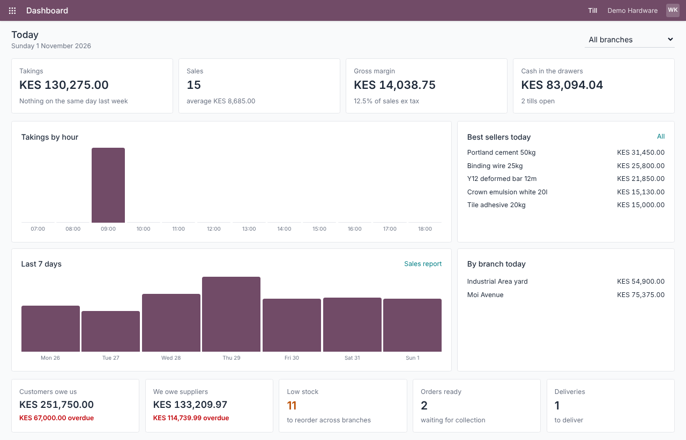
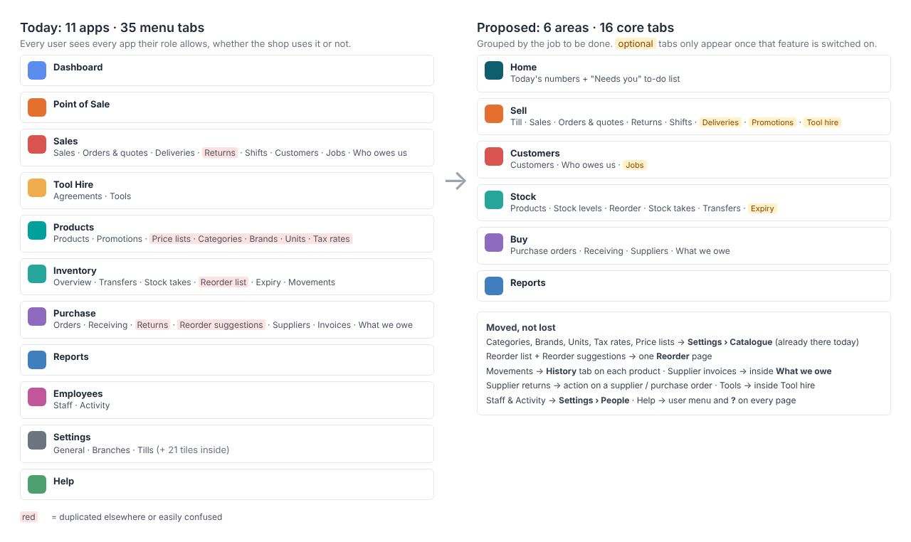
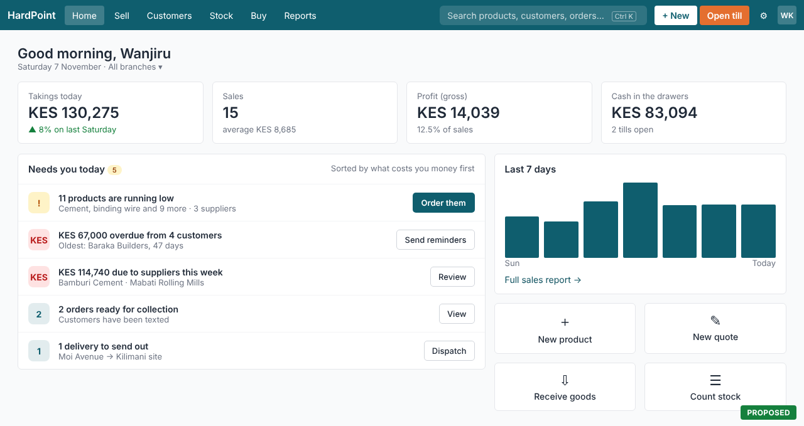
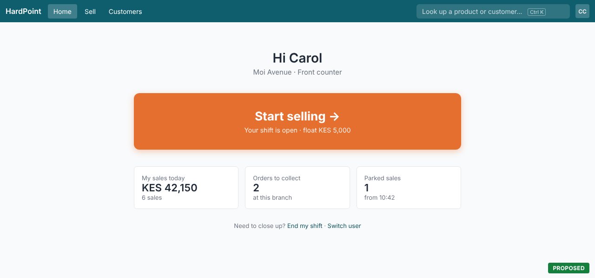
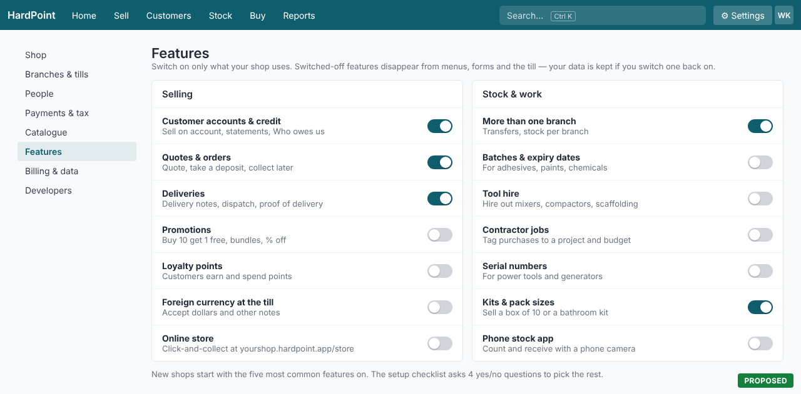
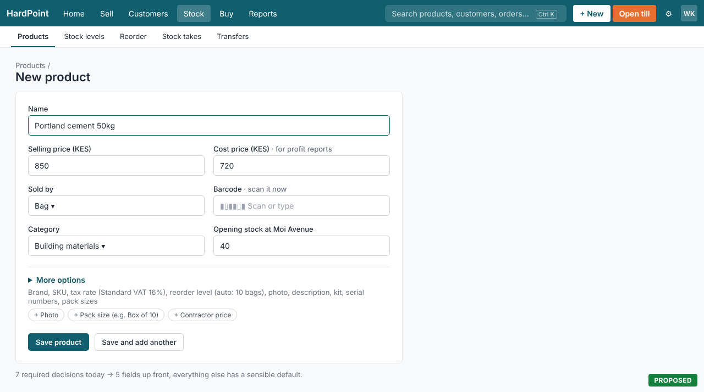
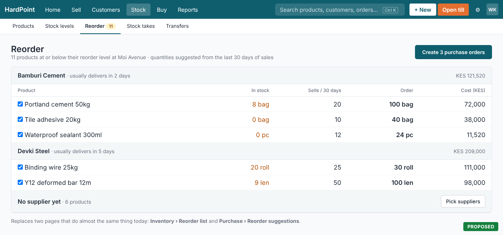
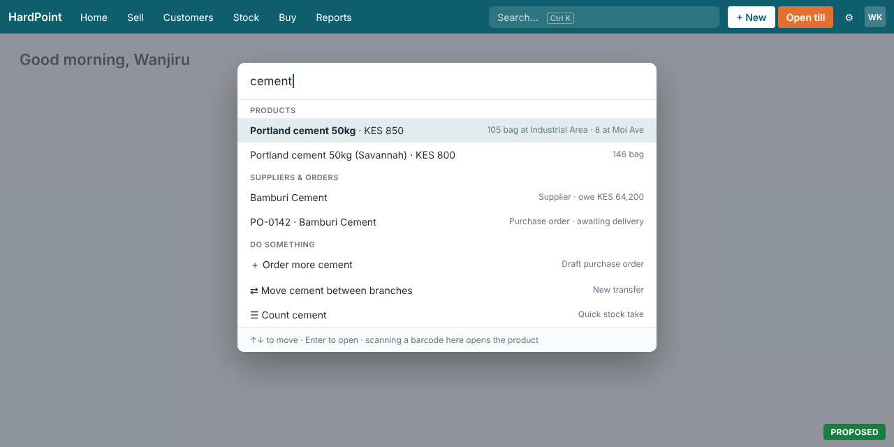

# Plan: making HardPoint simpler to use

HardPoint now does a lot: till, M-Pesa, eTIMS, quotes, deliveries, tool hire, contractor jobs, batches, currencies,
loyalty, an online store, an API. Each feature makes sense alone. Together they make the back office feel crowded,
especially for a small one-branch shop that only needs to sell, count stock and reorder.

This plan keeps every feature. It changes **what people see by default** and **how many steps the common jobs
take**. The images in [`docs/simplify/`](simplify/) are mockups of the proposed screens. Screens marked
"today" are real screenshots from `docs/screenshots/`.

**Contents:** [What makes it hard today](#what-makes-it-hard-today) · [Principles](#principles) ·
[The seven changes](#the-seven-changes) · [Order of work](#order-of-work) · [How we'll know it worked](#how-well-know-it-worked) ·
[Risks](#risks)

## What makes it hard today

From `app/helpers/navigation_helper.rb`, `app/views/settings/show.html.erb` and the screenshots:

| Problem | Where | Effect |
|---|---|---|
| **11 apps and 35 menu tabs**, behind a grid button | `navigation_apps` | People have to learn where everything lives before they can do anything. The grid hides the apps one click away. |
| **The same thing in two places** | Categories, Brands, Units, Tax rates and Price lists are in the Products menu *and* in Settings › Catalogue. "Reorder list" (Inventory) and "Reorder suggestions" (Purchase) both list low stock. "Returns" is in Sales and in Purchase. | People don't know which one is the "real" one, and the menus are longer than they need to be. |
| **Every feature is shown, used or not** | Tool Hire, Jobs, Expiry, Currencies, Loyalty, Online store, Developers… | A shop that never hires tools still sees Tool Hire. Each unused tab is noise. |
| **The dashboard shows numbers, not next steps** | `dashboards/_owner` | The owner sees "Low stock 11", "Customers owe us KES 251,750", but has to work out what to do and find the page to do it. |
| **Cashiers land on the same app grid as the owner** | `dashboards/show` (non-owner branch) | A cashier's job is the till. Everything else is a detour. |
| **Long forms** | `products/_form` asks for SKU, barcode, category, brand, unit, tax, price, cost, reorder level, description, 4 checkboxes, photo | Adding the first 50 products is slow, and the most-skipped fields sit between the important ones. |
| **21 settings tiles in one list** | `settings/show` | Setup things (branches, tax), integrations (M-Pesa, eTIMS), catalogue lists and account admin are mixed together. |

*Today: the dashboard is informative, but every card is a number to interpret, and there are no actions.*

## Principles

1. **Show what this shop uses.** Features a shop hasn't switched on don't appear anywhere.
2. **One home for each thing.** No page is reachable from two menus under two names.
3. **Name areas by the job, not the module.** *Sell, Stock, Buy* rather than *Sales, Products, Inventory, Purchase*.
4. **Every number on Home leads to an action.** "11 low" comes with an **Order them** button.
5. **Ask for the minimum, default the rest.** Forms show the fields people fill in nine times out of ten.
6. **Each role starts where its work is.** Cashiers start at the till; owners start at their to-do list.

## The seven changes

### 1. Six areas instead of eleven apps

Replace the app grid with a plain top bar: **Home · Sell · Customers · Stock · Buy · Reports**, with Settings
under a ⚙ and Help in the user menu. Nothing is deleted; the pages that appeared twice get one home.

- Catalogue lists (Categories, Brands, Units, Tax rates, Price lists) live only in **Settings › Catalogue**. They are
  set up once and rarely touched; they don't need a tab next to Products.
- **Stock › Products** and **Stock › Stock levels** sit together, because shop staff think of "the cement" and "how
  much cement we have" as one thing.
- **Movements** becomes a *History* tab on each product (people look up one product's movements, not all of them).
- **Supplier invoices** move inside **What we owe**; **Supplier returns** becomes a *Return to supplier* action on a
  supplier or purchase order, so "Returns" only means customer returns.
- **Staff** and **Activity** move to **Settings › People**.

**Code:** rewrite `navigation_apps` in `app/helpers/navigation_helper.rb` into the six areas, swap the grid button and
popover in `app/views/shared/_navigation.html.erb` for the plain menu, and keep the old paths as redirects so
bookmarks and help articles keep working. Update `docs/BRAND.md` (layout section) and the help centre.

### 2. A "Needs you today" home for owners and managers

Keep the four headline numbers, and replace the bottom row of counts with a to-do list. Each row is one thing to
act on, sorted by what costs the shop money first, with the button that does it.

Rows come from data the dashboard already loads: low stock (→ Reorder), overdue customers (→ send SMS reminders,
which already exist), supplier bills due, orders ready for collection, deliveries to dispatch, eTIMS submissions
failing, shifts left open overnight. A row disappears when there's nothing to do; an empty list says
"All caught up". Four quick actions (New product, New quote, Receive goods, Count stock) cover the most common
starting points.

**Code:** a small `HomeTasks` object next to the existing dashboard query, and a `dashboards/_needs_you` partial.
The hourly chart and best sellers move to Reports › Today, one click away.

### 3. Cashiers start at the till

Staff who can sell but can't see the dashboard get one big **Start selling** button (or **Open a shift** when they
have none), with their own day's numbers underneath. They see only the areas their role allows: Home, Sell,
Customers.

**Code:** the non-owner branch of `app/views/dashboards/show.html.erb`. Optionally, a per-till setting
"open straight into the till" for counter computers.

### 4. Switch features on and off

A new **Settings › Features** page lists the optional features with a switch each. A switched-off feature
disappears from menus, the till, forms and Home. Its data is kept, so switching it back on brings everything back.

New shops start with the common ones on (customer accounts, quotes & orders, deliveries, more than one branch,
kits & pack sizes). The setup checklist (`app/models/onboarding.rb`) gains one step, "What does your shop do?",
with four yes/no questions (Do you hire out tools? Do you sell goods that expire? Do contractors buy for
projects? Do you take dollars?) that set the rest.

**Code:** a `features` jsonb (or one boolean per feature) on `accounts`, an `Account#feature?(:tool_hire)` helper,
and guards in `navigation_apps`, the till partials and the forms. Tool Hire already does a version of this
(`Current.account.hire_items.exists?`), so the pattern is there. Existing shops are migrated with each feature on
if they have any data for it, so nothing they use vanishes.

Settings itself is regrouped into **Shop · Branches & tills · People · Payments & tax · Catalogue · Features ·
Billing & data · Developers**, with Developers hidden unless API access is on.

### 5. Shorter forms with sensible defaults

The product form shows the five fields that matter (name, prices, unit, barcode, category) plus **opening stock**,
so a new product is sellable in one step. Everything else sits under **More options**, already filled in: SKU
generated, tax = the shop's standard rate, reorder level suggested from the unit, Active and Track stock on.

*Today's form, for comparison: [`screenshots/24-product-form.png`](screenshots/24-product-form.png).*

**Save and add another** keeps the category and unit, for entering a shelf of similar items. Apply the same
review to the other long forms: new customer, new supplier, new purchase order, new quote.

**Code:** `app/views/products/_form.html.erb` with a `
` block; opening stock posts a stock adjustment
with reason "Opening stock" through the existing ledger.

### 6. One Reorder page

Merge **Inventory › Reorder list** (`ReorderListsController`) and **Purchase › Reorder suggestions**
(`ReorderSuggestionsController`) into **Stock › Reorder**: low products grouped by supplier, a suggested quantity,
and one button that creates the draft purchase orders. The count shows on the tab and on Home.

*Today's version: [`screenshots/62-reorder-suggestions.png`](screenshots/62-reorder-suggestions.png).*

**Code:** keep `ReorderSuggestion` as the engine, point `/reorder_list` at it, and redirect the old path.

### 7. One search box for everything

A search box in the top bar (and **Ctrl K** anywhere) finds products, customers, suppliers and documents by name,
number or barcode, and offers actions on what it found: *Order more cement*, *Move cement between branches*,
*Count cement*. It answers "where is that page?" without learning the menus.

**Code:** a `SearchController` returning grouped JSON over the existing product, customer, supplier and order
searches, and a Stimulus controller for the popup. A barcode scanned into the box opens the product.

## Order of work

Each phase ships on its own and is useful without the next.

| Phase | Changes | Size | Why this order |
|---|---|---|---|
| **1. Remove duplicates** | Change 1 (new top bar, single homes, redirects) and change 6 (one Reorder page) | ~1 week | Biggest reduction in clutter, no new concepts, low risk. |
| **2. Home that acts** | Changes 2 and 3 | ~1 week | Uses data already loaded; immediately visible to every user. |
| **3. Turn features off** | Change 4, onboarding question, data migration for existing shops | ~1.5 weeks | Needs the new navigation from phase 1 to hide things cleanly. |
| **4. Faster everyday work** | Changes 5 and 7 | ~1.5 weeks | Polishes the common jobs once the structure is settled. |

For each phase: update the help centre articles and screenshots, keep old URLs redirecting, and add system tests
for the new navigation and feature switches.

## How we'll know it worked

- **Time to first sale** for a new shop (sign-up to first completed sale), from the events log.
- **Clicks to common jobs:** reorder low stock (today: Purchase › Reorder suggestions › Create drafts; target: one
  button on Home), add a product, find a customer's balance.
- **Support requests** tagged "where is…" or "how do I…".
- **Features switched on per shop:** if most shops leave a feature off, it's correctly hidden by default.
- A short session with 3–5 shop owners and cashiers before and after each phase, timing the same five tasks.

## Risks

| Risk | Mitigation |
|---|---|
| Existing users can't find moved pages | Redirect every old path; a one-time "Menus have moved" banner with a link to a before/after help article; the search box finds pages by their old names too. |
| A shop loses sight of a feature it uses | Migration switches on any feature the shop has data for; switching off never deletes data. |
| Hiding fields hides mistakes (e.g. wrong tax rate) | Defaults come from shop settings; "More options" shows a one-line summary of the defaults it's using. |
| Bigger shops want the detail back | Managers can still reach everything from Settings, Reports and search; the Features page is the single switch. |
