# HardPoint user guide

Every guide from HardPoint's help centre in one document. In the app, open **Help** from the menu under your name.
This file is generated from `app/views/help/articles` by `bin/rails help:export`; edit the guides there, not here.

## Contents

**Getting started**

- [Setting up your shop](#getting-started): The first afternoon: branches, taxes, products, staff and a test receipt.
- [Finding your way around](#getting-around): The six areas, Home, search, filtering lists, Group By, Settings and where Help is.
- [Shop settings, branches and text messages](#shop-settings): Your shop's name, colours and logo, its preferences, branches and their receipt codes, tills, features, and texting customers.
- [Importing products from a spreadsheet](#importing-products): Bring in your whole price list at once, and update prices later the same way.
- [Staff, roles and PINs](#staff-and-roles): Who can do what, quick switching with a PIN, and approving discounts.
- [Tills, receipt printers and cash drawers](#tills-and-printers): Printing from the browser, or silently through QZ Tray, and opening the drawer.

**At the till**

- [Selling at the till](#selling): Opening a shift, scanning, discounts, parking a sale, taking payment, returns and closing up.
- [Shifts, cash and closing up](#shifts-and-cash): Opening with a float, cash drops and payouts, the X report, the blind count at close, over or short, and the Z report.
- [Returns, refunds and voids](#returns-and-refunds): Taking goods back against a receipt, restocking or writing off, refund methods, approval PINs, and voiding a sale rung up by mistake.
- [When the internet goes down](#offline): How the till keeps selling offline and sends the sales when it's back.
- [Sending documents: pictures, PDFs and WhatsApp](#whatsapp): Receipts, quotes, invoices and credit notes as pictures or PDFs to any app, and documents sent from your own WhatsApp with a link.
- [Promotions and offers](#promotions): Percentages off, "buy 10, get 1 free" and mix-and-match bundles, applied by the till by itself.

**Customers and orders**

- [Customers](#customers): Adding customers with their KRA PIN and prices, choosing them at the till, and what the customer page shows.
- [Customers on account, quotes and orders](#customer-accounts): Credit limits, deposits, statements and delivery notes.
- [Deliveries and transport charges](#deliveries): Charging transport at the till or afterwards, delivery notes, and tracking the lorry to site.
- [Jobs for contractors](#contractor-jobs): Tag what contractors buy to their projects (online or offline), track it against a budget, and print a cost summary or a bill for their client.
- [The material calculator](#material-calculator): From a wall's, slab's or roof's measurements to the blocks, cement, steel and sheets it needs, and a quote at your prices.
- [Fundi commissions](#fundis): Paying masons, plumbers and electricians a commission on the customers they bring: rates, naming them at the till, and paying them.
- [Selling online with click-and-collect](#online-store): Your catalogue online: switching it on, what customers see, and handling their orders.

**Stock and purchasing**

- [Products and the catalogue](#products): Adding products, barcodes and pack sizes, loose goods, kits, special prices and quantity breaks, and printing shelf labels.
- [Changing many prices at once](#changing-prices): Raising or lowering prices for a category, brand or supplier, with rounding and a preview.
- [Stock levels, transfers and stock takes](#stock-and-stock-takes): Adjusting stock, moving it between branches, counting it, and the reorder list.
- [Buying from suppliers](#buying-from-suppliers): Purchase orders, receiving deliveries, reorder suggestions, supplier invoices and what you owe.
- [Stock on your phone](#stock-on-your-phone): Look up products, count stock takes and check deliveries in with your phone's camera.
- [Batches and expiry dates](#batches-and-expiry): Selling the oldest first, writing off expired stock, counting by batch, and finding who bought a recalled batch.
- [Sending goods back to a supplier](#supplier-returns): Damaged or wrong deliveries: taking them out of stock, the debit note, and the supplier's credit note.

**Money and tax**

- [M-Pesa payments](#mpesa): Payment prompts to the customer's phone, and money paid straight to your Paybill or Till.
- [Airtel Money](#airtel-money): Connecting your merchant account, prompts to the customer's phone, typed transaction IDs and late payments.
- [KRA eTIMS](#etims): Connecting your branch's control unit and what happens when KRA is unreachable.
- [Reports and the owner's dashboard](#reports): Today's takings at a glance, and sales, margin, VAT, stock and cash reports for any period.
- [QuickBooks Online export](#quickbooks): A month of sales, payments and supplier bills as journal entries for your accountant to import.
- [Dollars and other currencies](#foreign-currencies): Taking foreign notes at the till, the daily market rate, counting them at close, and suppliers who invoice in dollars.

**Your account**

- [Your profile and signing in](#my-profile): Signing in at your shop's address, forgotten passwords, two-factor and recovery codes, PINs, Switch user and the daily email.
- [Plans, billing and read-only mode](#billing): Your free trial, paying HardPoint, changing plan and what happens if an invoice is late.
- [Connecting a web shop or other apps](#connecting-apps): API keys and webhooks, for the developer who connects your web shop or accounts.
- [Backups, exporting your data and closing your account](#your-data): Automatic and manual backups, downloading everything, and what happens when a shop is closed.

## Getting started

### Setting up your shop

_The first afternoon: branches, taxes, products, staff and a test receipt._

When you open a shop, HardPoint starts you with one branch called **Main branch**, Kenya's VAT rates and the usual units (piece, metre, kilogram, bag and so on). The owner's dashboard shows a **Set up your shop** checklist that ticks itself off as you go; you can come back to it any time from **Settings › Set up your shop**. Most shops are ready in an afternoon.

New to the screens? [Finding your way around](#getting-around) takes two minutes.

#### 1. Branches and tills

In **Settings › Branches**, rename the main branch and add its address and phone number (they go on receipts and invoices). Add a branch for each shop or yard that keeps its own stock. Then in **Settings › Tills** add a till for each counter that takes money.

#### 2. Taxes

Check **Settings › Tax rates**. VAT at 16% is the default for new products; zero-rated and exempt rates are there for the goods that need them. Prices you enter include VAT.

#### 3. Products

The quickest way is to [import a spreadsheet](#importing-products) of your price list. You can also add products one at a time in **Products**, with barcodes, units of sale (a bag, or a metre off the roll) and reorder levels. To put opening stock on the shelf, include a `stock` column in the import, or use **Adjust stock** on each product.

#### 4. Staff

Invite everyone who uses HardPoint in **Settings › Staff** and give them a role. See [Staff, roles and PINs](#staff-and-roles).

#### 5. A test receipt

Print a test receipt from the checklist to check the printer's paper width and that the text fits. See [Tills, receipt printers and cash drawers](#tills-and-printers).

#### Optional: M-Pesa, Airtel Money and KRA eTIMS

Connect your Paybill or Till number in **Settings › M-Pesa**, Airtel Money in **Settings › Airtel Money**, and your branch's control unit in **Settings › KRA eTIMS**. You can sell without them and add them later. See [M-Pesa payments](#mpesa), [Airtel Money](#airtel-money) and [KRA eTIMS](#etims).

#### Your first sale

Press **Open till**, open a shift with the cash in the drawer, and ring something up. The rest is in [Selling at the till](#selling).

### Finding your way around

_The six areas, Home, search, filtering lists, Group By, Settings and where Help is._

HardPoint is arranged in six areas, named for the job: **Home**, **Sell**, **Customers**, **Stock**, **Buy** and **Reports**. You only see the areas your role uses, and only the features your shop has switched on (see [Switching features on and off](#features)).

**Walkthrough: Find your way around**

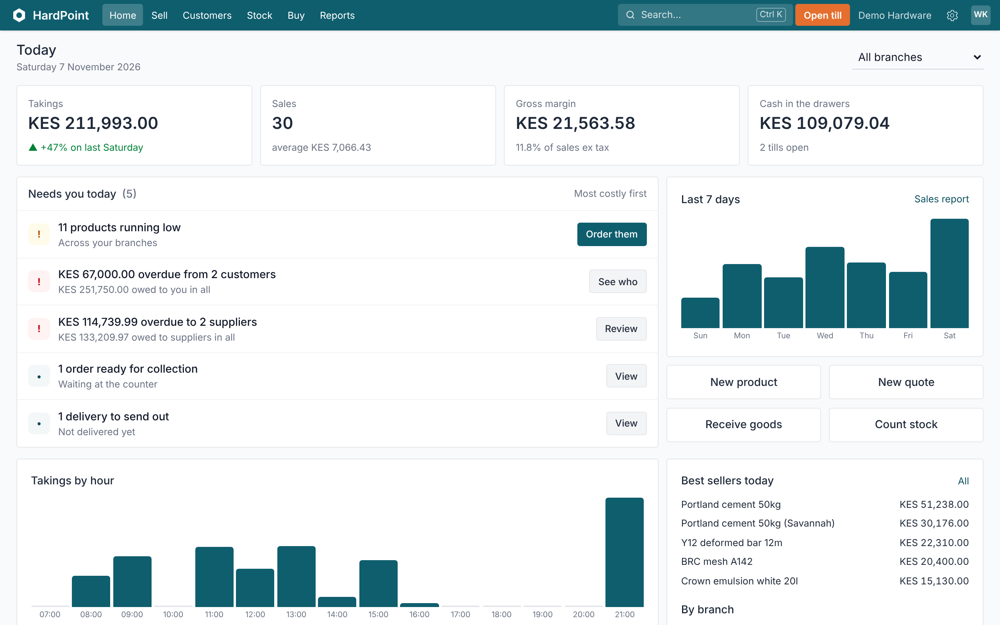

1. **Six areas, named for the job.** Home, Sell, Customers, Stock, Buy and Reports. You only see the areas your role uses. The one you're in is highlighted.
2. **Search anything.** Products, customers, suppliers, receipt and order numbers, and pages. Press Ctrl K from anywhere, or scan a barcode into it.
3. **Straight to the till.** Opens the point of sale. The first time on a computer, you choose which till it is, and it remembers.
4. **One branch or all of them.** Home shows every branch together. Choose a branch to see just its numbers.
5. **Today at a glance.** Takings, sales, margin and the cash in the drawers, live as the tills sell. Press a number to open the report behind it.
6. **Needs you today.** Low stock, customers and suppliers overdue, stock takes to approve and orders to collect, most costly first, each with the button that deals with it.
7. **Settings.** Everything you set up once. Shop details, branches and tills, staff, M-Pesa, KRA eTIMS, features and the catalogue lists.
8. **You, and help.** Your profile and PINs, Switch user, Help, these Guided tours, Contact support and Sign out.

#### The top bar

- The areas are along the top. The one you're in is highlighted, and its own menu is underneath: in Stock, for example, **Products**, **Stock levels**, **Reorder**, **Stock takes**, **Transfers** and **Expiry**.
- **Search** (or **Ctrl K** anywhere) finds products, customers, suppliers, receipt and order numbers, and pages, even by the names they used to have. Scan a barcode into it to open that product.
- **Open till** takes you straight to the point of sale, for those who sell.
- The **gear** opens Settings.
- Your name, on the right, opens **My profile** (password, PINs, two-factor, the daily email), **Switch user**, **Help**, **Contact support** and signing out.

#### Home

Owners and managers see today's takings, sales, margin and cash in the drawers, then **Needs you today**: low stock, overdue customers and suppliers, stock takes to approve, orders to collect and deliveries to send, each with the button that deals with it. Cashiers see one big button into the till, with their own sales underneath.

#### Where things moved

If you used HardPoint before the six areas: Products, Inventory and the stock side of Purchase are now **Stock**; the reorder list and reorder suggestions are one **Stock › Reorder** page; customers, jobs and who owes us are **Customers**; promotions and deliveries are in **Sell**; supplier invoices are on **Buy › What we owe** and returns to suppliers on **Buy › Purchase orders** (the ⚙ menu); categories, brands, units, tax rates, price lists, staff and activity are in **Settings**. Old links still work and take you to the new page.

#### Searching and filtering lists

Lists such as Products, Sales, Orders & quotes and Purchase orders have a search bar at the top.

- Type a few letters of a name, SKU, receipt or order number and press Enter. A barcode scanner works in the search bar too.
- The small arrow at the end of the bar opens **Filters**: a branch, a status, a date and so on. Each filter you choose shows in the bar as a tag; press its **×** to remove it.
- Long lists are split into pages; use **‹** and **›** on the right.

#### Group By

On **Stock › Products**, **Buy › Purchase orders** and **Sell › Orders & quotes**, the same dropdown has a **Group By** column. Grouping turns the list into one row per group with how many it holds and their total:

- Products by **category** or **brand**;
- Purchase orders by **supplier** or **status**, to see what's still to come from each supplier;
- Orders and quotes by **status** or **customer**.

Open a group to see what's in it. Filters and search still apply, so "Open orders, grouped by customer" works. Choose the grouping again to switch it off.

#### Settings

**Settings** collects everything you set up once: shop details, billing, features, branches and tills; M-Pesa, Airtel Money, KRA eTIMS, SMS and currencies; staff and activity; and the catalogue's categories, brands, units, tax rates and price lists. Reports has the QuickBooks export.

#### Switching features on and off

Owners choose what their shop uses in **Settings › Features**: deliveries, promotions, foreign currencies, the online store, contractor jobs, batches and expiry dates, serial numbers, and the API. A feature that's off is left out of the menus, Settings, Home and forms. Nothing is deleted, so switching it back on brings everything back. A feature can't be switched off while it's live (a promotion running, products recording batches); the page says what to finish first.

#### Getting help

**Help** opens these guides. If you're stuck, **Contact support** (under your name) sends us a message with the page you were on, so we can see what you see. Or chat with us on WhatsApp.

### Shop settings, branches and text messages

_Your shop's name, colours and logo, its preferences, branches and their receipt codes, tills, features, and texting customers._

Most of what you set up once lives in **Settings** (the gear in the top bar): your shop's name and time zone, your branches and tills, the features you use, and text messages to customers. Shop details, Features and SMS are for the shop's owner; owners and managers look after branches and tills.

**Walkthrough: Find your way around Settings**

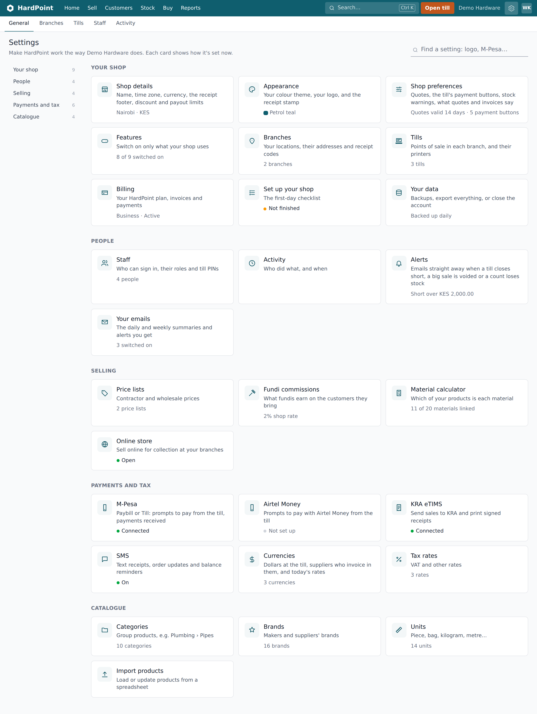

1. **Jump to a section.** Settings comes in sections, and the box at the top finds a setting by name. Press a section to go straight to it. You only see what your role uses.
2. **Your shop.** Branches and tills. Owners also get Shop details, Appearance (your colours and logo), Shop preferences, Features, Billing and Your data. Each card shows how it's set now.
3. **People.** Staff, with their roles and till PINs, Activity (who did what, and when), the alert amounts, and the emails you get.
4. **Payments and tax.** M-Pesa, Airtel Money, KRA eTIMS, text messages and tax rates, each showing whether it's connected, and currencies if your shop takes them.
5. **The catalogue's lists.** Categories, brands and units, set up once and used on every product, and importing products from a spreadsheet.

#### Shop details

Open **Settings › Shop details**. The page is called **Shop settings** and holds:

- **Business name**: printed on receipts and used in emails and texts.
- **Time zone**: sets when your day starts and ends for reports, shifts and the daily email.
- **Currency (ISO code)**: three letters, such as KES.
- **Largest discount a cashier can give without approval (%)**: see [Staff, roles and PINs](#staff-and-roles).
- **Receipt footer**: a line or two at the bottom of receipts, emailed receipts and invoices, for example your returns policy or KRA PIN. The footer is also sent to KRA eTIMS (the first 100 characters).
- **Require two-factor sign-in for owners and managers**: once ticked, owners and managers without it are asked to set it up the next time they use HardPoint.

The page also shows your shop's web address. To change it, contact support. Press **Save settings** when you're done.

#### Appearance: your colours and logo

**Settings › Appearance** (owners) chooses the colour of the top bar, buttons and links for everyone at the shop, on every screen, the till, the phone and your online store: one of eight themes, or your own brand colour. A colour too light for white writing on it is refused, so screens stay readable. Upload your **logo** (PNG or JPEG, under 1 MB) for receipts, quotes, invoices, statements and the online store, and choose whether receipts print the round **stamp**.

#### Shop preferences

**Settings › Shop preferences** tunes how HardPoint works for you. Anything left alone keeps the usual setting.

- **Selling**: how many days a quote is valid (14 to begin with), the payment terms new customers on account get (30 days), and which payment buttons the till shows. Cash is always there; hide Card, say, if you don't take cards.
- **Stock**: how far ahead batches count as expiring (30 days), when stock counts as not selling (90 days, for the dead stock report and the Monday email), how many days of sales the reorder list looks at (30), and how long suppliers usually take to deliver (7) for those without a lead time of their own.
- **Quotes, invoices and statements**: _How to pay_ (your Paybill or bank account) and your _Terms_, printed at the end of each.

#### Branches

**Settings › Branches** lists your locations. Owners and managers can press **Add branch** and give it a **Name**, **Address** and **Phone**. These are printed at the top of its receipts.

- Each branch gets a **Receipt code** made from the first letters of its name. Its receipt numbers start with it, for example MOI-000123. Press **Edit** to change it: 1 to 6 letters or numbers.
- Each branch has its own tills, stock levels, sales, orders, purchase orders and stock takes. M-Pesa, Airtel Money and KRA eTIMS can be set up per branch too.
- **Remove branch**, on its edit page, only works for a branch with no tills and no sales.
- How many branches and tills you can have depends on your plan: see [Plans, billing and read-only mode](#billing).

#### Tills

**Settings › Tills** lists each point of sale and its branch. Owners and managers press **Add till**, give it a name (such as Front counter), pick the branch and choose how receipts print. Untick **In use** to retire a till. Printers and cash drawers are explained in [Tills, receipt printers and cash drawers](#tills-and-printers).

#### Features

**Settings › Features** switches parts of HardPoint on and off: deliveries, promotions, foreign currencies, the online store, contractor jobs, batches and expiry dates, serial numbers, and the API. Press **Save features** after changing them. See [Switching features on and off](#features).

#### Text messages (SMS)

HardPoint can text customers through Africa's Talking. To turn it on:

1. Open **Settings › SMS**. It takes you to the bottom of Shop details.
2. Tick **Send texts to customers (SMS)** and press **Save settings**.

Once it's on:

- **Receipts**: after a sale, type the customer's number in **Text receipt to…** and press **Text**. On a past sale, use **Text the receipt**.
- **Order ready**: on a customer order, **Mark ready and text** (with the customer's first name) tells them to come and collect, with anything left to pay. The customer needs a phone number.
- **Balance reminders**: on a customer who owes money, **Text a reminder** sends their balance, what's overdue, and your Paybill if you have one. Owners, managers and accountants can send these, once a day per customer. Nothing is texted to a customer with **Don't text this customer** ticked.
- **Online orders**: customers who order from your online store get a text saying you have their order.

Texts only go to Kenyan mobile numbers. A shop can send up to 500 texts a day, so a mistake can't run up a bill.

#### Seeing what was sent

Under the SMS tick box, Shop details shows how many texts went this month and a **Texts sent** link. That page lists each text: when, to whom, what kind, the message, who sent it and whether it was **Sent** or **Failed**, with its cost where Africa's Talking reported one.

#### Elsewhere in Settings

Staff and activity are in [Staff, roles and PINs](#staff-and-roles). Payments and tax have their own guides: [M-Pesa payments](#mpesa), [Airtel Money](#airtel-money) and [KRA eTIMS](#etims). Exporting and closing the account are in [Exporting your data and closing your account](#your-data).

### Importing products from a spreadsheet

_Bring in your whole price list at once, and update prices later the same way._

Go to **Stock › Products**, choose **Import** from the **⚙** menu (or **Settings › Import products**) and choose a CSV file. A [template with the right columns](https://hardpoint.app/product-import-template.csv) is there to start from. Most spreadsheet programs save one with **File → Save as → CSV**. The first row names the columns; only `sku` and `name` are required.

- `sku`: your product code. A row whose SKU already exists updates that product.
- `name`, `category`, `brand`, `unit` (new categories, brands and units are created for you).
- `price` (including VAT) and `cost`, in shillings.
- `barcode`, `tax_rate`, `reorder_level`, `active`.
- `stock`: how many are on the shelf now, at the branch you choose on the import screen.

HardPoint checks the whole file before changing anything and shows the first rows as they'll be imported. If there are problems (a missing name, a price that isn't a number, a barcode already used by another product) it lists them by line so you can fix the file and try again.

To raise or lower many prices at once, choose **Change prices** from the ⚙ menu on the Products list. Pick every product, a category, a brand or a supplier; a percentage or an amount; and whether to round to the nearest 100, 500, 1,000 or 5,000 shillings. HardPoint shows every old and new price before anything changes, and pack prices and price lists can be included or left alone. See [Changing many prices at once](#changing-prices).

For price changes that don't follow a rule, press **Export CSV** on the Products list, edit the price column and import the file again. Only the columns in the file are changed.

Your plan sets how many active products you can have. An import that would go over it is held back, with a note to upgrade on the Billing page.

### Staff, roles and PINs

_Who can do what, quick switching with a PIN, and approving discounts._

Everyone who uses HardPoint gets their own login, so the activity log shows who did what. Invite people from **Settings › Staff**: they get an email to set their password (the link in it works for 3 days). Give each person the role that fits their job.

#### Roles

- **Owner**: everything, including billing, exporting data and closing the account.
- **Manager**: runs the shop: products and prices, stock, purchasing, customers, reports, and approving discounts, voids and returns.
- **Cashier**: sells, takes payments and does returns at the till (with approval where needed).
- **Stock clerk**: receives deliveries, orders from suppliers, moves stock between branches and counts it.
- **Accountant**: the money side without the till: customer accounts and statements, supplier invoices and payments, and reports.

Each person only sees the areas their role uses: a cashier sees Home, Sell, Customers and Stock, and starts at the till.

Managers can add staff and change their roles, but only an owner can make someone an owner, or change or remove an owner. Removing someone signs them out of every till and phone straight away.

**Walkthrough: Add a member of staff**

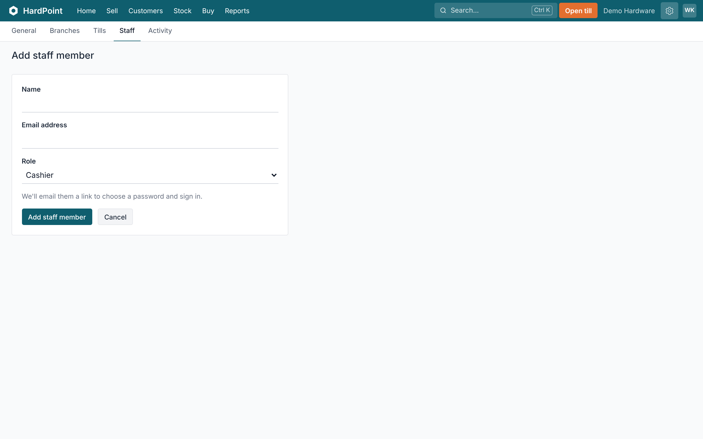

1. **Who they are.** Their name and email address. Everyone gets their own login, so the activity log shows who did what.
2. **Their role.** Owner, everything. Manager, runs the shop and approves discounts, voids and returns. Cashier, sells. Stock clerk, receives, orders, moves and counts stock. Accountant, the money side without the till.
3. **Add staff member.** We email them a link to choose a password. Cashiers and stock clerks then set a PIN under My profile, for Switch user at a shared till. Owners and managers set an approval PIN there.

#### Quick switching with a PIN

On a shared till, cashiers and stock clerks don't need to sign out. Each sets a 4 to 6 digit PIN under **My profile** (open your name in the top right). Then **Switch user**, in the same menu, changes who's selling in a couple of taps. Five wrong tries lock the PIN until its owner signs in with their password and sets a new one.

#### Discounts and other things that need approval

Cashiers can give discounts up to the limit set in **Settings › Shop details** (5% to begin with). Anything bigger, voids, returns and going over a customer's credit limit ask for an owner's or manager's **approval PIN** at the till. Owners and managers set theirs under **My profile › Approval PIN**. It authorises that one action only and signs nobody in; who approved it is recorded. After 10 wrong approval PINs in 15 minutes the shop accepts none for a while, so a PIN can't be guessed; an owner or manager can still approve by signing in at the till themselves.

#### Two-factor sign-in

Owners and managers should turn on two-factor sign-in under **My profile**, using an authenticator app, and keep the recovery codes somewhere safe. The owner can require it for all owners and managers in **Settings › Shop details**.

If someone has lost their phone and their recovery codes, the owner opens them in **Settings › Staff**, types their own password under **Two-factor sign-in** and presses **Reset two-factor**. That person is signed out everywhere, emailed, and sets two-factor up again with their password. The reset is in **Settings › Activity**. Someone who also works for another shop, or an owner with no other owner, is reset by HardPoint support instead, after we've checked who they are.

#### Seeing who did what

**Settings › Activity** lists every change: prices, stock adjustments, voids, approvals, settings. It can't be edited.

### Tills, receipt printers and cash drawers

_Printing from the browser, or silently through QZ Tray, and opening the drawer._

Each till has its own receipt settings: open it in **Settings › Tills** and choose how **Receipts print**.

#### Counter computers that only sell

Edit a till in **Settings › Tills** and tick **Open straight into selling**. On the computer set to that till, cashiers and stock clerks then go straight to the till when they sign in or switch user, without stopping at Home. Owners and managers still see Home, and the HardPoint logo at the top of the till leads there for everyone.

#### Printing from the browser (the default)

Any printer your computer can print to will work. Receipts open in the browser's print window, sized for 80 mm thermal paper. Choose the printer once and tick "don't ask again" if your browser offers it. To open the cash drawer on each receipt, turn on "open cash drawer" in the printer's driver settings.

#### Printing silently through QZ Tray

[QZ Tray](https://qz.io) is a small free program that lets HardPoint send receipts straight to a thermal printer, without the print window, and open the cash drawer on cash sales. Install it on the till computer, then set the till to **Straight to the printer with QZ Tray** and type the printer's name exactly as the computer shows it. Choose the paper width: 58 mm printers fit 32 characters a line, 80 mm printers 42 or 48. The first time a till prints, QZ Tray may ask whether to allow your shop's HardPoint address: tick **Remember this decision** and press **Allow**, once per till. Each shop has its own signing certificate, so no other shop's till can print through yours.

#### Barcode scanners

USB and Bluetooth scanners that type like a keyboard work without any setup. Scan on the till screen and the product is added to the sale.

## At the till

### Selling at the till

_Opening a shift, scanning, discounts, parking a sale, taking payment, returns and closing up._

The till is a full-screen page made for a barcode scanner and a busy counter. Open it from **Open till** in the top bar, or **Start selling** on a cashier's Home. Each computer remembers which till it is.

**Walkthrough: Make a sale at the till**

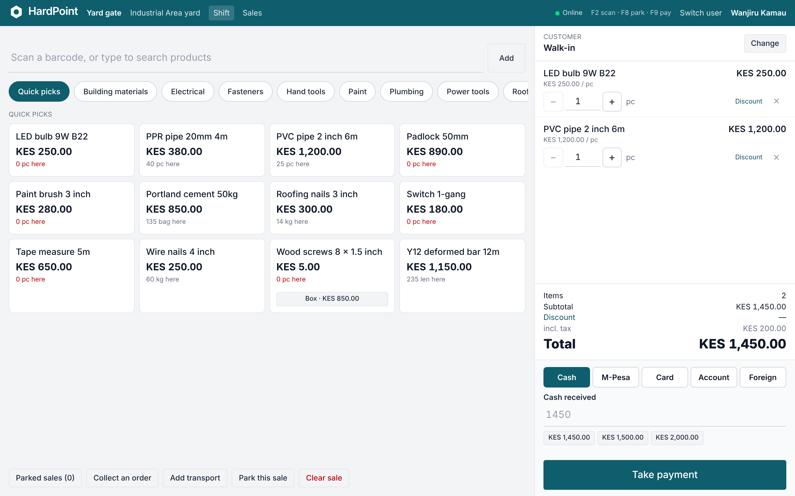

1. **Scan or search.** Scan a barcode and it's in the sale. No scanner? Type a few letters of the name or SKU and press the product. F2 brings you back here.
2. **Browse by category.** Quick picks are your best sellers. Press a category to see everything in it, handy on a touch screen.
3. **Tap to add.** Each button shows the price and how many you have at this branch. Tap one and a box asks how many, with 1 ready to confirm. Pack sizes, like a box of screws, have their own button underneath.
4. **Who's buying?** Walk-in by default. Press Change to choose a customer, so their prices, credit and KRA PIN go on the receipt.
5. **The sale.** Change a quantity with − and +, or type it. Discount gives money off one line, and × removes it.
6. **Totals and discount.** Press Discount for money off the whole sale, as an amount or a percentage. Over your shop's limit, a manager types their approval PIN.
7. **How they're paying.** Cash, M-Pesa, card, on account or foreign notes. To split a payment, take one part, then choose the next method for the rest.
8. **Take payment.** Press it, or F9. The receipt prints and the till is ready for the next customer. Cash shows the change to give.
9. **Park it for later.** The customer went back for something? Park this sale (F8) and serve the next person. Parked sales brings it back.

#### Opening the shift

Count the cash in the drawer and press **Open shift** with that float. Everything taken until you close is counted against it.

#### Ringing up a sale

1. Scan barcodes, type part of a name or SKU and pick the product, or tap through the categories. Quick-pick buttons cover fast movers and pack sizes.
2. Change the quantity for loose goods: 2.5 metres, 0.75 kg. A box's barcode adds the box at its pack price.
3. Choose a customer if the sale goes on their account, needs their KRA PIN on the receipt, or is for one of their jobs. Their price list applies as soon as you pick them.
4. If you're taking the goods to site, **Add transport** puts the delivery charge on the sale, with where it's going.
5. Promotions apply by themselves. To give a discount, use the line's or the sale's discount, as an amount or a percentage.
6. Press **Take payment**: cash (the till works out the change), M-Pesa, Airtel Money, card, foreign notes, on account for approved customers, or a mix. If the sale comes to nothing (a replacement under warranty discounted to zero, say), there's no payment to take: press **Complete sale, nothing to pay** instead. A cashier needs a manager's approval PIN for that.
7. The receipt prints. KRA's signature and QR code are on it when eTIMS is connected. It can also be emailed or texted, or sent with **WhatsApp receipt**.

Keyboard shortcuts: **F2** goes to the scan box, **F8** parks the sale, **F9** takes payment.

#### On a touch screen

The till works without a keyboard or scanner, on a touch-screen POS terminal, a tablet or a phone:

- Tap **Quick picks** or a category along the top of the products, then tap a product. A box asks how many, with 1 ready: tap **Add to sale** (or press Enter), or type the quantity or use **+** and **−** first. Scanning a barcode still adds one straight away. A category shows its subcategories' products too. Products are put into categories on the product form.
- Use **+** and **−** on a line to change the quantity, or tap the number to type one, and **✕** to take it off.
- Tap **Cash received** (or the amount for M-Pesa or card) and a number pad opens. **Exact** fills in the amount due, **C** clears it and **⌫** takes off a digit. The button with the dots beside the amount opens and closes the pad, and each till remembers how you left it.
- The device's own keyboard stays out of the way while a scanner is plugged in; tap the scan box when you want to type a search.
- On a phone, the till shows the products and the sale one at a time: switch with **Products** and **Sale** at the top. The Sale tab shows how many items are in the sale and its total.

#### Sending documents by WhatsApp

Receipts, quotes and orders, statements, purchase orders and delivery notes have a **WhatsApp** button. It opens WhatsApp with a short message and a link to the document, addressed to the customer's or supplier's phone number. The link works for 30 days and shows only that one document. See [Sending documents on WhatsApp](#whatsapp).

#### Parking a sale

If a customer goes to fetch something, **Park this sale** and serve the next person. Parked sales wait on the till until you **Recall** them. **Clear sale** throws away a cart you don't want.

#### Things that need a manager

A discount above the shop's limit, a void, a return, or a sale that takes a customer past their credit limit asks for an owner's or manager's approval PIN. They type it at the till; it approves that one thing and doesn't sign them in. See [Staff, roles and PINs](#staff-and-roles).

#### Returns and voids

- **Return**: find the sale under **Sales** and press **Return items** to refund part or all of it, putting the goods back into stock or writing them off, and refunding by cash, M-Pesa, Airtel Money, card or account credit.
- **Void**: **Void sale** cancels a sale made in error, as long as its shift is still open. After the shift has closed, use a return instead.

More in [Returns, refunds and voids](#returns-and-refunds).

#### Cash during the day

**Cash drop / payout** records cash taken to the safe, paid out (for transport, say) or paid in. The **X report** shows how the shift is doing without closing it.

#### Closing the shift

At the end of the day, press **Close shift** and count the drawer. The count is blind: the till doesn't show what it expects until you've entered what's there. HardPoint then shows the difference and prints the **Z report**. Past shifts are under **Sell › Shifts**. More in [Shifts, cash and closing up](#shifts-and-cash).

### Shifts, cash and closing up

_Opening with a float, cash drops and payouts, the X report, the blind count at close, over or short, and the Z report._

A shift runs from the cash you start with to the count at the end of the day. Every cash sale, refund and payout in between is counted against it, so at closing time HardPoint knows what should be in the drawer and can tell you if it's over or short.

#### Opening a shift

1. Open the till. If no shift is open on it, HardPoint asks for one first.
2. Count the change in the drawer and type it in **Cash in the drawer to start**.
3. Press **Open shift**.

A shift belongs to the till, not to one person. Each till has one open shift at a time, and cashiers who switch in with their PIN sell into the same shift. Each sale still records who rang it up, and the report shows who opened and who closed the shift.

#### Cash in and out during the day

Press **Shift** in the till's top bar, then **Cash drop / payout**. Choose what's happening, type the amount and a reason, and press **Record**:

- **Drop to the safe**: takings taken out of the drawer.
- **Pay out**: cash paid from the till, for transport or a supplier, say. When it pays a supplier's bill, pick the supplier under **Paying a supplier's bill?**: it's recorded as a cash payment to them, and the profit and loss doesn't count it as an expense on top of the goods.
- **Pay in**: more change added to the float.

Cash movements go on the till this device is set to, since that's the drawer the cash is in. A payout above the shop's limit (KES 5,000 to start with; owners change it under **Settings › Shop details**) needs an owner's or manager's approval PIN, and **Settings › Activity** records who approved it.

Each one shows on the shift report with its reason. On tills that print through QZ Tray, **Open drawer** in the top bar opens the drawer without a sale. It's logged as "No sale" in **Settings › Activity**.

#### The X report

Press **Shift** on the till at any time to see the **X report**: how the shift is doing so far, without closing it. It shows sales, voids, discounts and tax; takings by method (cash, card, M-Pesa, on account, and Airtel Money or foreign cash when used); deposits and account payments; refunds; and the cash drawer worked out line by line. **Print** prints it.

#### Closing the shift

1. Finish or clear any sale still open or parked on the till. The shift won't close while one has goods on it.
2. On the shift, press **Close shift**. Cashiers can also use **End my shift** on their Home.
3. Count all the cash and type it in **Cash counted**. If the till takes dollars or other currencies, count each one's notes separately in its own box.
4. Add a **Note** if the manager should know something, then press **Close shift** and confirm.

The count is blind: the closing page doesn't show what's expected. Afterwards the **Z report** shows the expected cash, what was counted, and whether the drawer is **Over**, **Short** or **Balanced**, with the same for each foreign currency. Press **Print** to print it. Once closed, nothing more can be sold on that till until a new shift is opened.

**Walkthrough: Close a shift**

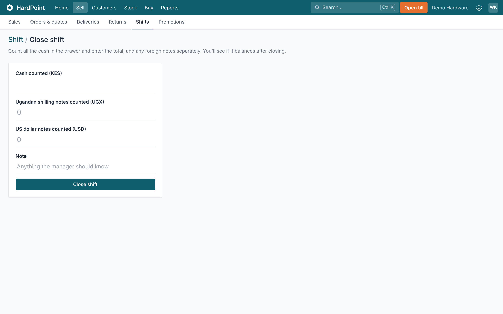

1. **Count the drawer.** Count all the cash and type the total. The count is blind. This page doesn't show what's expected, so nobody counts to a number.
2. **Foreign notes.** If the till takes dollars or other currencies, count each one's notes separately, in its own box.
3. **Anything to report?** Add a note if the manager should know something, like a payout without a slip.
4. **Close shift.** Press it and confirm. The Z report then shows the expected and counted cash, and whether the drawer is Over, Short or Balanced. Nothing more can be sold on this till until a new shift is opened.

#### What's expected in the drawer

The opening float, plus cash sales, cash deposits on orders and cash account payments, less cash refunds (on returns and on voided sales), change given for foreign notes, payouts and drops, plus pay-ins. M-Pesa, Airtel Money and card takings are listed on the report but don't count towards the drawer.

#### Past shifts

**Sell › Shifts** lists shifts with the till, branch, who opened and closed them, and the over or short. Owners and managers see every till; cashiers see the shifts of the till they're on. Open one to see its X or Z report. The **Shifts and cash counts** report lists every closed shift in a period. See [Reports and the owner's dashboard](#reports).

#### Shifts left open

On the owner's Home, **Cash in the drawers** shows the cash expected in every open till. A shift still open from an earlier day shows under **Needs you today**; press **See shifts** and close it so the cash gets counted.

For the till itself, see [Selling at the till](#selling); for dollars, see [Dollars and other currencies](#foreign-currencies).

### Returns, refunds and voids

_Taking goods back against a receipt, restocking or writing off, refund methods, approval PINs, and voiding a sale rung up by mistake._

When a customer brings goods back, record a return against their receipt. When a sale was rung up by mistake and the shift is still open, void it instead. Both put stock back and keep the shift's cash right.

#### Finding the sale

Press **Sales** in the till's top bar, or go to **Sell › Sales**. Type the receipt number from the customer's receipt in the search box (for example MAIN-000123), or filter by date and branch, and open the sale.

#### Returning goods

Returns are done at a till with an open shift, because a cash refund comes out of that drawer.

1. On the sale, press **Return items**.
2. Under **Returning**, type how many of each item are coming back. You can return part of a line, some lines or the whole sale. Items already returned are shown, and you can't return more than was bought.
3. Leave **Back on the shelf?** ticked to put the goods back into stock. Untick it for damaged goods: they're written off.
4. Choose **Refund by**: Cash, Card, M-Pesa, Airtel Money, or **Credit to customer's account**. It starts as the way the customer paid. Account credit needs a sale with a customer.
5. Type a **Reason** if you like, then press **Process return**.

The refund is what the customer actually paid for those items, including their share of any discount. If the items were part of a promotion the rest of the sale no longer qualifies for (one pipe of "any 3 for 3,000", or the free bag of "buy 10, get 1"), the refund is only what the kept goods no longer earn, so the customer doesn't keep a saving on goods that aren't a bundle any more. HardPoint records how you paid them back; for card, M-Pesa and Airtel Money refunds, send the money yourself. Credit to the account lowers what the customer owes.

**Walkthrough: Return goods**

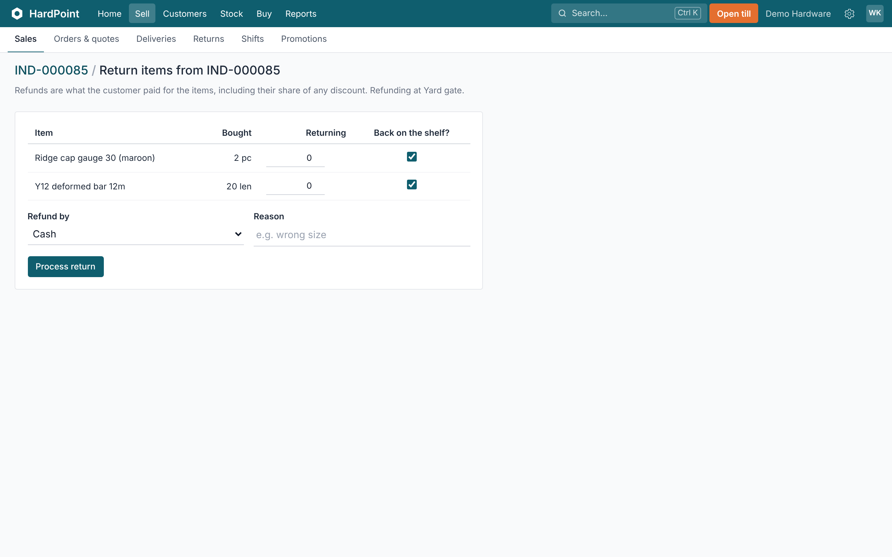

1. **What's coming back.** Under Returning, type how many of each item are coming back. Part of a line, some lines or the whole sale. You can't return more than was bought.
2. **Back on the shelf?** Leave it ticked to put the goods back into stock. Untick it for damaged goods, and they're written off.
3. **Refund by.** Cash, card, M-Pesa, Airtel Money, or credit to the customer's account. It starts as the way they paid. For card and mobile money, send the money back yourself. HardPoint records how you did.
4. **Why.** A reason, if you like, such as "wrong size".
5. **Process return.** The refund is what the customer paid for those items, including their share of any discount. The return gets its own number, and its page has Print for the return slip. With eTIMS, it goes to KRA as a credit note.

#### Approval

A cashier or stock clerk needs an owner's or manager's **Manager approval PIN** to process a return or void a sale. Owners and managers don't need to type one. See [Staff, roles and PINs](#staff-and-roles).

#### The return slip

Each return gets its own number, such as MAIN-R00012. Its page shows the items, which were restocked or written off, who did it and who approved it. **Print** prints a return slip with the refund and how it was paid. The sale also lists its returns.

#### KRA eTIMS

When the branch is connected to eTIMS and the original sale went to KRA, each return and each void is sent to KRA as a credit note against it. See [KRA eTIMS](#etims).

#### Voiding a sale

**Void sale** cancels a sale made in error, such as one rung up twice. It's only there while the sale's shift is still open and nothing has been returned from it. After that, use a return.

1. On the sale, press **Void sale**.
2. Type the **Reason** (required) and, for a cashier, the manager approval PIN.
3. Say how the money goes back. The way the sale was paid is chosen for you: cash from this till's drawer, an M-Pesa or Airtel Money reversal (type its code), a refund to the card, or credit to the customer's account. A sale paid two ways needs you to choose.
4. Press **Void sale**, and give the money back that way.

All the stock goes back, and the sale stops counting in the shift's takings. It stays in the sales list, crossed out and marked **Voided**, with who voided it, why and how the money went back; **Settings › Activity** has the same. A cash refund comes off the cash expected in the drawer. An M-Pesa payment that's reversed shows apart in the **M-Pesa reconciliation** report. If it was a collected order, the order is reopened.

#### The returns list

**Sell › Returns** lists every return with its receipt, when, who did it, the refund method and the amount.

#### Stock, the shift and reports

- Restocked items go back into stock; written-off items don't.
- The X and Z reports show refunds by method and the number of voided sales. Cash refunds come off the cash expected in the drawer. See [Shifts, cash and closing up](#shifts-and-cash).
- In the **Sales and margin** report, returns count on the day they happen. Restocked goods take their cost back out; written-off goods don't. **Payments by method** has a refunds column. See [Reports and the owner's dashboard](#reports).

### When the internet goes down

_How the till keeps selling offline and sends the sales when it's back._

If the internet drops, the till says so and offers the **offline till**. It has your products and prices from the last time it was online, so you can keep scanning, taking cash and printing receipts.

- Offline sales are kept on that computer and sent to HardPoint as soon as the connection is back. Each one is sent only once, however many times the connection comes and goes.
- Offline receipts have their own numbers (the till's and a code for the device, such as MAIN-OFF1-K7Q2-0001), so they never clash with sales made online or with another device on the same till. Searching **Sell › Sales** for the number on an offline receipt finds the sale, for a return.
- Customers can be chosen for their prices, and a contractor's sale can go on one of their jobs.
- M-Pesa and Airtel Money prompts, account sales and eTIMS need the internet; a cashier can still type the M-Pesa or Airtel transaction code. KRA gets offline sales when they're sent.
- Stock levels update when the sales reach HardPoint.

To be ready for an outage, open the till once a day while online so its copy of the products is fresh. Don't clear the browser's data on a till computer: unsent offline sales are kept there.

### Sending documents: pictures, PDFs and WhatsApp

_Receipts, quotes, invoices and credit notes as pictures or PDFs to any app, and documents sent from your own WhatsApp with a link._

Most customers and suppliers would rather get a document on WhatsApp than by email. HardPoint writes the message and the link for you; WhatsApp sends it from your own phone or computer, so there's nothing to set up.

#### Sharing as a picture or a PDF

On a receipt, a quote or order, a tax invoice and a credit note (a return), press **Share** (or **Share receipt**, **Share invoice**, **Share credit note**). It's also on the till when a sale is done.

- **Share as a picture** makes a sharp JPEG of the document, with your logo and colours, and opens your phone's or computer's share menu: WhatsApp, Telegram, email, Bluetooth, or any app you have. Customers see it straight away in the chat, without opening a link.
- **Save the picture** keeps the JPEG on the device, to attach later.
- **Share the PDF** sends the PDF instead, for printing or for the customer's accounts.

The picture is made on your own device from the document, and only goes where you send it. On a computer whose browser can't share files (Firefox, for one), it's saved instead: attach it in WhatsApp Web or your email.

#### Where the WhatsApp button is

- **Receipts:** **WhatsApp receipt** on the till after a sale, and **WhatsApp** on any sale under **Sell › Sales**.
- **Quotes and orders:** on the order page. A quote's message says how long it's valid for.
- **Statements:** on a customer's statement, with the balance and, if you have M-Pesa connected, your Paybill and the account number to pay to.
- **Purchase orders:** on the purchase order, addressed to the supplier, with the branch to deliver to and the date.
- **Delivery notes:** on the delivery note, so the customer knows what's coming.

#### Sending one

1. Press the **WhatsApp** button.
2. WhatsApp opens (the app on a phone or computer, or WhatsApp Web in the browser) with the message written. If the customer or supplier has a mobile number in HardPoint, the chat with them opens; if not, WhatsApp asks who to send it to.
3. Check the message and press send.

#### What the customer sees

The message has a short line from your shop and a link. The link opens that one document: the receipt as a page, and quotes, orders, statements, purchase orders and delivery notes as a PDF on your letterhead. It needs no password, shows nothing else from your shop, and stops working after **30 days**. A statement always opens with the period it was sent for, however long ago that was. To send it again after that, press the button again for a fresh link.

#### Links you've sent

Each document's page lists the links sent for it under **Links sent on WhatsApp**: when, by whom, and whether the link has been opened. If a link went to the wrong person, press **Take back** next to it: it stops opening at once, and **Activity** records who took it back. Then press the WhatsApp button again for a fresh link to the right person.

#### Tips

- Keep customers' and suppliers' mobile numbers up to date so the chat opens with the right person.
- Use a WhatsApp Business account on the shop phone, so messages come from the shop rather than a member of staff.
- Anyone you forward a link to can open it until it expires or you take it back, so send it only to the person it's for.

### Promotions and offers

_Percentages off, "buy 10, get 1 free" and mix-and-match bundles, applied by the till by itself._

Promotions change prices for a while without anyone typing a discount: a cement week, a paint sale, "buy 10, get 1 free", "any 3 tools for KES 3,000".

Don't see it? It's one of the optional features: the owner switches on **Promotions** in **Settings › Features**.

#### Setting one up

1. Owners and managers go to **Sell › Promotions** and press **New promotion**.
2. Choose the offer: a percentage off the shelf price, free items when buying a quantity (buy 10, get 1 free means the 11th is free), or **mix and match**: any number of the chosen products together for one price.
3. List the products by SKU or barcode, or tick whole categories, and set the dates. Leave the branches unticked to run it everywhere.

Untick **Active** to pause a promotion. A promotion that has been used can't be deleted; **End now** stops it and keeps its results.

#### At the till

- The till applies promotions by itself. Each line shows the offer and what it took off.
- If two promotions cover the same product, the customer gets the one that saves them most, never both.
- Customers on a price list (contractors) get whichever is better: their own price or the promotion.
- A mix-and-match bundle works across the whole sale: a hammer, a level and a tape on separate lines make one bundle. The dearest items go into bundles first, and the saving is shared across those lines. Extra items pay their usual price. Packs and lines with a hand discount aren't counted. If the items' own promotions save more than the bundle, those are used instead.
- Promotions aren't discounts, so they don't need a manager's PIN; hand discounts can still be given on top, within the usual limits.
- The receipt shows each saving and how much the customer saved in all.

#### Quotes and the online store

Percentage-off promotions also price new quotes, orders and online orders (a quote keeps its price until it expires). The online store shows the old price struck through. Free items and bundles are only given at the till. The offline till applies promotions too, as long as its catalogue was loaded after the promotion was set up.

#### How it went

Each promotion's page shows how many sales used it, units sold, what it gave away and the takings on those lines.

## Customers and orders

### Customers

_Adding customers with their KRA PIN and prices, choosing them at the till, and what the customer page shows._

You don't need a customer for every sale: most go through as **Walk-in**. Add the people you want to know again: contractors, fundis, regulars, and anyone who buys on account or needs a tax invoice. Customers live in **Customers › Customers**.

#### Adding a customer

1. On **Customers**, press **New**.
2. Type their **Name** and **Phone**. The phone number finds them at the till and is where texted receipts go.
3. Owners and managers can set a **Credit limit** in shillings. 0 means cash only; above 0 lets them buy on account.
4. Under **More options**, add their **Email**, **Tax PIN** (their KRA PIN, for tax invoices) and **Address** (for deliveries and statements). Owners and managers also choose their **Prices** and how many days they **Pay within**. There's room for **Notes** too.
5. Press **Add customer**.

To change any of it later, open the customer and press **Edit**. The customer's KRA PIN appears on their tax invoices, quotes and statements, and goes to KRA with the sale when eTIMS is connected.

#### Contractor and wholesale prices

Make a price list, such as Contractor, in **Settings › Price lists**, and give products their price on it under **Special prices** on each product page (see [Products and the catalogue](#products)). Then set the customer's **Prices** to that list. Customers left on **Retail** pay the normal price.

#### Choosing a customer at the till

1. At the top of the cart, press **Change** next to **Customer**.
2. Type part of their name or phone number and pick them. The cart is repriced at once with their price list, shown as a badge by their name.
3. To go back to a cash sale, press **Walk-in customer**.

If they're not there yet, press **New customer** under the search. The form opens with the name or phone number you searched for. Fill in the rest and press **Add and use on this sale**: you're back at the till with the new customer on the sale. **Back to the till** returns without adding them.

#### The customer page

Open a customer from the list (search by name or phone) to see:

- Their **Prices**, what the customer **Owes on account** (and how much is overdue), **Credit left** and how many days they pay within.
- **Unpaid account sales** with their due dates, and **Payments on account**.
- Open quotes and orders, open jobs, and their **Recent purchases**.

The buttons along the top are **New quote**, **Statement**, **Record payment** (when they owe something) and, with contractor jobs switched on in **Settings › Features**, **Add a job**. When SMS is set up and they owe money, **Text a reminder** sends their balance to their phone, once a day at most. A statement can also go by PDF, email or WhatsApp. A customer who asks not to be texted gets **Don't text this customer** ticked on their record; after that no receipt, order text or reminder goes to their number.

**Walkthrough: A customer's account**

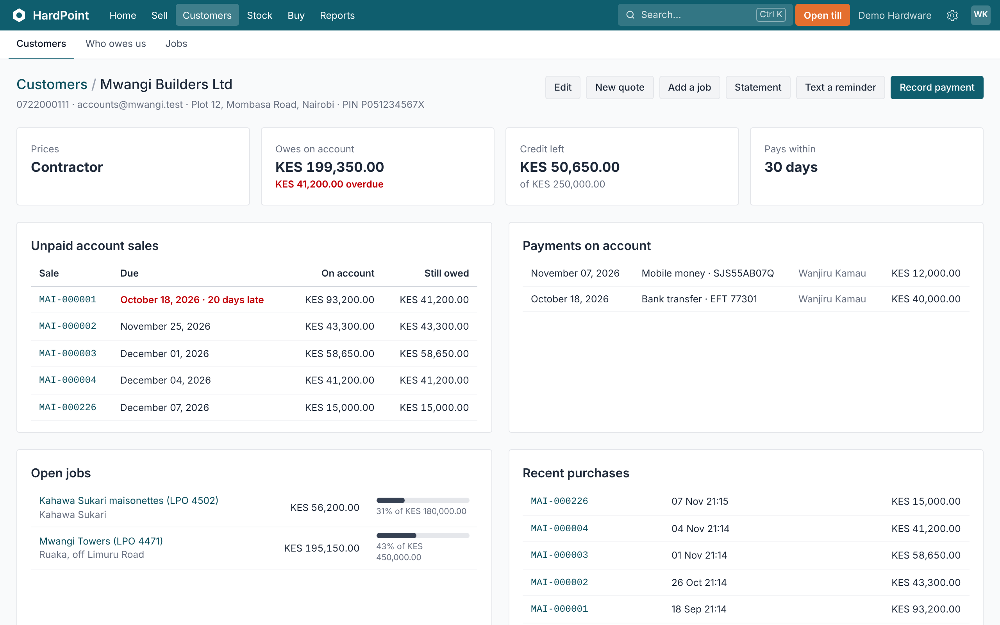

1. **How to reach them.** Phone, email, address and KRA PIN. The phone finds them at the till and gets texted receipts. The PIN goes on their tax invoices.
2. **Their account at a glance.** Their prices, what they owe on account and how much of it is overdue, the credit they have left, and how many days they pay within.
3. **What you can do.** New quote, Statement (as a PDF, by email or WhatsApp), Text a reminder when they owe and SMS is set up, and Record payment, which settles their oldest sales first.
4. **Unpaid account sales.** Each sale they haven't paid for yet, with its due date. Their payments on account are listed alongside.
5. **What they buy.** Their recent purchases. Open quotes, orders and jobs are listed above when they have any.

#### Who owes us

**Customers › Who owes us** lists every customer with a balance, split into not yet due, 1–30, 31–60, 61–90 and over 90 days late, with a **Statement** link for each. Owners, managers and accountants can see it.

#### More on customers

- Credit, quotes, deposits, payments and statements: [Customers on account, quotes and orders](#customer-accounts).
- Tagging a contractor's purchases to a project: [Jobs for contractors](#contractor-jobs).
- Sending receipts, quotes and statements to their phone: [Sending documents on WhatsApp](#whatsapp).

### Customers on account, quotes and orders

_Credit limits, deposits, statements and delivery notes._

Contractors and regular customers can buy on account and pay later. Customers live in **Customers**; the till can add a new one too.

#### Credit limits and terms

Open the customer, press **Edit**, and give them a credit limit and payment terms (30 days is the default). A price list (contractor, wholesale) gives them their own prices whenever they're chosen at the till. A sale that would take them past their limit needs an owner's or manager's approval PIN.

#### Selling on account

At the till, choose the customer and pay **On account**. The sale is the invoice: it's due after their payment terms, and **Tax invoice (A4)** on the sale gives trade customers a proper tax invoice.

#### Quotes and orders

1. In **Sell › Orders & quotes**, press **New**, choose the customer and add the goods. Save it as a quote, and send it as a PDF or by email. Quotes are valid for 14 days unless you change it.
2. When the customer agrees, press **Confirm order**. For a customer who buys on account, an order worth more than the credit they have left needs an owner or manager, or a manager's approval PIN, as it would at the till. **Take deposit** records money paid up front (cash, M-Pesa, card or bank).
3. When the goods are in, press **Mark ready to collect** (with SMS on, the customer can be texted).
4. When they come, press **Collect at …** on the order at the till: it's rung up at the quoted prices, with the deposit already counted. The sale, VAT and all, goes to KRA then, not when the deposit was taken (see [KRA eTIMS](#etims)).

**Walkthrough: Write a quote**

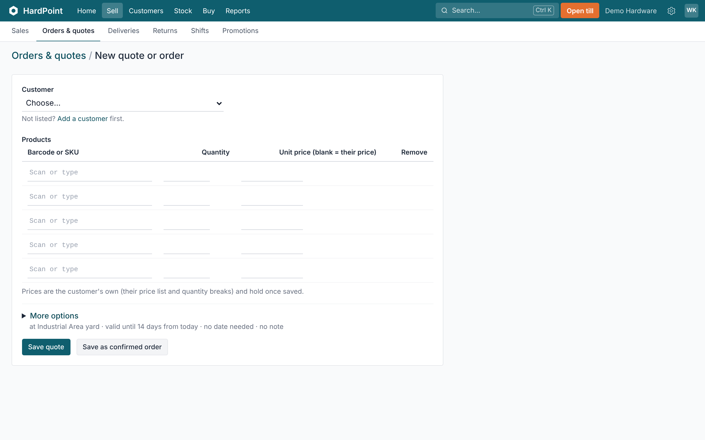

1. **Who it's for.** Choose the customer. Not listed? Add a customer first. With contractor jobs switched on, you can put it against one of their jobs.
2. **The goods.** Scan or type each barcode or SKU with the quantity. Prices are the customer's own, from their price list and quantity breaks, and hold once saved. Owners and managers can type a different unit price.
3. **Branch, dates and a note.** More options sets the branch, how long the quote is valid (14 days if left blank), when it's needed by, and a note shown on the quote.
4. **Quote or order.** Save quote to send it as a PDF or by email. When they agree, press Confirm order on it and take a deposit. If they've already agreed, Save as confirmed order.

#### Payments and statements

Press **Record payment** on the customer to take money against their account; it settles their oldest sales first unless you fill in amounts under **Put against particular sales**, which pays those sales and leaves the others (a disputed invoice, say) open. If they've paid more than they owe, **Refund credit** hands the credit back; cash goes out of this device's till. A debt the shop has given up on is removed with **Write off**: an owner or manager approves it (an accountant types a manager's approval PIN) with a reason, and it stays on the statement and in Activity. **Statement** prints or emails what's owed and how old it is at the end of the period, and balance reminders can go by SMS. **Customers › Who owes us** lists every customer's balance by how late it is.

#### Deliveries

For goods going out on the lorry, press **Deliver** on the sale and print the delivery note with a signature line. Mark it dispatched with the driver and vehicle, then delivered with who received it and a photo of the signed note. **Sell › Deliveries** lists what's due out.

To charge for transport after the sale, enter the **Transport charge** on the delivery note. It becomes an order for the customer, collected at the till or put on their account like any other. A charge needs a named customer. To charge it at the time of the sale instead, use **Add transport** on the till. See [Deliveries and transport charges](#deliveries).

### Deliveries and transport charges

_Charging transport at the till or afterwards, delivery notes, and tracking the lorry to site._

Hardware goes out on the lorry or the pick-up. HardPoint prints the delivery note, tracks it from the yard to the site, and charges the customer for transport, either at the till or afterwards. Deliveries are switched on under **Settings › Features**.

#### Charging transport at the till

1. Ring up the goods as usual.
2. Press **Add transport**, type the charge and where it's going (the customer's address is filled in if they have one), and press **Add to sale**.
3. Transport appears as its own line on the sale and the receipt, with VAT like any other line, and is paid with the rest of the sale.

Transport lines keep the amount you typed: customer price lists and quantity breaks don't change them.

#### Making the delivery note

1. Open the sale and press **Deliver**.
2. Check the delivery address, and add the transport charge if it wasn't on the sale (see below).
3. Under **What's going out**, lower a quantity to send part of the sale now. The note prints only what's on the lorry; the sale then shows **Deliver the rest** for a later note.
4. Print the delivery note. It has a line for the customer to sign.

**Cancel delivery** cancels the transport order charged on the note too, while it's still unpaid. If a deposit was taken on it, refund that first; if the transport was already paid at the till, refund it from that receipt with a return.

#### Charging transport afterwards

If the customer asks for delivery after paying, type the **Transport charge** on the delivery note. HardPoint makes an order for the customer for that amount, which they pay at the till (it's loaded like any other order) or which goes on their account. The delivery note links to the order and shows whether it's paid.

- A transport charge afterwards needs a named customer. For a walk-in customer, add transport at the till before they pay.
- If transport is already on the sale, the delivery note says so, so it isn't charged twice.

#### Out and delivered

1. When the lorry leaves, mark the note **dispatched** with the driver and vehicle.
2. When it arrives, mark it **delivered** with who received it and a photo of the signed note.

**Sell › Deliveries** lists what's due out, and Home shows deliveries due today. Send the customer the delivery note on WhatsApp so they know what's coming: see [Sending documents on WhatsApp](#whatsapp).

### Jobs for contractors

_Tag what contractors buy to their projects (online or offline), track it against a budget, and print a cost summary or a bill for their client._

Contractors often buy for several projects at once. A job keeps each project's purchases together, so they (and you) can see what it has cost, and they can pass the costs on to their own client.

Don't see it? It's one of the optional features: the owner switches on **Contractor jobs** in **Settings › Features**.

#### Adding a job

1. Open the customer and press **Add a job**, or go to **Customers › Jobs**.
2. Give it a name ("Mwangi Towers"), their reference or LPO number if they use one, the site and, if they like, a budget for materials.

#### At the till

- Choose the customer as usual. If they have open jobs, a **Job** list appears under their name; pick the one they're buying for.
- The till shows how much of the budget is left. Going over is allowed, but it shows in red.
- The job is printed on the receipt and on the A4 tax invoice.
- Quotes and orders can be for a job too (**New quote for this job** on the job's page). When the order is collected, the sale is for the same job.
- The offline till has the same **Job** list. If the job was closed before the sale is sent, the sale is recorded without it and flagged.

#### What a job has cost

The job's page shows what it has cost so far (sales less anything returned), how that compares with the budget, every material that went into it, and its sales, returns and open orders. **Cost summary (PDF)** gives the contractor the same on your letterhead. Owners and managers also see the shop's **Margin** on the job: what the goods cost when they were sold, against the price ex tax.

#### A bill for the contractor's client

Contractors often pass the materials on to the people they're building for, with something added. On the job's **Edit** page, fill in **Client** and **Markup on materials**. Then **Bill for … (PDF)** on the job's page gives a materials bill on the contractor's own letterhead (their name, address, phone and PIN, not your shop's). It lists each material, net of returns, at your price plus the markup, with the total. The markup percentage isn't printed. Leave the markup empty to bill at your prices.

When the work is finished, press **Close job** so it stops showing at the till. A job with orders still to be collected can't be closed until they're collected, cancelled or moved to another job, so nothing is rung up without its job. You can reopen it at any time.

### The material calculator

_From a wall's, slab's or roof's measurements to the blocks, cement, steel and sheets it needs, and a quote at your prices._

A customer asks what a wall, a slab or a roof will cost. The material calculator works out the materials from the measurements and prices them at your shelf prices, and one press makes it a quote. Find it under **Sell › Orders & quotes** (the actions menu beside the title) or from **New quote**.

#### Before the first time: link the materials

Someone who looks after the catalogue opens **Link materials to products** and, for each material (cement, sand, ballast, stones and blocks, Y8 to Y16 bars, BRC mesh, binding wire, iron sheets, ridge caps, roofing nails, tiles, adhesive, grout, paint), types the SKU, barcode or name of the product you sell for it. If you sell it in a different unit, say how many of your product one unit of the material is: **1000** for sand sold by the kg (the calculator works in tonnes), **0.04** for binding wire sold in 25 kg rolls, **0.05** for paint sold in 20-litre tins. A material that isn't linked is still worked out, but left off the total and the quote.

#### Measuring the job

- **Wall**: length and height (all the walls together), the area of doors and windows to leave out, what it's built with (9×9 or 6×9 machine-cut stone, 6 or 4 inch blocks) and the mortar mix.
- **Concrete**: a slab, footings or a beam, with how many alike, the mix (1:2:4 for slabs and beams), and the steel: BRC mesh, or bars at a spacing both ways.
- **Plastering**: the area (both faces of a wall count) and thickness.
- **Roofing**: the roof's length along the ridge and from eave to ridge, one or two sides, and the sheet length.
- **Tiling** and **Painting**: the area, and for paint the coats and what the tin says it covers.

Add as many parts as the job has (outside walls and inside walls as two walls, say), press **Work it out**, and the materials and their total appear beside them. Each part says what it assumed: the joints, the waste, the overlaps.

#### Making the quote

Choose the customer and press **Make a quote**. The quote has one line per material at the customer's prices, rounded up to whole bags, lengths and sheets, and its note lists what was measured. Change anything you like before sending it; from there it's an ordinary quote, confirmed into an order, paid a deposit and collected at the till.

The figures are a counter's estimate, not an engineer's. For a large job, the customer's builder or quantity surveyor has the last word.

### Fundi commissions

_Paying masons, plumbers and electricians a commission on the customers they bring: rates, naming them at the till, and paying them._

Fundis (masons, plumbers, electricians, carpenters and other tradespeople) bring customers to the shop. HardPoint keeps each fundi's commission for you: it's earned when a sale they brought is paid, taken back if it's voided or returned, and paid out in cash or by M-Pesa. Switch it on in **Settings › Features › Fundi commissions**.

#### Setting the rates

Go to **Customers › Fundis › Commission rates** (owners and managers). Set a **shop rate**, say 2%, then a different rate for any category where it differs: less on cement, more on fittings. A subcategory without a rate uses its parent's. Commission is worked on each line's value **before tax**. If you've agreed a rate with one fundi, put it on their page as **their own rate**; they get it on everything instead.

#### Adding fundis

Press **New** on **Customers › Fundis**, or **New fundi** from the till. Their phone number is the one you pay them on by M-Pesa. A fundi who has stopped coming can be made inactive; their history stays.

#### Naming the fundi at the till

Under the customer at the top of the sale, press **Add** beside **Fundi** and search by name or phone. A quote or order can name the fundi too, and collecting it at the till carries them to the sale. Nothing is earned until the sale is paid in full. Sales made on the offline till don't name a fundi.

#### What they're owed, and paying them

Each fundi's page is their statement: every sale they brought, anything taken back, every payment, and what's owed now. Owners and managers press **Pay commission** and choose **M-Pesa** (type the M-Pesa code) or **Cash from a till**: the cash is recorded as a payout from that till, so its count at close still balances, and the profit and loss counts it as an expense. You can't pay more than is owed.

#### Reports and emails

**Reports › Fundi commissions** shows, for any period, what each fundi brought in, earned, had taken back and was paid, and what each is owed today. The Monday summary email lists the fundis who brought in the most that week.

### Selling online with click-and-collect

_Your catalogue online: switching it on, what customers see, and handling their orders._

Your online store is at `yourshop.hardpoint.app/store`. Customers browse, see what's in stock at your branches, and order for collection. There's nothing to build.

Don't see it? It's one of the optional features: the owner switches on **Online store** in **Settings › Features**.

#### Switching it on

1. The owner goes to **Settings › Online store**.
2. Tick **Online store is on**, choose the branches customers can collect from, and add a headline, a few words about the shop and when orders are ready (for example "Orders before 3pm are ready the same day").
3. Choose whether customers see how many are in stock, or only "In stock", "Low stock" and "Out of stock".

Every active product with a price is in the store. To keep one out, open the product and untick **Show in the online store**. Photos you add to products appear in the store. Online prices are your retail prices (with quantity breaks) less any offer running at every branch; a customer's price list and offers at one branch only don't apply online, and the order confirms at exactly the total shown at checkout.

#### When an order comes in

- It appears in **Sell › Orders & quotes** marked **Online**, and owners and managers get an email.
- Pack it, then press **Mark ready to collect** (or **Mark ready and text**, where SMS is on): their order page shows it's ready, and the customer gets a text.
- When they come, ring the order up at the till as usual. Anything they paid ahead by M-Pesa is already on the order as a deposit.

#### Paying ahead

If you've connected an M-Pesa Paybill, the customer's order page shows your business number with their order number as the account number. Payments made that way are matched to the order automatically. Till (Buy Goods) numbers can't carry an order number, so with one of those customers pay when they collect.

## Stock and purchasing

### Products and the catalogue

_Adding products, barcodes and pack sizes, loose goods, kits, special prices and quantity breaks, and printing shelf labels._

Everything you sell lives in **Stock › Products**. Owners, managers and stock clerks can add and change products; everyone else can look them up. To bring in a whole price list at once, see [Importing products from a spreadsheet](#importing-products).

**Walkthrough: Search and filter a list**

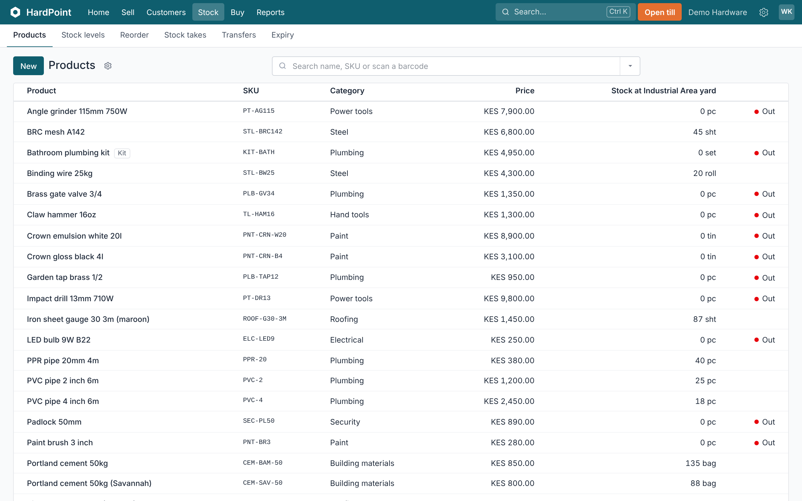

1. **The area's own menu.** Each area has its pages along here. In Stock, that's Products, Stock levels, Reorder, Stock takes, Transfers and Expiry.
2. **Add one.** New opens a blank product. To add hundreds at once, use Import from the ⚙ menu instead.
3. **Everything else.** The ⚙ has the list's other jobs. Import, Change prices, Export CSV and Print labels.
4. **Search.** Type part of a name or SKU, or scan a barcode, and press Enter. Filters you choose show here as tags. Press × on a tag to remove it.
5. **Filters and Group By.** Narrow the list by category, brand or branch, or group it by category or brand to see how many and what they're worth. Long lists come 50 at a time, with ‹ and › on the right.

#### Adding a product

1. On **Stock › Products**, press **New**.
2. Type the **Name** and **Selling price** in shillings, including VAT. Add the **Cost price** too, for profit reports.
3. Choose what it's **Sold by** (piece, bag, metre…) and its **Category**.
4. Scan the maker's **Barcode**. If it has none, leave it blank and HardPoint gives it a barcode of its own for your labels.
5. Enter the **Opening stock**: what's on the shelf at this branch now.
6. Press **Add product**, or **Add and start another** to go straight to a new one with the same category and unit.

**More options** holds the rest: the **SKU** (left blank, one is made for you), **Brand**, **Tax** (blank uses the shop default), **Reorder level** for the low-stock alert, a description and a **Photo**. To change a product later, open it and press **Edit**.

#### Active, inactive and services

- Untick **Active** to hide a product from the till. A product with stock history can't be deleted, so make it inactive instead.
- Untick **Track stock** for services such as cutting or delivery.
- With the online store on, **Show in the online store** keeps a product on or off it.

#### Barcodes, pack sizes and loose goods

A product can have several barcodes: add them under **Barcodes** on the product page. Units are set up in **Settings › Units**; tick **Sold in parts** for kilograms, metres or litres so the till accepts 2.5 or 0.75. Other units only take whole numbers.

If you sell nails by the kilo and by the box, add the box under **Pack sizes**: choose the **Pack**, how many it **Holds**, and a **Price** if it isn't simply that many times the single price. Then add the box's own barcode, choosing the pack under **For**. Scanning it adds a box at the box price.

#### Kits and serial numbers

- Tick **Kit** for something sold as one item but made of other products, such as a toilet set. Add the parts under **Kit contents**. Selling a kit takes its parts out of stock.
- **Serial numbers** appears once it's switched on in **Settings › Features**. The till then asks for the serial number of each one sold, and it's printed on the receipt.

#### Special prices and quantity breaks

Under **Special prices** on the product, choose who it's **For** (a price list, or **Everyone (retail)**), a **From qty** and the **Unit price**. For example, cement at 750 shillings a bag from 50 bags. Customers always get the lowest price that applies. Make price lists such as Contractor or Wholesale in **Settings › Price lists**, then set a customer's **Prices** when editing them.

#### Categories, brands and tax rates

These are in Settings, under **Catalogue**. A category can sit **Inside** another, like Plumbing › Pipes. In **Tax rates**, mark VAT 16% as **Default for new products**, and give exempt or zero-rated goods their own rate.

#### The products list

Search by name or SKU, or scan a barcode into the search box. Filter by **Category**, **Brand** or **Include inactive**, choose which branch's stock to show under **Stock at**, and **Group by** category or brand. The **⚙** menu has **Import**, **Change prices** (see [Changing many prices at once](#changing-prices)), **Export CSV** and **Print labels**.

#### Shelf labels

**Print labels** in the ⚙ menu labels the products in your current search or category; the button on a product page labels just that one. Set the copies for each, choose an **A4 sheet** (3 × 8 labels) or a **Label printer roll** (50 × 25 mm), and press **Open print view**. Print at 100% scale with no margins.

Stock levels and counts are covered in [Stock levels, transfers and stock takes](#stock-and-stock-takes), and offers in [Promotions and offers](#promotions).

### Changing many prices at once

_Raising or lowering prices for a category, brand or supplier, with rounding and a preview._

When a supplier puts its prices up, or cement goes up across the market, you can change hundreds of prices in one go instead of editing each product. Owners, managers and anyone allowed to manage the catalogue can do it.

#### Changing prices by a rule

1. Open **Stock › Products**, press the **⚙** menu and choose **Change prices**.
2. Under **Which products**, choose **All products**, a **category** (its subcategories are included), a **brand**, or a **supplier's products**.
3. Choose whether to change by a **percentage** or an **amount** in shillings, and type it. Use a minus sign to lower prices: `-5` takes 5% off.
4. Choose whether to **round new prices** to the nearest 100, 500, 1,000 or 5,000 shillings, so the shelf prices stay tidy.
5. Tick **Packs with their own price too** to change the price of a bag, box or bundle as well, and **Contractor and wholesale prices too** to change price lists as well.
6. Press **Preview**. HardPoint lists every price that will change, old and new, and changes nothing yet.
7. If it looks right, press **Apply** and confirm.

The change is recorded in the activity log, with who made it and what it was. Sales already made keep the price they were sold at, and margins in reports use the cost on the day each sale was made.

#### Examples

- Your cement supplier puts prices up 8%: **Supplier's products**, that supplier, percentage, `8`, round to the nearest 100.
- Clearing a brand: the brand, percentage, `-15`, without contractor prices.
- Transport costs have gone up on everything heavy: the Building materials category, amount, `50`.

#### Changes that don't follow a rule

When each product needs its own new price, use a spreadsheet instead: press **Export CSV** on the Products list, change the price column and import the file again. See [Importing products from a spreadsheet](#importing-products).

#### After changing prices

- Reprint shelf labels for the changed products with **Print labels** in the Products ⚙ menu.
- Tills pick up the new prices on the next sale. The offline till picks them up the next time it's opened online.
- Quotes already sent keep their prices until they expire.

### Stock levels, transfers and stock takes

_Adjusting stock, moving it between branches, counting it, and the reorder list._

HardPoint keeps stock per branch. Every sale, delivery, transfer and correction is a line in the stock history, so you can always see why a number is what it is. **Stock › Stock levels** shows what each branch holds and what it's worth, with stock on its way between branches on its own line.

#### Correcting stock

Open the product and press **Adjust stock**. Choose the branch, how many to add or take off, and the reason: opening stock, found, damaged, stolen, expired, internal use or a correction. Adjustments are in the activity log with who made them.

The till only sells what is on the shelf: once a product is down to zero at the branch, it can't be sold until the delivery is recorded or the stock adjusted, and the till says how many are left when a cashier tries to sell more. A kit needs all its parts.

A level can still go below zero when the offline till sold something that another till had already sold, since the goods have gone. **Stock › Stock levels** counts these for the branch; press **Below zero** to list them (the same **Below zero** filter is on the products list), then record the delivery or adjust the stock.

A product's unit, whether it tracks stock and whether it is a kit can't change while any branch has stock of it, since the quantities on hand would mean something else: adjust the stock to zero first.

#### Moving stock between branches

1. In **Stock › Transfers**, press **New**, choose the branches and the products, and press **Send transfer**. The stock leaves the sending branch and shows as in transit.
2. When it arrives, the other branch counts it in. If anything is short, type what arrived against that line and say whether the rest was lost on the way (it is written off at the receiving branch) or never left (it goes back into the sending branch's stock), then press **Mark received at …**. What arrived is theirs, and the transfer shows what was short.
3. While it is still in transit, **Cancel transfer** puts the stock back at the sending branch.

**Walkthrough: Move stock between branches**

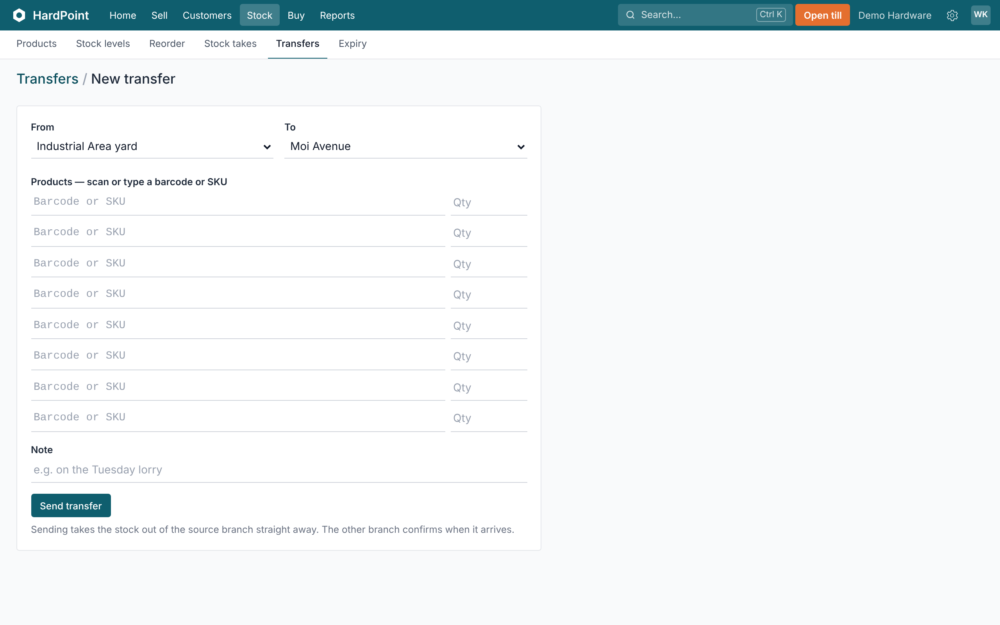

1. **From and to.** Choose the branch the stock leaves, and the one it's going to.
2. **What's going.** Scan or type each product's barcode or SKU, with how many. Leave the spare rows empty.
3. **A note for the other end.** Say how it's coming, like "on the Tuesday lorry".
4. **Send transfer.** The stock leaves the sending branch straight away and shows as in transit. When it arrives, the other branch opens the transfer and presses Mark received at, followed by its own name. Until then, Cancel transfer puts it back.

#### Stock takes

1. In **Stock › Stock takes**, press **New**. Count **everything**, or pick one category for a quicker cycle count, and press **Start counting**.
2. Count the shelves: type quantities on the computer, scan with a barcode scanner, or [count on your phone](#stock-on-your-phone). Several people can count at once.
3. Press **Submit for approval**. The **Differences** tab shows what's over or short and what it's worth at cost; **Not counted** shows what was missed.
4. An owner or manager presses **Approve and correct stock**. Anything not counted is left as it was.

Selling carries on during a stock take; HardPoint allows for what was sold while you counted.

**Walkthrough: Count stock**

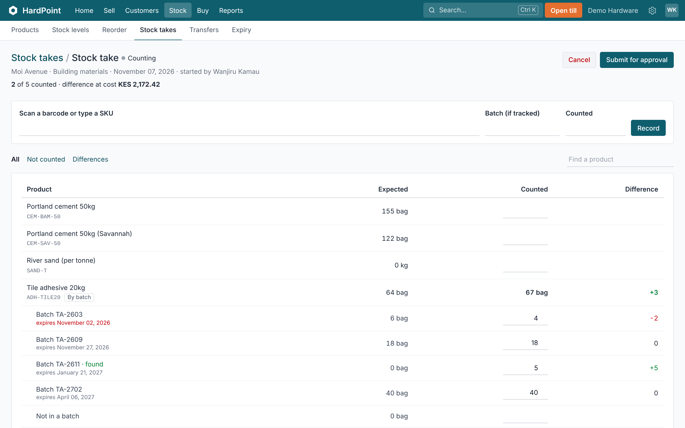

1. **How far you've got.** How many products are counted, out of how many in this stock take, and what the differences so far are worth at cost. Several people can count at once, and the till keeps selling.
2. **Scan as you count.** Scan a barcode or type a SKU, type how many are on the shelf and press Record. Recording a product again replaces its count. Batch is only for products tracked by batch.
3. **What's left, and what's off.** Not counted shows what nobody has counted yet. Differences shows only what's over or short. Find a product to jump to it.
4. **Or type the counts in.** Expected is what HardPoint thinks is on the shelf. Type the count in its row and it saves by itself. The difference shows in red when you're short and green when you're over.
5. **Submit, then approve.** When the counting's done, press Submit for approval. An owner or manager checks the differences and presses Approve and correct stock. Anything not counted stays as it was, and Cancel changes nothing.

#### Knowing what to reorder

Give products a **reorder level**. **Stock › Reorder** shows everything at or below it at a branch, and owners, managers and stock clerks get a low-stock email each morning. It also lists anything at zero that has no reorder level, since the till can't sell it and it would otherwise go unnoticed. To turn the list into orders, see [Buying from suppliers](#buying-from-suppliers).

With more than one branch, **Move from another branch first** at the top of Stock › Reorder lists what's short here (at or below its reorder level, or turned away at the till in the last two weeks) that another branch has more of than it needs. It only suggests what that branch can spare and still have its own two weeks' cover. Press **Prepare the transfer**: the transfer opens filled in, and is sent when you've checked it and pressed **Send transfer**. Each line to order also says how much could be moved first. The morning email lists the same moves.

A branch that sells a product faster or slower than the others can have its own level: on the product's page, type it under **Reorder at** next to the branch and press **Set**. Leave it blank to use the product's level. Stock already on order, or on its way from another branch, counts as coming, so it isn't suggested twice.

#### Stock history

**All movements** on **Stock › Stock levels** lists every change to stock, filtered by product, branch and reason. Each product's page shows its latest movements too.

### Buying from suppliers

_Purchase orders, receiving deliveries, reorder suggestions, supplier invoices and what you owe._

The **Buy** area handles everything from ordering to paying: suppliers, purchase orders, deliveries, supplier invoices and what you owe. Stock clerks order and receive; accountants handle invoices and payments.

#### Suppliers

Add each supplier in **Buy › Suppliers** with their contacts, payment terms and, if they invoice in dollars, their currency. On the supplier's page you can list the products they supply, with their code, price, lead time and minimum order, and mark them as the preferred supplier.

#### Ordering

1. In **Buy › Purchase orders**, press **New**, choose the supplier and branch, and add the products. To order by the box or bag, type one of the product's pack sizes under **Pack**; the quantity and cost are then per pack, and stock still counts the pieces.
2. Press **Email to …** to send it with a PDF attached, or **Mark sent (phoned in)** if you ordered by phone.

**Stock › Reorder** works out what to order per branch from reorder levels, the last 30 days' sales, lead times, what's already on order and minimum order sizes, grouped by supplier. **Draft an order for …** turns a supplier's suggestions into a draft order to check and send, and when several suppliers have suggestions, **Draft … purchase orders** does them all at once. **Order them** on Home takes you there.

Use **Group By › Supplier** on the orders list to see what's still to come from each supplier.

**Walkthrough: Order from a supplier**

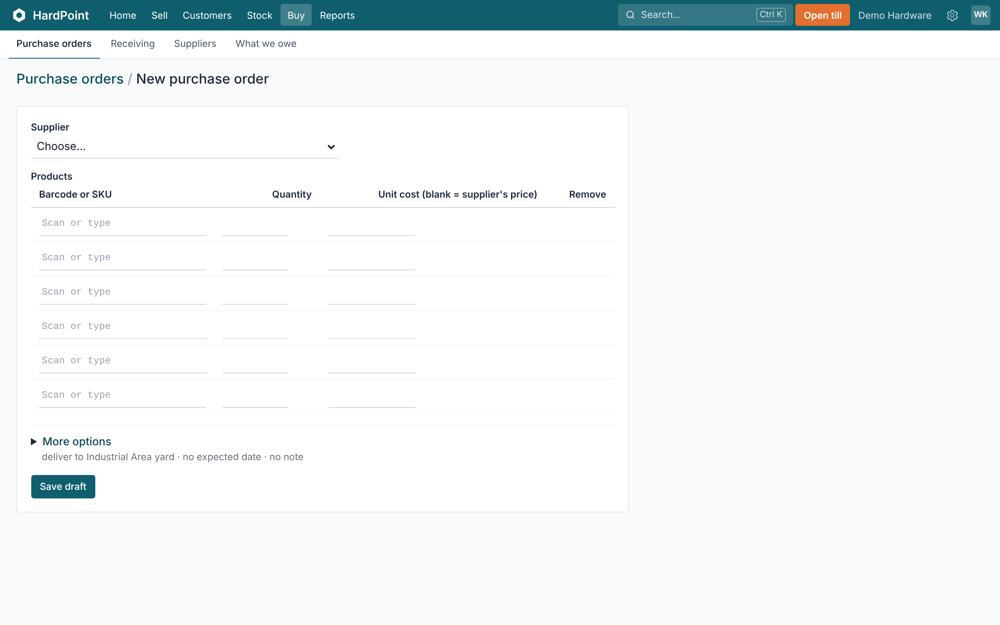

1. **The supplier.** Choose who you're ordering from. To order everything that's running low, Stock › Reorder can draft the orders for you instead.
2. **What to order.** Scan or type each barcode or SKU with the quantity. Leave the unit cost blank to use the supplier's price.
3. **Delivery.** More options sets the branch it's delivered to, when it's expected, and a note to the supplier.
4. **Save draft, then send.** The order is saved as a draft. On it, press Email to … to send it with a PDF attached, or Mark sent (phoned in). When the goods come, press Receive goods.

#### Receiving a delivery

1. Open the order and press **Receive goods**, or go to **Buy › Receiving › New** for goods that came without an order.
2. Enter what arrived and what it cost, the supplier's delivery note number, and any transport, duty or other costs.
3. Press **Receive into stock**. The goods go into the branch, the extra costs are spread over the lines by value, and each product's cost becomes the average of the old and new stock.

Deliveries can also be checked in [on your phone](#stock-on-your-phone). Products tracked by batch ask for the batch number and expiry date.

If the supplier can't send the rest of a partly delivered order, open it and press **Close short**. The order shows what never came, and those goods stop counting as on order, so **Stock › Reorder** suggests them again.

**Walkthrough: Receive a delivery**

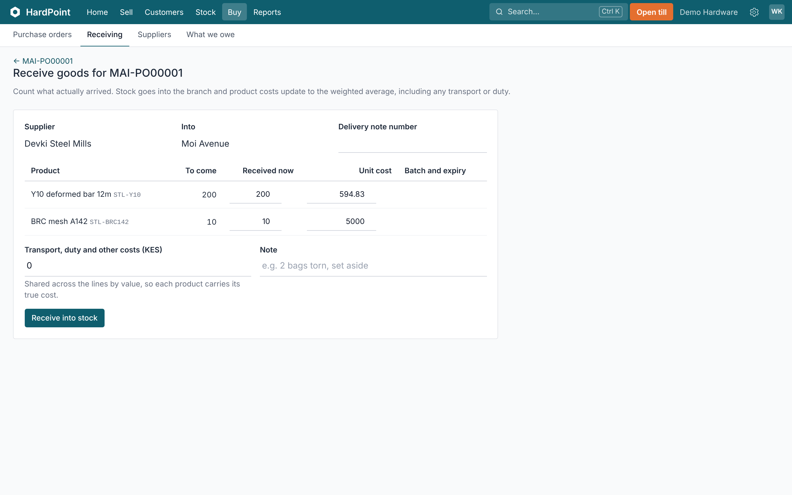

1. **Where it's from, and where it goes.** Against an order, the supplier and branch come from the order. Type the supplier's delivery note number, so their invoice can be matched to it later.
2. **Count what arrived.** Each line starts at what's still to come. Change Received now to what actually came off the lorry, and the unit cost if the price changed. Anything short stays on the order for the next delivery.
3. **Transport and duty.** Add what it cost to get the goods here. It's shared across the lines by value, so each product carries its true cost.
4. **Anything wrong?** Note torn bags or wrong items for whoever deals with the supplier. To send goods back, make a return to the supplier afterwards.
5. **Receive into stock.** The goods go into the branch's stock, and each product's cost becomes the average of the old and new stock. Then record the supplier's invoice from the delivery.

#### Invoices and payments

When the supplier's invoice comes, press **Record the supplier's invoice** on the delivery, or **Record invoice** on the supplier. An invoice for a delivery starts at the value of the goods, in the supplier's currency, without the transport or duty you paid yourself; if what you record differs from that by more than a little, HardPoint says so, and a delivery takes one invoice. **Record payment** settles their oldest invoices first. **Buy › What we owe** shows every supplier's balance by age: not yet due, 1–30, 31–60, 61–90 and over 90 days.

Something wrong with a delivery? See [Sending goods back to a supplier](#supplier-returns).

### Stock on your phone

_Look up products, count stock takes and check deliveries in with your phone's camera._

**HardPoint Stock** is the part of HardPoint made for phones. Stock clerks use it at the shelf and at the lorry: point the camera at a barcode instead of walking back to the counter.

#### Opening it

1. On a computer, go to **Stock › Stock levels** and scan the QR code at the bottom with the phone, or type `yourshop.hardpoint.app/m`.
2. Sign in with your own HardPoint email and password.
3. In Chrome's menu choose **Add to home screen** (Safari: Share › Add to Home Screen) to open it like an app.

Scanning with the camera works in Chrome on Android. On other phones, type the barcode or SKU, or pair a Bluetooth barcode scanner, which types into the box like a keyboard. Choose your branch at the top.

#### Looking something up

Press **Scan with camera** and point it at the barcode. You see the price, pack prices, stock at every branch, what's on order and the latest movements at your branch. Owners, managers and stock clerks also see the cost.

#### Counting a stock take

- Someone starts the stock take on a computer (**Stock › Stock takes**). It then appears under **Count**.
- Scan a product, type how many are there and press **Add to count**. If the same product is on another shelf or in the store room, scan it there too and add again. Several people can count at once.
- **Set total** replaces the count, for correcting a mistake.
- Scanning a box's barcode asks how many boxes, and counts what's inside.
- Products tracked by batch ask **Which batch?**: pick the batch number printed on the pack, or type it if it isn't listed. Choose **Not in a batch** for stock with no number.
- The phone doesn't show how many the system expects, so people count what's really there. A manager reviews and approves the stock take on a computer.

#### Checking in a delivery

- Orders sent to suppliers appear under **Receive**. Open the one that's arrived.
- Scan each item as it comes off the lorry and enter how many; the list shows what's still to come beside what's arrived. If everything is plainly there, **Everything still to come has arrived** checks it all in at once.
- Enter the supplier's delivery note number and press **Record delivery**. The goods go into stock, the same as a goods received note made on a computer.
- Items that weren't ordered, and transport costs, are added on a computer in **Buy › Receiving**.

### Batches and expiry dates

_Selling the oldest first, writing off expired stock, counting by batch, and finding who bought a recalled batch._

For products that go off or can be recalled (tile adhesive, sealants, paint, chemicals, fertiliser), HardPoint can keep track of each manufacturer's batch and its expiry date.

Don't see it? It's one of the optional features: the owner switches on **Batches and expiry dates** in **Settings › Features**.

#### Turning it on

Open the product, press **Edit** and tick **Batches and expiry dates**. Anything already on the shelf is kept as "not in a batch" and sold first.

#### Receiving

When the product arrives, enter the batch number and the expiry date printed on the packaging, on the goods received note or on the phone. A delivery with two batches of the same product is received as two lines (or two deliveries on the phone).

#### Selling

Nothing changes at the till. HardPoint takes stock from the batch that expires first, and skips expired batches unless nothing else is left. The sale remembers which batches it took; returns and voids put stock back into the same batches, and transfers carry the batch to the other branch.

#### Expired stock

- **Stock › Expiry** lists what has expired or expires in the next 30 days at a branch, and what it's worth.
- Open a batch and press **Write off** to take expired or damaged stock out, so the shelf and HardPoint agree.

#### Recalls

A batch's page lists **who bought it**, at every branch, with the customer's phone number where the sale was in their name. The product's page and each sale show the batches too.

#### Stock takes

In a stock take, products tracked by batch are counted **batch by batch**. The stock take lists each batch that was in stock when it started, plus a line for stock not in any batch. Enter what you find for each batch. If a pack has a batch number that isn't listed, use **A batch not listed** (or type the number when scanning) and add its expiry date. Batches you don't count are left as they are.

When a manager approves the stock take, each batch is corrected to what was counted. A batch found on the shelf is added with its expiry date, so it's sold in expiry order like the rest. If some of a batch was sold while the count was going on, it can't go below nothing; the rest of the difference comes off the product's other stock, oldest first.

### Sending goods back to a supplier

_Damaged or wrong deliveries: taking them out of stock, the debit note, and the supplier's credit note._

When a delivery arrives damaged, or the supplier sent the wrong thing, record the goods going back. HardPoint takes them out of stock and raises a debit note, so what you owe the supplier and your VAT stay right.

#### Recording a return

1. Open the delivery (**Buy › Receiving**) and press **Return goods to …**. Its products are listed at what you paid. Or open the supplier and press **Return goods**.
2. Enter how many of each are going back and choose the reason. For products tracked by batch, choose the batch the goods came from, so the right one leaves the books.
3. Leave **Email the debit note to the supplier** ticked to send them the PDF straight away.

The goods leave stock at once ("returned to supplier" in the stock history), and the debit note, which is the cost plus VAT, comes off what you owe the supplier. It settles their oldest invoice first, like a payment. The VAT report takes its VAT off the period's input tax.

#### The supplier's credit note

When the supplier sends their credit note, open the return and note its number and date. **Returns to suppliers** (in the ⚙ menu on **Buy › Purchase orders**) lists the returns still waiting for one, so you can chase them. The amount was already taken off what you owe when the return was recorded, so the credit note doesn't reduce it again.

## Money and tax

### M-Pesa payments

_Payment prompts to the customer's phone, and money paid straight to your Paybill or Till._

Connect your Paybill or Till number in **Settings › M-Pesa › Add Paybill or Till** with the Daraja API keys (consumer key, secret and passkey) from Safaricom's developer portal. Then press **Receive payments** so Safaricom tells HardPoint about money paid in. The keys are stored encrypted.

**Walkthrough: Connect M-Pesa**

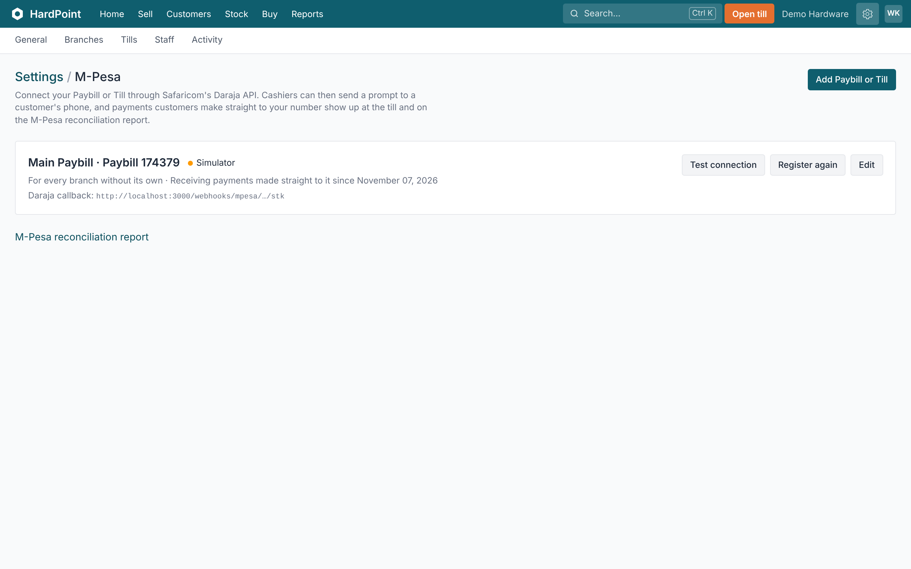

1. **Add Paybill or Till.** Add your Paybill or Till number with the Daraja API keys (consumer key, secret and passkey) from Safaricom's developer portal. The keys are stored encrypted.
2. **Your number.** Which branches use it, whether it's live, and whether payments made straight to it are coming in.
3. **Receive payments.** Press Receive payments once (it says Register again after that), so Safaricom tells HardPoint about money paid straight in. Test connection checks the keys. Then at the till, choose M-Pesa and type the customer's phone, and the sale completes when they pay.
4. **Does it all match?** The reconciliation report lists money received but not yet used on a sale, and M-Pesa codes typed at a till that Safaricom never confirmed.

#### Payment prompts

At the till, choose M-Pesa and enter the customer's phone number. They get a prompt on their phone for the amount, enter their PIN, and the sale completes itself when Safaricom confirms. If it doesn't go through, the till says why.

#### Money paid straight to your Paybill or Till

When a customer pays by Lipa na M-Pesa themselves, the payment appears on the till within seconds. Pick it to pay the sale. Payments whose account number is an order reference or a customer's account number are matched to that order or account automatically.

#### Reconciliation

**Reports › M-Pesa reconciliation** lists money received but not yet used on a sale, and M-Pesa codes typed at a till that Safaricom never confirmed, so anything that doesn't match stands out.

Customers on Airtel Money pay the same way: see [Airtel Money](#airtel-money).

### Airtel Money

_Connecting your merchant account, prompts to the customer's phone, typed transaction IDs and late payments._

Customers who use Airtel Money can pay at the till the same way M-Pesa customers do: a prompt on their phone, or a transaction ID the cashier types in. You need an Airtel Money merchant account and API access from Airtel Africa.

#### Connecting your merchant account

1. Register on Airtel Africa's developer portal and create an app for collections in Kenya. Airtel gives you a **client ID** and a **client secret**: first for the sandbox (test money), then for production once Airtel approves you.
2. In HardPoint, open **Settings › Airtel Money** and press **Add Airtel Money**.
3. Give it a name, choose **Sandbox** or **Production**, and type your merchant or till number if you want it shown to cashiers. Paste the client ID and secret. They're stored encrypted and never shown again.
4. Choose the branch it's for, or leave it for **every branch without its own**.
5. Press **Test connection**. If it says it's connected, the keys are right.
6. Copy the **callback address** shown on the page into your app on Airtel's developer portal. That's how Airtel tells HardPoint a customer has paid. Keep it private: it identifies your shop.

Only the shop's owner can connect Airtel Money. To stop taking it, edit the account and untick **In use**.

#### Taking a payment with a prompt

1. Ring up the sale and choose **Airtel** among the payment methods. It's there once Airtel Money is connected for the branch.
2. Type the customer's Airtel number (for example 0733 000 111) and press **Send prompt**. The amount is rounded up to the next whole shilling.
3. The customer gets a message on their phone and enters their Airtel Money PIN. The till waits and completes the sale by itself when Airtel confirms, then prints the receipt with the Airtel Money transaction ID.
4. If the customer declines, has too little money or doesn't answer within a few minutes, the till says so. Try again, or take another payment method.

Press **Stop waiting** if the customer walks away. If they pay anyway, the money isn't lost: see below.

#### Typing a transaction ID instead

If the customer has already paid your merchant number from their phone, choose **Airtel**, type the transaction ID from their confirmation message in the **Code** box and press **Take payment**. The ID is required, so every Airtel payment can be traced. This also works on the offline till.

#### Money that arrived after the till stopped waiting

When a prompt is paid after the cashier stopped waiting, the payment shows on the till under **Received on Airtel Money, not used yet**, with the time, phone number and amount. Press **Use** next to it to put it on the current sale. Each payment can be used once.

#### Refunds, deposits and accounts

Airtel Money is a payment method for order deposits, customers paying their accounts, paying suppliers and refunds on returns. A refund recorded as Airtel Money is a note of how you paid the customer back; send the money from your Airtel merchant account yourself.

#### Reports and tax

Airtel Money has its own line in **Payments by method**, on the X and Z reports and in the daily summary email. KRA eTIMS receives it as a mobile money payment, and the QuickBooks export posts it to its own account.

#### If something goes wrong

- **"Couldn't connect"** when testing: check you chose the environment (sandbox or production) that matches the keys.
- **Prompts never arrive:** check the number is an Airtel line and the customer's phone has signal.
- **The till keeps waiting:** HardPoint also asks Airtel directly after about 20 seconds, so a lost callback doesn't stop the sale. Check the callback address on Airtel's portal matches the one in Settings.

### KRA eTIMS

_Connecting your branch's control unit and what happens when KRA is unreachable._

KRA's eTIMS needs every sale to be sent to a control unit registered to your KRA PIN and branch. Register each branch's OSCU device on KRA's eTIMS portal first. Then in **Settings › KRA eTIMS › Add control unit**, enter the PIN, branch ID and serial number KRA gave you, and press **Set up with KRA**.

- Products are registered with KRA the first time they're sold at that branch, and again if you change a product's name or tax rate.
- Each sale, void and return is sent to KRA, and KRA's signature and QR code are printed on the receipt.
- If KRA can't be reached, the sale goes ahead and is queued. HardPoint keeps retrying, and **Settings › KRA eTIMS › Submissions** shows anything still waiting, and anything KRA refused with the reason; fix it and send it again. The owner's dashboard warns about refusals. Each control unit sends its invoices one at a time, in order, and every hour HardPoint checks for any sale that never made it into the queue and sends it.
- A customer's tax PIN, if they gave one, is put on their invoices, so check it's their KRA PIN (like P051234567X).

Set each tax rate's eTIMS code, and the item class of your categories, so KRA classifies your goods correctly.

**Deposits and VAT.** A deposit on an order or quote isn't a sale yet, so it isn't sent to KRA when it's taken. The whole sale, with its VAT, goes to KRA when the order is collected at the till, and the deposit counts as part of the payment. If your accountant treats a deposit as the point when VAT is due, account for those deposits separately; HardPoint won't report them to KRA early.

### Reports and the owner's dashboard

_Today's takings at a glance, and sales, margin, VAT, stock and cash reports for any period._

Owners, managers and accountants see the **Dashboard** and **Reports**. Other roles don't.

#### The owner's dashboard

The dashboard is the first thing owners and managers see. It shows today's takings against the same day last week, the number of sales and the average sale, gross margin, cash in the drawers, takings by hour and over the last week, best sellers, each branch, money owed both ways, low stock, orders ready and deliveries due. It updates by itself as sales happen, so it can stay open on the office screen. Warnings, such as sales KRA refused, appear at the top.

#### Reports

Open **Reports**, choose a report, then a period (today, this week, last month, or your own dates) and a branch. Every report can be viewed on screen, downloaded as **CSV** to open in Excel, or as a **PDF** on your letterhead.

- **Sales and margin**: takings, returns, tax, cost and margin by day, month, branch, cashier, category or product.
- **Profit and loss**: sales less returns, cost of sales, gross profit, stock losses and till payouts.
- **Tax (VAT)**: output tax by rate, input tax from supplier invoices, and VAT payable, for your return.
- **Payments by method** (Airtel Money appears once it's connected or used), **M-Pesa reconciliation**, and **Shifts and cash counts** with each shift's over or short.
- **Discounts, voids and returns**: per cashier, with who approved the big ones.
- **Stock valuation** at cost and selling price, and **Dead stock**: what hasn't sold for a while and the money tied up in it.
- Plus **Who owes us**, **What we owe** and the stock history.

Margins are worked out from what each item cost on the day it was sold, so later price changes don't rewrite the past.

**Walkthrough: Read a report**

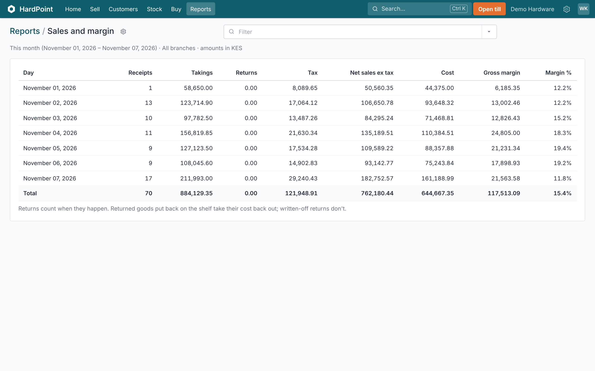

1. **Filters.** A period, branch or grouping you choose shows here as a tag. Press × on a tag to go back to the default.
2. **Change them.** Choose today, this week, last month or your own dates, one branch, and, on reports that have it, what to group by.
3. **What you're looking at.** The period and branch the figures cover (this month and all branches, unless you change them), and the currency.
4. **The figures.** The rows, with totals at the bottom. Margins use what each item cost on the day it sold, so later price changes don't rewrite the past.
5. **Take it with you.** The ⚙ has Export CSV, to open in Excel, Download PDF on your letterhead, and Print.

#### QuickBooks Online

**Reports › QuickBooks export** downloads a month of the books as a zip your accountant imports into QuickBooks Online: journal entries for each day's sales by branch, returns, voids, deposits, customer and supplier payments and supplier invoices, plus customer and supplier lists. Set the QuickBooks account names once on that page so they match your chart of accounts. Each journal file stays under QuickBooks' 1,000-line limit, and anything that couldn't be exported (a sale whose payments don't add up, say) is listed in `not-in-the-journal.csv` with the reason. See [QuickBooks Online export](#quickbooks).

#### Emails to the owner

Owners, managers and accountants can have the figures come to them, each turned on or off under **My profile**:

- **Daily summary**, each morning at about 7:15: yesterday's takings with charts of the day by hour and the last seven days, branches, how it was paid and the best sellers. Then **Worth a look**: products at zero (which the till can't sell), what customers asked for that wasn't on the shelf, stock written off, cash counts that didn't balance, discounts, voids and returns by cashier, anything sold below cost, offline sales to check, tills left open and M-Pesa payments not on any sale. A day without sales sends nothing.
- **Weekly summary**, each Monday: the week's takings against the eight before, each day, the best sellers and what they made over cost, who owes you and how late, supplier bills due this week, and stock that hasn't sold in 90 days.
- **Alerts**, for owners and managers, sent straight away: a till closing short, a completed sale voided, or an approved stock count losing more than the amounts set on **Settings › Shop details**. Whoever did it isn't sent one.

### QuickBooks Online export

_A month of sales, payments and supplier bills as journal entries for your accountant to import._

If your accountant keeps the books in QuickBooks Online, HardPoint can give them a month of your figures ready to import, so nobody types sales in by hand. Owners, managers and accountants can download it.

#### Before the first export: match the account names

Open **Reports › QuickBooks export**. Under **Accounts in QuickBooks** is a list of each kind of money (cash, M-Pesa, Airtel Money, card, what customers owe, sales, VAT on sales, cost of sales, stock and so on) and the QuickBooks account it goes to. Ask your accountant for the names in their chart of accounts, type them in exactly, and press **Save account names**. Blank boxes keep the usual QuickBooks name shown in grey. You only need to do this once.

#### Downloading a month

1. Choose the **Month** and press **Download for QuickBooks**.
2. You get a ZIP file. Send it to your accountant, or open it yourself.

Inside the ZIP:

- `README.txt`: the import steps, written for the person doing them.
- `customers.csv` and `suppliers.csv`: your customers and suppliers, to import first so every name in the journal already exists in QuickBooks.
- `journal.csv` (or `journal-1.csv`, `journal-2.csv`… for a busy month): the journal entries. Each file stays under QuickBooks' limit of 1,000 lines, and an entry is never split between files.
- `not-in-the-journal.csv`, only if needed: anything that couldn't go in the journal, with the reason.

#### Importing into QuickBooks Online

1. In QuickBooks, import `customers.csv` as Customers and `suppliers.csv` as Suppliers.
2. Then import each journal file under **Settings › Import data › Journal entries**. Dates are written day/month/year.
3. Check the totals against HardPoint's **Sales and margin** and **Tax (VAT)** reports for the same month.

#### What's in the journal

- **Sales**, one entry per branch per day: the money taken by each payment method, sales before VAT, VAT on sales, and the cost of what was sold taken out of stock.
- **Voids and returns**, reversing their sales, with goods put back into stock at their cost.
- **Deposits** on orders, and **customers paying** their accounts.
- **Supplier invoices** with VAT on purchases, and **payments to suppliers**. Invoices in dollars or another currency are converted at the rate they were entered at.
- **Goods returned to suppliers**: the debit note comes off what you owe the supplier, out of stock and off VAT on purchases.
- **Stock gains and losses** (found, damaged, stolen, stock takes, lost between branches), at cost, against the stock account, as in the **Profit and loss** report.
- **Transport and duty** entered on a delivery go into stock, with the other side in a clearing account. When the transporter's or customs' bill is entered in QuickBooks, post it to that clearing account.
- Refunded deposits come out of the money they were paid back from. Every amount is a positive debit or credit, as QuickBooks wants.

HardPoint sends journal entries rather than invoices because QuickBooks won't import invoices once VAT is set up, which it is for every VAT-registered shop.

#### What gets left out, and why

A sale whose payments don't add up to its total, or a payment to a supplier in a foreign currency, can't be turned into a balanced entry. They're listed in `not-in-the-journal.csv` with the date, amount and reason, for your accountant to enter by hand.

Export each month once. Importing the same month twice puts the entries in QuickBooks twice.

### Dollars and other currencies

_Taking foreign notes at the till, the daily market rate, counting them at close, and suppliers who invoice in dollars._

HardPoint keeps your books in your own currency, and lets you take other currencies at the till and buy from suppliers who invoice in them.

Don't see it? It's one of the optional features: the owner switches on **Foreign currencies** in **Settings › Features**.

#### Setting rates

Owners and managers add currencies in **Settings › Currencies**, with what one unit is worth in your currency (for example 1 USD = 129.50 KES, or 1 UGX = 0.0348 KES). Update the rate when your bureau's or bank's changes. Each payment and order keeps the rate it used, so changing it never changes the past. Untick **Take it at the till** for currencies you only buy in.

#### The daily market rate

Each morning HardPoint fetches the market rate for every currency you use and shows it under your rate. **Use …** takes it as your rate once. Tick **Follow the daily rate** to have the rate updated every morning, less a margin you choose (for example 1.5%, so a dollar handed over is worth a little less than the market says, to cover the bank's charges and the rate moving before you bank it).

- If the market rate moves more than 10% in a day, it isn't applied by itself. It's shown as **Not applied** until an owner or manager presses **Use it**, so a fault in the feed can't change what the till takes for a dollar.
- The market rate is a mid-market rate from a public feed, not a bureau's buying rate. Set the margin to match what you actually get.
- If the feed can't be reached, rates stay as they were.

#### At the till

1. Choose **Foreign** as the payment method, pick the currency and type the notes handed over.
2. The till shows what they're worth and the change, which is given in your currency. Notes worth less than what's due leave the rest to be paid another way.
3. The receipt shows the notes and the rate.

#### Closing the till

Count your own cash as usual, and each foreign currency separately. The Z report shows the foreign notes expected and counted, and the change given for them comes out of the expected cash.

#### Suppliers in dollars

- Choose the supplier's currency when adding them (it can't change once there are orders or invoices).
- Their orders, invoices, payments and what you owe them are in that currency.
- When goods arrive, check the **rate today** on the receiving form: stock is costed in your currency at that rate, with transport and duty added in your currency.
- "What we owe" shows their balance in their currency, with the total in yours at today's rates; the VAT report converts their invoices at the rate recorded on each.

## Your account

### Your profile and signing in

_Signing in at your shop's address, forgotten passwords, two-factor and recovery codes, PINs, Switch user and the daily email._

Everyone who uses HardPoint signs in with their own email address and password. This guide covers signing in, what's under **My profile**, and what to do if you're locked out. Who can do what is in [Staff, roles and PINs](#staff-and-roles).

#### Signing in

Every shop has its own web address, like **yourshop.hardpoint.app**. It's in your welcome email.

1. Go to your shop's address. If you only remember the HardPoint website, press **Sign in**, type your shop's name as it appears in its address under **Your shop's web address** and press **Continue**.
2. Type your **Email address** and **Password** and press **Sign in**.
3. If you use two-factor sign-in, type the 6-digit code from your authenticator app and press **Verify**.

You stay signed in on that computer or phone until you sign out, for up to two weeks without using it (three months in all); after that HardPoint asks you to sign in again.

#### Forgotten your password?

1. On the sign-in page press **Forgot password?**.
2. Type your email address and press **Email reset instructions**.
3. Open the link in the email (it only works for a short while), type your new password twice and press **Save**.

Choosing a new password signs you out everywhere, so sign in again with it.

#### My profile

Open your name in the top right and choose **My profile**. It shows your name, email address and role, and these sections, depending on your role:

- **Password**, for everyone: see below.
- **Signed-in devices**, for everyone: press **See devices** for every computer and phone you're signed in on at this shop, with when it was last used and where from. Press **Sign out** next to a till that was replaced or a phone that went missing, or **Sign out everywhere else** to keep only the device you're on. If you see a device you don't recognise, sign it out and change your password.
- **Two-factor sign-in**, for everyone.
- **Approval PIN**, for owners and managers: press **Set an approval PIN**, type 4 to 6 digits and your password. You type it at a cashier's till to approve a big discount, a void or a return. It doesn't sign you in.
- **Till PIN**, for cashiers and stock clerks: press **Set a PIN**, type 4 to 6 digits and your password, then **Save PIN**. Use it with Switch user (below). **Remove PIN** turns it off.
- **Emails**, for owners, managers and accountants: the **daily summary** each morning, the **weekly summary** each Monday, and (for owners and managers) **alerts** sent straight away when a till closes short, a big sale is voided or a stock count loses a lot. All are on to begin with; press **Turn off** or **Turn on** beside each.

#### Changing your password

1. On My profile press **Change password**.
2. Type your **Current password**, then the **New password** twice. It needs at least 10 characters.
3. Press **Change password**.

You stay signed in where you are, and you're signed out everywhere else, in case someone else knew the old password. If you work for more than one shop, it's the same password for all of them.

#### Two-factor sign-in

1. Install an authenticator app, such as Google Authenticator or Microsoft Authenticator.
2. On My profile press **Set up two-factor** and scan the QR code with the app. If you can't scan it, type the key shown under it.
3. Type the 6-digit code the app shows and press **Turn on**. If it doesn't match, check your phone sets its time automatically.
4. HardPoint shows 10 **recovery codes**, once only. Write them down or print them, keep them away from your phone, and press **I've saved them**.

If you lose your phone, type a recovery code instead of the 6-digit code. Each works once; My profile shows how many are left. If you've lost your phone _and_ your recovery codes, ask the shop's owner to reset your two-factor (see [Staff, roles and PINs](#staff-and-roles)). An owner who is the only owner, or anyone who works for more than one shop, asks HardPoint support through **Contact support** or WhatsApp; we'll check who you are first. Once it's reset you sign in with just your password and set two-factor up again on your new phone. To turn two-factor off, type your password and a code from your app (or a recovery code) and press **Turn off two-factor**. If the owner requires two-factor for owners and managers, you'll be taken to set it up before you can do anything else.

#### Switch user

On a shared till, the next cashier or stock clerk doesn't need the password. Choose **Switch user** (under your name, or in the till's top bar), tap your name, type your till PIN and press **Switch in**. The person before is signed out of that till. Only people who have set a till PIN are listed.

#### Signing out

Open your name in the top right and choose **Sign out**.

#### If you're locked out

- **"Try another email address or password."**: check both, or use Forgot password.
- **"Try again later."**: after too many tries in a few minutes, HardPoint stops you for a short time. Wait a few minutes.
- **"Please sign in again."**: the two-factor step must be finished within 10 minutes of typing your password.
- **"Too many wrong codes."**: after 10 wrong two-factor codes in a row, no code is accepted for 15 minutes, and you're emailed. If you weren't the one typing them, someone knows your password: change it with Forgot password.
- **Till PIN locked**: five wrong PINs lock it. Sign in with your password and set a new PIN on My profile to unlock it.
- If the shop is being closed, only its owners can sign in.

#### On your phone

Your shop's address works in a phone's browser too. For stock work, see [Stock on your phone](#stock-on-your-phone).

### Plans, billing and read-only mode

_Your free trial, paying HardPoint, changing plan and what happens if an invoice is late._

New shops get **30 days free** on the plan they chose when signing up. The owner sees the plan, what's in use and every invoice under **Settings › Billing**.

#### Paying

When the trial ends HardPoint emails the first invoice, due a week later. Pay it from the Billing page with an M-Pesa prompt to your phone, or by card. A reminder comes two days before it's due, and a receipt when it's paid. You can also start paying before the trial ends.

#### Monthly or yearly

Under **Add-ons and how often you pay**, choose **Monthly** or **Yearly**. A yearly invoice covers twelve months for the price of ten. The change applies from your next invoice.

#### Changing plan

Pick another plan on the Billing page. A bigger plan applies straight away, and the difference for the rest of the period you've paid for comes as its own invoice, due a week later. A smaller one only if your branches, tills and staff fit within it. The new price applies from the next invoice. Products never count towards a plan.

#### One more till or branch

If you only need one more till or branch than your plan allows, add it under **Add-ons and how often you pay** rather than moving up a plan. Type how many extra you want and press **Save**. The room is there straight away. If you've already paid for this month or year, the rest of it comes as its own invoice for the extra, due a week later; after that it's on your regular invoice. You can give an extra back the same way once you've retired the till or branch that used it.

#### Setup visits and till kits

If HardPoint set your shop up on site, trained your staff or supplied a till kit, that comes as its own invoice on the Billing page, paid the same way as your subscription.

#### If an invoice isn't paid

A week after it's due, the shop becomes **read-only**: everyone can still sign in and look things up, and the owner can export the data, but nothing can be sold or changed. Paying the invoice unlocks the shop straight away, and the month (or year) you've paid for starts that day: the time the shop was read-only isn't charged. Offline sales rung up before the lock are still accepted.

### Connecting a web shop or other apps

_API keys and webhooks, for the developer who connects your web shop or accounts._

On the Business and Enterprise plans, other apps can work with your shop's products, stock, customers, sales and orders: a web shop that shows your stock and takes click-and-collect orders, your bookkeeper's software, or a spreadsheet that updates itself.

Don't see it? It's one of the optional features: the owner switches on **API and webhooks** in **Settings › Features**.

#### Giving an app access

1. The owner goes to **Settings › Developers › New API key**.
2. Name the key after the app, and choose **read only** unless it needs to change things (a web shop placing orders does).
3. Copy the key into the app's settings, or send it to its developer by a safe route. It's shown only once.

Everything an app changes appears in **Activity** under the key's name. If a key might have leaked, or you stop using the app, **Revoke** it and the app is cut off at once.

#### Webhooks

Webhooks tell another app the moment something happens: a sale, a price change, stock running down. Your developer gives you an address for them in **Settings › Developers › Add endpoint**. If that app stops answering, HardPoint keeps trying for a day and then switches the webhook off and emails you.

Your developer will find everything they need in the [API and webhook documentation](https://hardpoint.app/developers).

### Backups, exporting your data and closing your account

_Automatic and manual backups, downloading everything, and what happens when a shop is closed._

#### Backups

HardPoint backs up your shop by itself every night at 2 a.m.: every record, product image and delivery photo, checked file by file after it's stored. Owners find them under **Settings › Your data › Backups**.

1. To make one straight away, for example before a big price change or a stock take, press **Back up now**. It usually takes a few minutes.
2. Choose how often backups run under **Back up automatically**: every day, every week (Mondays), every month (the 1st) or off, and how many to keep under **Automatic backups to keep**. Backups you make yourself are kept for 30 days. Press **Save**.
3. Every owner gets an email when a backup is ready. To hear only about problems, choose **Only if one fails** under **Email the owners**. Owners are always emailed if a backup fails, and HardPoint support is told too.
4. Press **Download** next to a backup to keep your own copy. It's a ZIP of spreadsheet (CSV) files, like an export, with a **manifest.json** that lists a checksum for every file so you can check the copy is complete.

Only owners can make, download or delete backups, and each one is recorded in **Activity**. Backups work while the shop is read-only. Passwords, PINs and API keys are never included. These are your shop's own copies: HardPoint also backs up every shop every hour for its own disaster recovery.

#### Exporting everything

The owner can download all of the shop's data from **Settings › Your data**: products, stock, sales, customers, suppliers, purchases and more, as CSV files (they open in Excel or Google Sheets) in one ZIP file. HardPoint emails a link when it's ready; the link works for 7 days. Export works even while the shop is read-only.

#### What HardPoint counts

To see whether shortcuts such as search and Home's to-do list help, HardPoint counts how many times a day each one is used in your shop. It keeps only the numbers: not who used them and not what anyone searched for. The counts aren't part of the export.

#### Closing your account

The owner can close the shop from the same page, confirming with their password. From then on the shop is read-only and only owners can sign in, and **30 days later** its data is deleted for good. Until then an owner can change their mind and cancel the closure from the same page.

Export your data first: once it's deleted, it can't be recovered. HardPoint keeps the invoices it issued to your shop, because tax law requires it.
